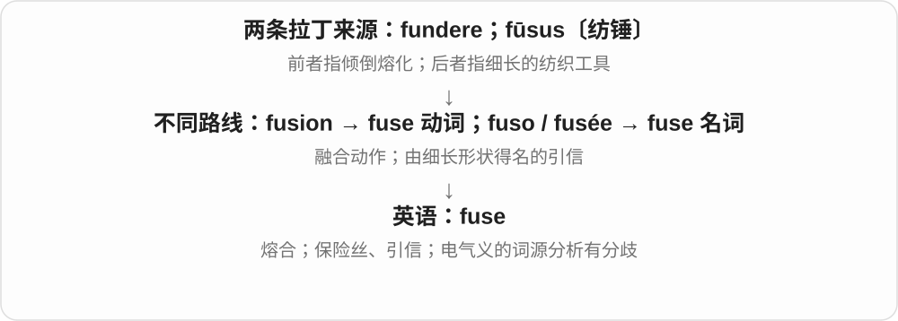
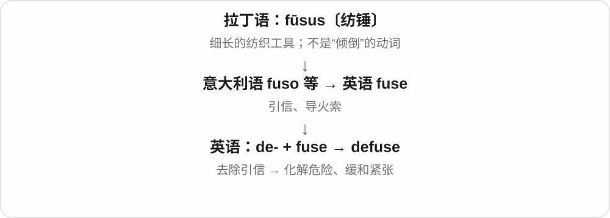

# 1442 · fuse — 融合；引信；保险丝；拒绝〔须分源〕

[逐词精讲目录](../00_逐词精讲目录.md) · [总目录](../00_总目录_按常用程度.md)

## 核心词根与来源

融合动词 fuse 常分析为由 fusion 逆构；引信名词有纺锤等不同的历史材料，保险丝的归源也有不同处理。原族中的 refuse 拒绝更早来源有争议，不应简单拆成再融合。

**FUSE：同形词要先分清来源**

两块材料熔合，与引信点燃，不应直接当作同一个历史动作。

- **熔合和器件名称**：fuse
- **解除危险**：defuse
- **不能机械切分的借词**：refuse
- **refuse → refused：拒绝与不接受**：refuse · refused

## 词形与演化规律

defuse 是解除引信、化解危险的英语构词；refuse 的常见拒绝义不是 re- 加现代融合动词。逐词讲解保留不同来源。

古法语 refuser 的较早拉丁来源存在不同分析，保留分歧。

## 单词速览（按词族由简到繁）

同一基础词的相关扩展放在一起，先读基础形式，再读扩展；各组之间优先读常用的。具体词源关系见各词讲解。

| 单词 | 音标 | 核心意思 |
|---|---|---|
| [fuse](#w-2) | /fjuːz/ | 熔合；融合；保险丝；引信 |
| [refuse](#w-1) | 动词 /rɪˈfjuːz/；名词 /ˈrefjuːs/ | 拒绝；废弃物、垃圾 |
| [refused](#w-4) | /rɪˈfjuːzd/ | 拒绝〔refuse 的过去式、过去分词〕 |
| [defuse](#w-3) | /ˌdiːˈfjuːz/ | 拆除引信；化解紧张或危险 |

## 逐词讲解

### 1. fuse — 熔合；融合；保险丝；引信

**音标**：/fjuːz/

**先抓住这个画面**

动词像两块材料受热后接成一体；名词还可以是断开电路的保险丝，或引燃装置的引信。

**怎么拆**

融合动词通常分析为由 fusion 逆构。引信名词经意大利语 fuso 等来自拉丁语 fūsus“纺锤”，与 fundere 的分词同形却不能直接认作同一个来源。保险丝名词的归源，词典有不同处理。

**怎么变成今天的意思**

fuse A with B 是把两样东西融合；a blown fuse 是已熔断的保险丝。a short fuse 还可比喻脾气急，容易突然发火。

**常见搭配与例句**

fuse together；fuse tradition with innovation；blow a fuse；have a short fuse。

> Heat fused the two pieces of glass together.

热量使两块玻璃熔合在一起。

> The electrician found a blown fuse.

电工发现有一根保险丝熔断了。

> He has a short fuse when he is tired.

他累的时候很容易发火。

**别混淆**

fuse 的几个义不能只用“融合”硬套。安全装置叫 fuse，不叫 fusion；diffuse 是向外散开。

### 2. refuse — 拒绝；废弃物、垃圾

**音标**：动词 /rɪˈfjuːz/；名词 /ˈrefjuːs/

**先抓住这个画面**

把递来的请求挡回去，就是动词“拒绝”；被弃置、不要的东西，就可以是名词“废弃物”。

**怎么拆**

拒绝义来自古法语 refuser。其更早来源有分歧：有联系 refundere“倒回”的分析，也有 refūtāre 与 recūsāre 混合的分析。普通“拒绝”不是 re- 再 + fuse 融合；另有少用的 re-fuse 概念。

**怎么变成今天的意思**

refuse to answer 是拒绝回答；refuse an offer 是拒绝提议。household refuse 是生活垃圾，名词较正式，通常不可数。

**常见搭配与例句**

refuse to do；refuse an invitation；refuse collection。

> She refused to sign a document she had not read.

她拒绝签署一份自己没有读过的文件。

> Household refuse is collected on Tuesdays.

生活垃圾在星期二收运。

**别混淆**

refuse 与 refund 不能简单当成同义。前者不接受，后者退钱；两词是否有共同深层路线，词源学中有不同解释。

### 3. refused — 拒绝〔refuse 的过去式、过去分词〕

**音标**：/rɪˈfjuːzd/

**先抓住这个画面**

别人提出请求、给出东西，你明确不接受或不去做，就是 refused；它强调把这个请求或选择挡在外面。

**怎么拆**

动词 refuse 已有 e，加 -d，/z/ 后读 /d/。近源是古法语 refuser；更早有接拉丁 refundere 倒回的分析，也有拉丁其他拒绝词混合的分析，不能强定唯一链。

**怎么变成今天的意思**

**古法语 refuser → 英语动词 refuse**  
拒绝；较早拉丁来源分析有分歧

↓

**refuse 去 e + -ed → refused**  
拒绝过、被拒绝

refused the offer 拒绝提议；refused to answer 拒绝回答；refused entry 被拒绝进入。

**常见搭配与例句**

refused to leave；a request that was refused。

> He refused to answer the question.

他拒绝回答这个问题。

> The request was refused because the room was already booked.

因为房间已被预订，这项请求遭到拒绝。

**别混淆**

拒绝做某事常用 refused to do。动词 refuse 的 s 读 /z/；垃圾名词 refuse 常前重音、末尾 /s/，与本词形区分。

### 4. defuse — 拆除引信；化解紧张或危险

**音标**：/ˌdiːˈfjuːz/

**先抓住这个画面**

想象把快要引发爆发的“导火索”拿掉，让冲突暂时炸不起来。

**怎么拆**

de- 去除 + fuse“引信”。这里属于 fuse 的引信名词支线，深层来自“纺锤”名称，作为易混辨析保留，不算 fundere“倾倒”的确定后代。

**怎么变成今天的意思**

日常最常用的是比喻义 defuse tension、defuse a situation，表示及时降低冲突升级的可能。它不保证所有根本矛盾已经解决。

**常见搭配与例句**

defuse tension；defuse an argument；defuse a crisis。

> A gentle joke helped defuse the tension.

一个温和的玩笑帮助缓和了紧张气氛。

> The mediator tried to defuse the argument before it escalated.

调解者试图在争论升级前将其化解。

**别混淆**

defuse 是化解潜在爆发；diffuse 是扩散。正确的常见搭配是 defuse tension。

## 这一组要分清什么

defuse tension 是化解紧张；diffuse 是扩散，两词虽形近但含义不同。

## 串起来练习

The negotiator tried to defuse the tension after both sides refused the proposal.

双方拒绝提议后，谈判者试图缓和紧张。
