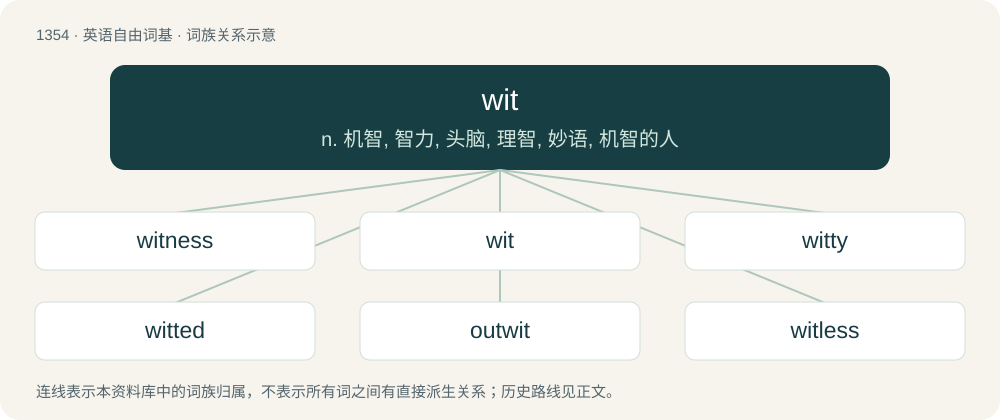

# 1442 · wit — n. 机智, 智力, 头脑, 理智, 妙语, 机智的人

[总目录](../00_总目录_按常用程度.md)

**类型**：英语自由词基　｜　**来源语言**：见词源记录

## 核心含义与来源

- 核心含义：n. 机智, 智力, 头脑, 理智, 妙语, 机智的人
- 英文含义：Sanity.
- 词形：wit

**多个词源／构词路径**：同一拼写可能有不同来源；以下按词性和含义分别列出。

**来源记录 1**（名词；Sanity.）

From Middle English wit, witt, wyt, from Old English witt (“mind, sanity, sense, understanding”), from Proto-West Germanic \*witi, from Proto-Germanic \*witją (“knowledge; reason; wit”), from Proto-Germanic \*witaną (“to know”), from Proto-Indo-European \*wóyde (“to know”), from \*weyd- (“to see”). Cognates Cognate with Dutch wit (“knowledge”), German and Luxembourgish Witz (“joke; humour, wit”), Low German Weet (“knowledge; idea; inkling”), Yiddish וויץ (vits, “joke”), Danish vid (“wit”), Faroese and Icelandic vit (“intelligence, wits; reason, sense; knowledge; awareness, sentience”), Norwegian Bokmål and Swedish vett (“intelligence, sense, wit”), Norwegian Nynorsk vett, vit (“sense, wits”), Gothic 𐌿𐌽𐍅𐌹𐍄𐌹 (unwiti, “folly, ignorance”); also Breton gouzout (“to know”), Cornish godhvos, goffos (“to know”), Irish feadair (“to know”), Welsh gwybod (“to know”), Latin videō (“to see”), Ancient Greek οἶδ’ (oîd’), οἶδα (oîda, “to know”), Albanian vizë (“line, stripe, track; dash”), Latvian veids (“form, kind, mode, type”), Lithuanian veidas (“face; front; appearance, aspect, look”), Belarusian ве́даць (vjédacʹ, “to know”), Bulgarian вям (vjam, “to know”), Czech vědět (“to know”), Polish wiedzieć (“to know”), Russian ве́дать (védatʹ, “to know”), Serbo-Croatian vedeti, viedieti (“to know”), Slovak vedieť (“to know”), Slovene vedeti (“to know”), Ukrainian ві́дати (vídaty, “to know; to deal, manage”), Armenian գիտեմ (gitem, “I know”), գիտենալ (gitenal), գիտնալ (gitnal, “to know”), Avestan 𐬬𐬀𐬉𐬛 (vaēd, “find”), 𐬬𐬌𐬛 (vid, “know, understand”), Persian نوید (navid / nawīd, nuwēd, “invitation; annunciation; good news”), Tocharian A ime (“awareness, consciousness, memory, thought”), Tocharian B īme (“awareness, consciousness, memory, thought”), ūwe (“educated, knowledgeable, learned”), Sanskrit विद् (vid, “to know; to find; to consider as”). Compare wise.

**来源记录 2**（动词；To know, be aware of (constructed with of when used intransitively).）

From Middle English witen, woten, from Old English weotan, witan, from Proto-West Germanic \*witan, from Proto-Germanic \*witaną (“to know”), from Proto-Indo-European \*wóyde (“to know”), from \*weyd- (“to see”). Cognates Cognate with North Frisian waase, wed, weet (“to know”), Saterland Frisian wíete (“to know”), West Frisian wite, witte (“to know”), Alemannic German wüsse (“to know”), Cimbrian bizzan (“to know”), Dutch and Low German weten (“to know”), German wissen (“to know”), Limburgish wéïte (“to know; to remember”), Luxembourgish wëssen (“to know”), Vilamovian wysa, wyssa (“to know”), Yiddish וויסן (visn, “to know”), Danish vide (“to know”), Elfdalian witå (“to know”), Faroese and Icelandic vita (“to know”), Jutish veer (“to know”), Norwegian Bokmål vide, vite (“to know”), Norwegian Nynorsk veta, vita, våtå (“to know”), Scanian veda (“to know”), Swedish veta (“to know”), Gothic 𐍅𐌹𐍄𐌰𐌽 (witan, “to know”); also Breton gouzout (“to know”), Cornish godhvos, goffos (“to know”), Irish feadair (“to know”), Welsh gwybod (“to know”), Latin videō (“to see”), Ancient Greek οἶδ’ (oîd’), οἶδα (oîda, “to know”), Albanian vizë (“line, stripe, track; dash”), Latvian veids (“form, kind, mode, type”), Lithuanian veidas (“face; front; appearance, aspect, look”), Belarusian ве́даць (vjédacʹ, “to know”), Bulgarian вям (vjam, “to know”), Czech vědět (“to know”), Polish wiedzieć (“to know”), Russian ве́дать (védatʹ, “to know”), Serbo-Croatian vedeti, viedieti (“to know”), Slovak vedieť (“to know”), Slovene vedeti (“to know”), Ukrainian ві́дати (vídaty, “to know; to deal, manage”), Armenian գիտեմ (gitem, “I know”), գիտենալ (gitenal), գիտնալ (gitnal, “to know”), Avestan 𐬬𐬀𐬉𐬛 (vaēd, “find”), 𐬬𐬌𐬛 (vid, “know, understand”), Persian نوید (navid / nawīd, nuwēd, “invitation; annunciation; good news”), Tocharian A ime (“awareness, consciousness, memory, thought”), Tocharian B īme (“awareness, consciousness, memory, thought”), ūwe (“educated, knowledgeable, learned”), Sanskrit विद् (vid, “to know; to find; to consider as”). Compare guide.

## 词族图

## 单词速览（常用到不常用）

| 单词 | 音标 | 释义 |
|---|---|---|
| [witness](#w-1) | 英 /ˈwɪt.nɪs/；/ˈwɪt.nəs/ | n. 证人, 目击者, 证据, 证词；vt. 目击, 作证, 证明, 表明；vi. 作证人, 作为证据 |
| [wit](#w-2) | /wɪt/ | n. 机智, 智力, 头脑, 理智, 妙语, 机智的人 |
| [witty](#w-3) | 英 /ˈwɪti/；美 /ˈwɪti/ | a. 富于机智的, 诙谐的 |
| [witted](#w-4) | /ˈwɪtɪd/ | a. 有...智能的, 有...才智的 |
| [outwit](#w-5) | 英 /aʊtˈwɪt/ | vt. 瞒骗, 以智取胜 |
| [witless](#w-6) | /ˈwitlis/ | a. 无才智的, 不机敏的, 愚蠢的, 糊涂的, 无知的 |
| [fuckwit](#w-7) | /ˈfʌkwɪt/ | 【英文】A very stupid person. |
| [nitwit](#w-8) | 美 /ˈnɪtwɪt/ | n. 笨人, 傻子 |

## 逐词详解

### 1. witness

**词性**：名词　｜　**音标**：英 /ˈwɪt.nɪs/；/ˈwɪt.nəs/

**中文释义**：n. 证人, 目击者, 证据, 证词；vt. 目击, 作证, 证明, 表明；vi. 作证人, 作为证据

**英文义项**：Attestation of a fact or event; testimony. / One who sees or has personal knowledge of something.

**构词拆分**：wit + -ness

**词源与演化**：

From Middle English witnesse, from Old English ġewitnes, equivalent to wit + -ness. Cognate with Middle Dutch wetenisse (“witness, testimony”), Old High German gewiznessi (“testimony”), Icelandic vitni (“witness”).

**例句**：

> The bridesmaid and best man at a wedding typically serve as the witnesses.

该用例对应义项：One who is called upon to witness an event or action, such as a wedding or the signing of a document.

### 2. wit

**词性**：名词　｜　**音标**：/wɪt/

**中文释义**：n. 机智, 智力, 头脑, 理智, 妙语, 机智的人

**英文义项**：Sanity. / The senses.

**词源与演化**：

From Middle English wit, witt, wyt, from Old English witt (“mind, sanity, sense, understanding”), from Proto-West Germanic \*witi, from Proto-Germanic \*witją (“knowledge; reason; wit”), from Proto-Germanic \*witaną (“to know”), from Proto-Indo-European \*wóyde (“to know”), from \*weyd- (“to see”). Cognates Cognate with Dutch wit (“knowledge”), German and Luxembourgish Witz (“joke; humour, wit”), Low German Weet (“knowledge; idea; inkling”), Yiddish וויץ (vits, “joke”), Danish vid (“wit”), Faroese and Icelandic vit (“intelligence, wits; reason, sense; knowledge; awareness, sentience”), Norwegian Bokmål and Swedish vett (“intelligence, sense, wit”), Norwegian Nynorsk vett, vit (“sense, wits”), Gothic 𐌿𐌽𐍅𐌹𐍄𐌹 (unwiti, “folly, ignorance”); also Breton gouzout (“to know”), Cornish godhvos, goffos (“to know”), Irish feadair (“to know”), Welsh gwybod (“to know”), Latin videō (“to see”), Ancient Greek οἶδ’ (oîd’), οἶδα (oîda, “to know”), Albanian vizë (“line, stripe, track; dash”), Latvian veids (“form, kind, mode, type”), Lithuanian veidas (“face; front; appearance, aspect, look”), Belarusian ве́даць (vjédacʹ, “to know”), Bulgarian вям (vjam, “to know”), Czech vědět (“to know”), Polish wiedzieć (“to know”), Russian ве́дать (védatʹ, “to know”), Serbo-Croatian vedeti, viedieti (“to know”), Slovak vedieť (“to know”), Slovene vedeti (“to know”), Ukrainian ві́дати (vídaty, “to know; to deal, manage”), Armenian գիտեմ (gitem, “I know”), գիտենալ (gitenal), գիտնալ (gitnal, “to know”), Avestan 𐬬𐬀𐬉𐬛 (vaēd, “find”), 𐬬𐬌𐬛 (vid, “know, understand”), Persian نوید (navid / nawīd, nuwēd, “invitation; annunciation; good news”), Tocharian A ime (“awareness, consciousness, memory, thought”), Tocharian B īme (“awareness, consciousness, memory, thought”), ūwe (“educated, knowledgeable, learned”), Sanskrit विद् (vid, “to know; to find; to consider as”). Compare wise.

**例句**：

> The opportunity was right in front of you, and you didn't even have the wit to take it!

该用例对应义项：Intelligence; common sense.

### 3. witty

**词性**：形容词　｜　**音标**：英 /ˈwɪti/；美 /ˈwɪti/

**中文释义**：a. 富于机智的, 诙谐的

**英文义项**：Clever; amusingly ingenious. / Full of wit.

**构词拆分**：wit + -y

**词源与演化**：

From Middle English witty, witti, from Old English wittiġ, witiġ, ġewittiġ (“clever, wise”), from Proto-West Germanic \*witīg, \*witag, from Proto-Germanic \*witagaz, \*wītagaz (“knowing, wise, clever”), equivalent to wit + -y. Cognate with Middle Low German wittich, gewittich (“knowing, clever, wise, understanding”), German witzig (“funny, witty”), Norwegian Bokmål vettig, Norwegian Nynorsk vittig (“witty”).

**例句**：

> She may have grown older, but she has grown no less witty.

该用例对应义项：Quick of mind; insightful; in possession of wits.

### 4. witted

**词性**：形容词　｜　**音标**：/ˈwɪtɪd/

**中文释义**：a. 有...智能的, 有...才智的

**英文义项**：having a specified form of wit (intellectual ability)

**构词拆分**：wit + -ed

**词源与演化**：

From Middle English witted, ywitted, equivalent to wit + -ed. Compare Old English witod (“appointed, ordained, assured, certain”).

### 5. outwit

**词性**：动词　｜　**音标**：英 /aʊtˈwɪt/

**中文释义**：vt. 瞒骗, 以智取胜

**英文义项**：To get the better of; to outsmart, to beat in a competition of wits.

**构词拆分**：out- + wit

**词源与演化**：

From out- + wit.

### 6. witless

**词性**：形容词　｜　**音标**：/ˈwitlis/

**中文释义**：a. 无才智的, 不机敏的, 愚蠢的, 糊涂的, 无知的

**英文义项**：Lacking wit or understanding; foolish. / Indiscreet; not using clear and sound judgment.

**构词拆分**：wit + -less

**词源与演化**：

From Middle English witles, from Old English witlēas (“senseless; witless”), from Proto-Germanic \*witjalausaz (“witless”), equivalent to wit + -less. Cognate with Swedish vettlös (“senseless; witless; wild”), Icelandic vitlaus (“senseless; witless; foolish; mad”).

### 7. fuckwit

**词性**：名词　｜　**音标**：/ˈfʌkwɪt/

**英文义项**：A very stupid person. / A contemptible person.

**构词拆分**：fuck + wit

**词源与演化**：

From fuck + wit.

### 8. nitwit

**词性**：名词　｜　**音标**：美 /ˈnɪtwɪt/

**中文释义**：n. 笨人, 傻子

**英文义项**：A scatterbrained or stupid person.

**构词拆分**：nit (“louse egg; something very small”) + wit

**词源与演化**：

First attested in the 1910s in the US Northeast. Likely from German nit, dialect form of nichts (“nothing”), or Yiddish ניט (nit), dialect form of נישט (nisht, “no”), although some dictionaries give the alternative etymology nit (“louse egg; something very small”) + wit.

**例句**：

> I can't believe I have to work with that nitwit again today.
