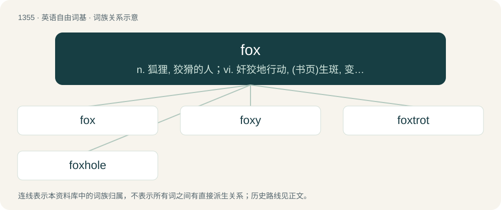

# 1443 · fox — n. 狐狸, 狡猾的人；vi. 奸狡地行动, (书页)生斑, 变酸；vt. 欺骗, 使变酸, 为(鞋等)换面, 使生黄斑

[总目录](../00_总目录_按常用程度.md)

**类型**：英语自由词基　｜　**来源语言**：见词源记录

## 核心含义与来源

- 核心含义：n. 狐狸, 狡猾的人；vi. 奸狡地行动, (书页)生斑, 变酸；vt. 欺骗, 使变酸, 为(鞋等)换面, 使生黄斑
- 英文含义：Any member of the genus Vulpes; a true fox.
- 词形：fox

**来源记录 1**（名词；Any member of the genus Vulpes; a true fox.）

From Middle English fox, from Old English fox (“fox”), from Proto-West Germanic \*fuhs, from Proto-Germanic \*fuhsaz (“fox”), from Proto-Indo-European \*púḱsos (“the tailed one”), possibly from \*puḱ- (“tail”). Cognates Cognate with Yola vox, voxe (“fox”), North Frisian foos (“fox”), Saterland Frisian Foaks (“fox”), West Frisian foks (“fox”), Alemannic German Fuchs, Fugs, fuksch, fuks, fòcks, vucks (“fox”), Bavarian Fuchs, vucs, vuks (“fox”), Central Franconian Fuss (“fox”), Cimbrian buks, vuks (“fox”), Dutch vos (“fox”), German Fuchs (“fox”), Low German Voss (“fox”), Luxembourgish Fuuss (“fox”), Vilamovian füks (“fox”), Yiddish פֿוקס (fuks, “fox”), Norn fúa (“she-fox”), Gothic 𐍆𐌰𐌿𐌷𐍉 (fauhō, “fox”); also Bulgarian, Russian, and Ukrainian пух (pux, “down, fluff”), Polish puch (“down, fluff; snow”), Sanskrit पुच्छ (púccha, “tail; hind-part”) (whence Bengali পুচ্ছ (puccho, “tail”), Hindi पूँछ (pū̃ch), पूंछ (pūñch, “tail; rear of an object”), Pali puccha (“tail”), Punjabi ਪੂਛ (pūch, “tail”)). Philosophical sense from the 1953 essay The Hedgehog and the Fox by Isaiah Berlin. Military aviation sense from the pre-NATO military spelling alphabet where Fox represented F and was short for 'to fire'.

## 词族图

## 单词速览（常用到不常用）

| 单词 | 音标 | 释义 |
|---|---|---|
| [fox](#w-1) | 英 /fɒks/；美 /fɑks/ | n. 狐狸, 狡猾的人；vi. 奸狡地行动, (书页)生斑, 变酸；vt. 欺骗, 使变酸, 为(鞋等)换面, 使生黄斑 |
| [foxy](#w-2) | 英 /ˈfɒksi/；美 /ˈfɑksi/ | a. 如狐的, 狡猾的, 赤褐色的 |
| [foxtrot](#w-3) | /ˈfɒkstɹɒt/ | n. 狐步舞；vi. 跳狐步舞 |
| [foxhole](#w-4) | /ˈfɒkshəul/ | n. 散兵坑 |

## 逐词详解

### 1. fox

**词性**：名词　｜　**音标**：英 /fɒks/；美 /fɑks/

**中文释义**：n. 狐狸, 狡猾的人；vi. 奸狡地行动, (书页)生斑, 变酸；vt. 欺骗, 使变酸, 为(鞋等)换面, 使生黄斑

**英文义项**：Any member of the genus Vulpes; a true fox. / The red fox, a small carnivore (Vulpes vulpes) with red or silver fur.

**词源与演化**：

From Middle English fox, from Old English fox (“fox”), from Proto-West Germanic \*fuhs, from Proto-Germanic \*fuhsaz (“fox”), from Proto-Indo-European \*púḱsos (“the tailed one”), possibly from \*puḱ- (“tail”). Cognates Cognate with Yola vox, voxe (“fox”), North Frisian foos (“fox”), Saterland Frisian Foaks (“fox”), West Frisian foks (“fox”), Alemannic German Fuchs, Fugs, fuksch, fuks, fòcks, vucks (“fox”), Bavarian Fuchs, vucs, vuks (“fox”), Central Franconian Fuss (“fox”), Cimbrian buks, vuks (“fox”), Dutch vos (“fox”), German Fuchs (“fox”), Low German Voss (“fox”), Luxembourgish Fuuss (“fox”), Vilamovian füks (“fox”), Yiddish פֿוקס (fuks, “fox”), Norn fúa (“she-fox”), Gothic 𐍆𐌰𐌿𐌷𐍉 (fauhō, “fox”); also Bulgarian, Russian, and Ukrainian пух (pux, “down, fluff”), Polish puch (“down, fluff; snow”), Sanskrit पुच्छ (púccha, “tail; hind-part”) (whence Bengali পুচ্ছ (puccho, “tail”), Hindi पूँछ (pū̃ch), पूंछ (pūñch, “tail; rear of an object”), Pali puccha (“tail”), Punjabi ਪੂਛ (pūch, “tail”)). Philosophical sense from the 1953 essay The Hedgehog and the Fox by Isaiah Berlin. Military aviation sense from the pre-NATO military spelling alphabet where Fox represented F and was short for 'to fire'.

**例句**：

> The quick brown fox jumps over the lazy dog.

该用例对应义项：The red fox, a small carnivore (Vulpes vulpes) with red or silver fur.

### 2. foxy

**词性**：名词　｜　**音标**：英 /ˈfɒksi/；美 /ˈfɑksi/

**中文释义**：a. 如狐的, 狡猾的, 赤褐色的

**英文义项**：The recreational drug 5-methoxy-dimethyltryptamine (5-MeO-DMT).

**构词拆分**：fox + -y

**词源与演化**：

From fox + -y. Compare Saterland Frisian fuksich (“foxy”), West Frisian foksich (“foxy”), Dutch vossig (“foxy”), German Low German vossig (“foxy”), German fuchsig (“foxy”).

**例句**：

> Don't you ever cheat on me, you foxy!

### 3. foxtrot

**词性**：名词　｜　**音标**：/ˈfɒkstɹɒt/

**中文释义**：n. 狐步舞；vi. 跳狐步舞

**英文义项**：A ballroom dance with a slow-slow-quick-quick rhythm. / A pace with short steps, as in changing from trotting to walking.

**构词拆分**：fox + trot

**词源与演化**：

From fox + trot.

### 4. foxhole

**词性**：名词　｜　**音标**：/ˈfɒkshəul/

**中文释义**：n. 散兵坑

**英文义项**：The burrow in the ground where a fox lives. / A small pit dug into the ground as a shelter for protection against enemy fire.

**构词拆分**：fox + hole

**词源与演化**：

From Middle English foxhol, from Old English foxhol, equivalent to fox + hole.

**例句**：

> The soldier took shelter in the foxhole.
