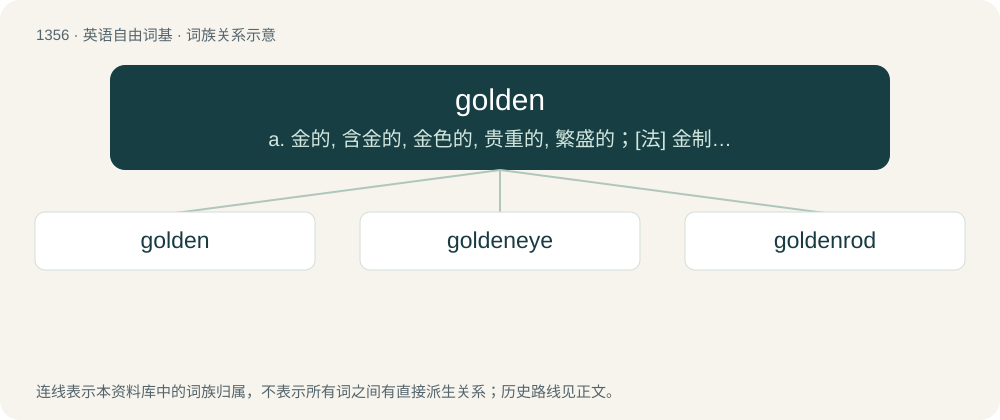

# 1444 · golden — a. 金的, 含金的, 金色的, 贵重的, 繁盛的；\[法\] 金制的, 金色的, 兴隆的

[总目录](../00_总目录_按常用程度.md)

**类型**：英语自由词基　｜　**来源语言**：见词源记录

## 核心含义与来源

- 核心含义：a. 金的, 含金的, 金色的, 贵重的, 繁盛的；\[法\] 金制的, 金色的, 兴隆的
- 英文含义：Made of, or relating to, gold.
- 词形：golden

**多个词源／构词路径**：同一拼写可能有不同来源；以下按词性和含义分别列出。

**来源记录 1**（形容词；Made of, or relating to, gold.）

From Middle English golden, a restored form (due to the noun gold) of earlier Middle English gulden, gylden, gilden ("golden"; &gt; English gilden), from Old English gylden (“golden”), from Proto-West Germanic \*gulþīn, from Proto-Germanic \*gulþīnaz (“golden, made of gold”), equivalent to gold + -en. Cognate with Dutch gouden, gulden (“golden”), German gülden, golden (“golden”), Danish gylden (“golden”). Doublet of gilden. More at gold.

**来源记录 2**（动词；To become gold or golden (in color).）

From gold + -en, or perhaps a derivation from the adjective above.

## 词族图

## 单词速览（常用到不常用）

| 单词 | 音标 | 释义 |
|---|---|---|
| [golden](#w-1) | 英 /ˈɡəʊl.dən/；美 /ˈɡoʊl.dən/ | a. 金的, 含金的, 金色的, 贵重的, 繁盛的；\[法\] 金制的, 金色的, 兴隆的 |
| [goldeneye](#w-2) | 英 /ˈɡəʊldənaɪ/ | n. 鹊鸭 |
| [goldenrod](#w-3) | 美 /ˈɡoʊldənˌɹɑd/ | n. 一种黄花属植物 |

## 逐词详解

### 1. golden

**词性**：形容词　｜　**音标**：英 /ˈɡəʊl.dən/；美 /ˈɡoʊl.dən/

**中文释义**：a. 金的, 含金的, 金色的, 贵重的, 繁盛的；\[法\] 金制的, 金色的, 兴隆的

**英文义项**：Made of, or relating to, gold. / Having a color or other richness suggestive of gold.

**构词拆分**：gold + -en

**词源与演化**：

From Middle English golden, a restored form (due to the noun gold) of earlier Middle English gulden, gylden, gilden ("golden"; &gt; English gilden), from Old English gylden (“golden”), from Proto-West Germanic \*gulþīn, from Proto-Germanic \*gulþīnaz (“golden, made of gold”), equivalent to gold + -en. Cognate with Dutch gouden, gulden (“golden”), German gülden, golden (“golden”), Danish gylden (“golden”). Doublet of gilden. More at gold.

**例句**：

> After retiring, Bob and Judy moved to Arizona to live out their golden years.

该用例对应义项：Relating to the elderly or retired.

### 2. goldeneye

**词性**：名词　｜　**音标**：英 /ˈɡəʊldənaɪ/

**中文释义**：n. 鹊鸭

**英文义项**：Any of several seaducks, of the genus Bucephala, having black and white plumage. / Any of several lacewings of the family Chrysopidae.

**构词拆分**：golden + eye

**词源与演化**：

From golden + eye.

### 3. goldenrod

**词性**：名词　｜　**音标**：美 /ˈɡoʊldənˌɹɑd/

**中文释义**：n. 一种黄花属植物

**英文义项**：Any tall-stemmed plant principally from genus Solidago (also Oligoneuron), usually with clusters of small yellow flowers. / A golden-yellow colour, like that of the goldenrod plant.

**构词拆分**：golden + rod

**词源与演化**：

From golden + rod.
