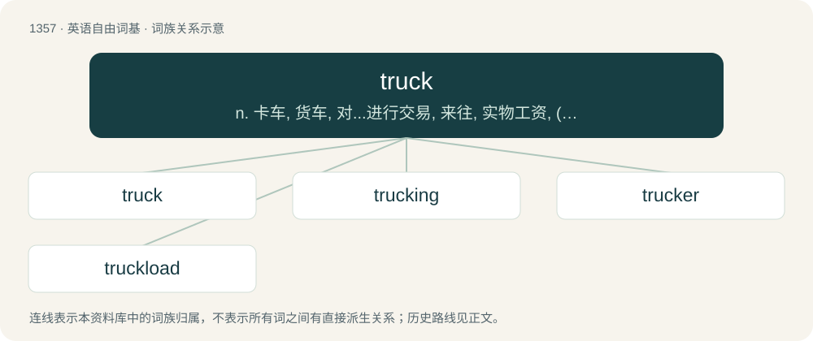

# 1446 · truck — n. 卡车, 货车, 对...进行交易, 来往, 实物工资, (供应市场的)蔬菜, 废物, 废话；vt. 对...进行交易, 交往, 以卡车运输；vi. 驾驶卡车, 以物易物

[总目录](../00_总目录_按常用程度.md)

**类型**：英语自由词基　｜　**来源语言**：见词源记录

## 核心含义与来源

- 核心含义：n. 卡车, 货车, 对...进行交易, 来往, 实物工资, (供应市场的)蔬菜, 废物, 废话；vt. 对...进行交易, 交往, 以卡车运输；vi. 驾驶卡车, 以物易物
- 英文含义：A small wheel or roller, specifically the wheel of a gun carriage.
- 词形：truck

**多个词源／构词路径**：同一拼写可能有不同来源；以下按词性和含义分别列出。

**来源记录 1**（名词；A small wheel or roller, specifically the wheel of a gun carriage.）

Perhaps a shortening of truckle, related to Latin trochus (“iron hoop, wheel”) from Ancient Greek τροχός (trokhós).

**来源记录 2**（动词；To fail; run out; run short; be unavailable; diminish; abate.）

From Middle English truken, troken, trukien, from Old English trucian (“to fail, run short, deceive, disappoint”), from Proto-West Germanic \*trokōn (“to fail, miss, lack”), from Proto-Indo-European \*derew-, \*derwu- (“to tear, wrap, reap”), from Proto-Indo-European \*der- (“to flay, split”). Cognate with Middle Low German troggelen (“to cheat, deceive, swindle”), Dutch troggelen (“to extort”), German dialectal truggeln (“to flatter, fawn”).

**来源记录 3**（动词；To tread (down); stamp on; trample (down).）

From dialectal truck, truk, trokk, probably of North Germanic origin, compare Norwegian dialectal trokka, trakka (“to stamp, trample, go to and fro”), Danish trykke (“to press, press down, crush, squeeze”), Swedish trycka. More at thrutch.

**来源记录 4**（动词；To trade, exchange; barter.）

From Middle English trukien, from unrecorded Anglo-Norman and Old French words, from Latin trocāre, from Frankish \*trokan. Related to Etymology 2.

## 词族图

## 单词速览（常用到不常用）

| 单词 | 音标 | 释义 |
|---|---|---|
| [truck](#w-1) | 英 /tɹʌk/ | n. 卡车, 货车, 对...进行交易, 来往, 实物工资, (供应市场的)蔬菜, 废物, 废话；vt. 对...进行交易, 交往, 以卡车运输；vi. 驾驶卡车, 以物易物 |
| [trucking](#w-2) | 英 /ˈtɹʌkɪŋ/ | n. 货车运输业；货车运输；以货易货 |
| [trucker](#w-3) | 英 /ˈtɹʌkə/；美 /ˈtɹʌkɚ/ | n. 卡车驾驶员, 从事货车运输业者, 以物易物者, 小贩 |
| [truckload](#w-4) | 美 /ˈtɹʌkˌloʊd/ | n. 货车荷载, 最低起运量 |

## 逐词详解

### 1. truck

**词性**：名词　｜　**音标**：英 /tɹʌk/

**中文释义**：n. 卡车, 货车, 对...进行交易, 来往, 实物工资, (供应市场的)蔬菜, 废物, 废话；vt. 对...进行交易, 交往, 以卡车运输；vi. 驾驶卡车, 以物易物

**英文义项**：A small wheel or roller, specifically the wheel of a gun carriage. / The ball on top of a flagpole.

**词源与演化**：

Perhaps a shortening of truckle, related to Latin trochus (“iron hoop, wheel”) from Ancient Greek τροχός (trokhós).

**例句**：

> We rented a truck big enough to carry the whole load in one trip.

该用例对应义项：A heavier motor vehicle designed to carry goods or to pull a semi-trailer designed to carry goods; (in Malaysia/Singapore) a such vehicle with a closed or covered carriage.

### 2. trucking

**词性**：名词　｜　**音标**：英 /ˈtɹʌkɪŋ/

**中文释义**：n. 货车运输业；货车运输；以货易货

**英文义项**：the conveyance of freight by trucks. / Lateral movement of the camera.

**构词拆分**：From truck + -ing.

**词源与演化**：

From truck + -ing.

**例句**：

> Yanni's trucking route is from Algiers to Bejaia.

### 3. trucker

**词性**：名词　｜　**音标**：英 /ˈtɹʌkə/；美 /ˈtɹʌkɚ/

**中文释义**：n. 卡车驾驶员, 从事货车运输业者, 以物易物者, 小贩

**英文义项**：One who has done something offensive; a deceitful, dishonest, or disreputable person; a deceiver; a cheat. / A rogue; rascal; miscreant; a ne'er-do-well.

**构词拆分**：truck (“to fail”) + -er (agent noun suffix)

**词源与演化**：

From Middle English \*trukere (“one who disappoints, a deceiver”), from Middle English trukien (“to fail, run out, disappoint”), equivalent to truck (“to fail”) + -er (agent noun suffix). Compare trooker.

**例句**：

> Layla's car was spotted by a trucker who called law enforcement.

### 4. truckload

**词性**：名词　｜　**音标**：美 /ˈtɹʌkˌloʊd/

**中文释义**：n. 货车荷载, 最低起运量

**英文义项**：The contents of a full truck or lorry. / A large number.

**构词拆分**：truck + load

**词源与演化**：

From truck + load.

**例句**：

> We were expecting just a handful of people to come to the festival, but then a truckload of revellers started arriving at the festival gates.

该用例对应义项：A large number.
