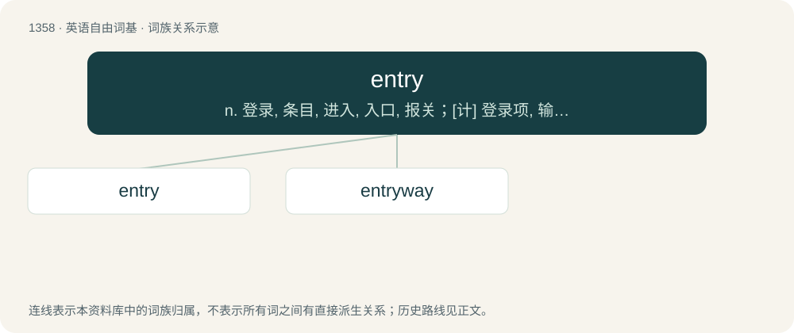

# 1447 · entry — n. 登录, 条目, 进入, 入口, 报关；\[计\] 登录项, 输入项, 条目

[总目录](../00_总目录_按常用程度.md)

**类型**：英语自由词基　｜　**来源语言**：见词源记录

## 核心含义与来源

- 核心含义：n. 登录, 条目, 进入, 入口, 报关；\[计\] 登录项, 输入项, 条目
- 英文含义：The act of entering.
- 词形：entry

**来源记录 1**（名词；The act of entering.）

Inherited from Middle English entre, from Old French entree (feminine past participle of the verb entrer, Modern French entrée). From Latin intrō. Doublet of entrada and entrée.

## 词族图

## 单词速览（常用到不常用）

| 单词 | 音标 | 释义 |
|---|---|---|
| [entry](#w-1) | /ˈɛntɹi/ | n. 登录, 条目, 进入, 入口, 报关；\[计\] 登录项, 输入项, 条目 |
| [entryway](#w-2) | /ˈentri,wei/ | n. 入口通道 |

## 逐词详解

### 1. entry

**词性**：名词　｜　**音标**：/ˈɛntɹi/

**中文释义**：n. 登录, 条目, 进入, 入口, 报关；\[计\] 登录项, 输入项, 条目

**英文义项**：The act of entering. / Permission to enter.

**词源与演化**：

Inherited from Middle English entre, from Old French entree (feminine past participle of the verb entrer, Modern French entrée). From Latin intrō. Doublet of entrada and entrée.

**例句**：

> The wrestler's dramatic entry into the stadium was very impressive.

该用例对应义项：The act of entering.

### 2. entryway

**词性**：名词　｜　**音标**：/ˈentri,wei/

**中文释义**：n. 入口通道

**英文义项**：An opening or hallway allowing entry into a structure; a pathway allowing entry into a locality or region.

**构词拆分**：entry + way

**词源与演化**：

From entry + way.

**例句**：

> There were greeters handing out programmes in the entryway to the museum.

该用例对应义项：An opening or hallway allowing entry into a structure; a pathway allowing entry into a locality or region.
