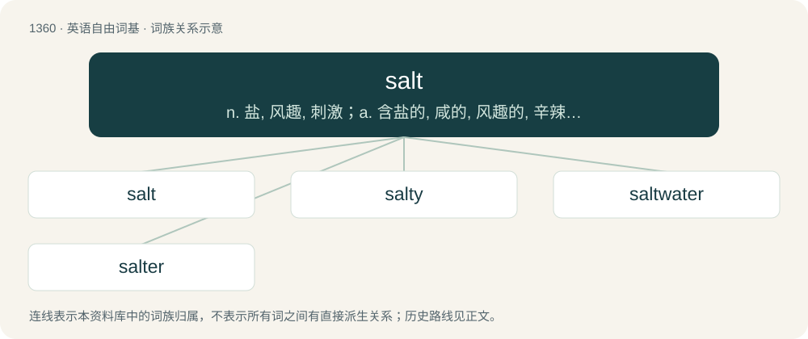

# 1448 · salt — n. 盐, 风趣, 刺激；a. 含盐的, 咸的, 风趣的, 辛辣的；vt. 加盐于, 用盐腌

[总目录](../00_总目录_按常用程度.md)

**类型**：英语自由词基　｜　**来源语言**：见词源记录

## 核心含义与来源

- 核心含义：n. 盐, 风趣, 刺激；a. 含盐的, 咸的, 风趣的, 辛辣的；vt. 加盐于, 用盐腌
- 英文含义：A common substance, chemically consisting mainly of sodium chloride (NaCl), used extensively as a food ingredient, seasoning, condiment, and preservative.
- 词形：salt

**来源记录 1**（名词；A common substance, chemically consisting mainly of sodium chloride (NaCl), used extensively as a food ingredient, seasoning, condiment, and preservative.）

From Middle English salt, from Old English sealt, from Proto-West Germanic \*salt, from Proto-Germanic \*saltą, from Proto-Indo-European \*sḗh₂l (“salt”). Doublet of sal, salary, and salsa, all ultimately from Latin sāl (“salt”), which it superseded as the general term for "salt". Cognate with Dutch zout, German Salz, Danish, Faroese, Icelandic, Norwegian Bokmål, Norwegian Nynorsk, and Swedish salt.

## 词族图

## 单词速览（常用到不常用）

| 单词 | 音标 | 释义 |
|---|---|---|
| [salt](#w-1) | 英 /sɒlt/；美 /sɑlt/ | n. 盐, 风趣, 刺激；a. 含盐的, 咸的, 风趣的, 辛辣的；vt. 加盐于, 用盐腌 |
| [salty](#w-2) | 英 /ˈsɒlti/；美 /ˈsɔlti/ | a. 有盐分的, 咸味浓的, 海洋的, 辛辣的, 有经验的 |
| [saltwater](#w-3) | /ˈsɒːltwɒːtə/ | a. 盐水的, 海产的, 海上的 |
| [salter](#w-4) | /ˈsɔːltə/ | n. 制盐人, 卖盐人, 腌制者, (非正式)矿山骗子 |

## 逐词详解

### 1. salt

**词性**：名词　｜　**音标**：英 /sɒlt/；美 /sɑlt/

**中文释义**：n. 盐, 风趣, 刺激；a. 含盐的, 咸的, 风趣的, 辛辣的；vt. 加盐于, 用盐腌

**英文义项**：A common substance, chemically consisting mainly of sodium chloride (NaCl), used extensively as a food ingredient, seasoning, condiment, and preservative. / One of the compounds formed from the reaction of an acid with a base, where a positive ion replaces a hydrogen of the acid.

**词源与演化**：

From Middle English salt, from Old English sealt, from Proto-West Germanic \*salt, from Proto-Germanic \*saltą, from Proto-Indo-European \*sḗh₂l (“salt”). Doublet of sal, salary, and salsa, all ultimately from Latin sāl (“salt”), which it superseded as the general term for "salt". Cognate with Dutch zout, German Salz, Danish, Faroese, Icelandic, Norwegian Bokmål, Norwegian Nynorsk, and Swedish salt.

**例句**：

> There was so much salt in that thread about the poor casting decision.

该用例对应义项：Tears; indignation; outrage; arguing.

### 2. salty

**词性**：形容词　｜　**音标**：英 /ˈsɒlti/；美 /ˈsɔlti/

**中文释义**：a. 有盐分的, 咸味浓的, 海洋的, 辛辣的, 有经验的

**英文义项**：Tasting of salt. / Containing salt.

**构词拆分**：salt + -y

**词源与演化**：

Inherited from Middle English salti. Equivalent to salt + -y. Compare Saterland Frisian soaltig (“salty”), West Frisian sâltich (“salty”), Dutch zoutig (“salty”), German Low German soltig (“salty”), German salzig (“salty”). (coarse; irritated, annoyed): Referencing the sharp, 'spicy' flavor of salt. (indignant): Perhaps implying the person is a crybaby, shedding salty tears, or derived from the preceding.

**例句**：

> Tom might have eaten the stew if it had been less salty.

### 3. saltwater

**词性**：形容词　｜　**音标**：/ˈsɒːltwɒːtə/

**中文释义**：a. 盐水的, 海产的, 海上的

**英文义项**：New Keynesian or Keynesian, in reference to macroeconomics and economics departments on the East Coast and West Coast of the United States of America.

**构词拆分**：salt + water

**词源与演化**：

From Middle English saltwater, salte water, equivalent to salt + water. Cognate with Saterland Frisian Soaltwoater (“saltwater”), West Frisian sâltwetter (“saltwater”), Dutch zoutwater (“saltwater”), German Low German Soltwater (“saltwater”), German Salzwasser (“saltwater”), Danish saltvand (“saltwater”), Swedish saltvatten (“saltwater”), Icelandic saltvatn (“saltwater”).

**例句**：

> As its name implies, the saltwater crocodile can live in salt water.

### 4. salter

**词性**：名词　｜　**音标**：/ˈsɔːltə/

**中文释义**：n. 制盐人, 卖盐人, 腌制者, (非正式)矿山骗子

**英文义项**：One who makes, sells, or applies salt. / A trout leaving salt water to ascend a stream.

**构词拆分**：salt + -er

**词源与演化**：

From salt + -er.
