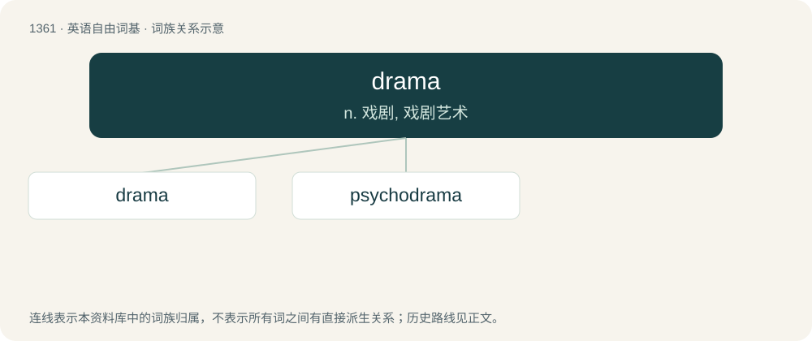

# 1450 · drama — n. 戏剧, 戏剧艺术

[总目录](../00_总目录_按常用程度.md)

**类型**：英语自由词基　｜　**来源语言**：见词源记录

## 核心含义与来源

- 核心含义：n. 戏剧, 戏剧艺术
- 英文含义：A composition, normally in prose, telling a story and intended to be represented by actors impersonating the characters and speaking the dialogue.
- 词形：drama

**来源记录 1**（名词；A composition, normally in prose, telling a story and intended to be represented by actors impersonating the characters and speaking the dialogue.）

From Late Latin drāma, from Ancient Greek δρᾶμα (drâma, “an act, a theatrical act, a play”), from δράω (dráō, “to act, to take action, to achieve”). Doublet of dorama.

## 词族图

## 单词速览（常用到不常用）

| 单词 | 音标 | 释义 |
|---|---|---|
| [drama](#w-1) | 英 /ˈdɹɑːmə/；美 /ˈdɹɑmə/ | n. 戏剧, 戏剧艺术 |
| [psychodrama](#w-2) | /ˈsaikəu.drɑːmə/ | n. 心理剧；\[医\] 精神表演疗法 |

## 逐词详解

### 1. drama

**词性**：名词　｜　**音标**：英 /ˈdɹɑːmə/；美 /ˈdɹɑmə/

**中文释义**：n. 戏剧, 戏剧艺术

**英文义项**：A composition, normally in prose, telling a story and intended to be represented by actors impersonating the characters and speaking the dialogue. / Such a work for television, radio or the cinema, usually one that is not a comedy.

**词源与演化**：

From Late Latin drāma, from Ancient Greek δρᾶμα (drâma, “an act, a theatrical act, a play”), from δράω (dráō, “to act, to take action, to achieve”). Doublet of dorama.

**例句**：

> After losing my job, having a car crash, and the big row with my neighbours, I don't need any more drama.

该用例对应义项：A situation in real life that has the characteristics of such a theatrical play.

### 2. psychodrama

**词性**：名词　｜　**音标**：/ˈsaikəu.drɑːmə/

**中文释义**：n. 心理剧；\[医\] 精神表演疗法

**英文义项**：A form of psychotherapy in which a patient acts a role in a context devised by a psychotherapist. / A drama in this form

**构词拆分**：psycho- + drama

**词源与演化**：

From psycho- + drama.
