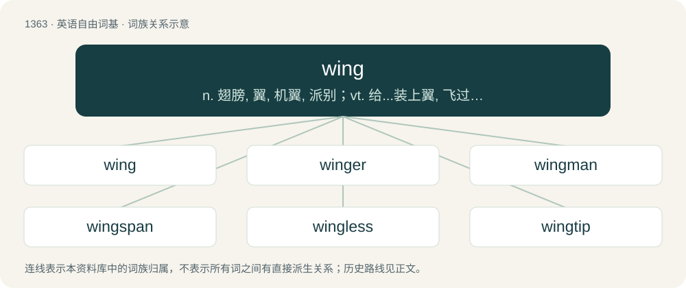

# 1451 · wing — n. 翅膀, 翼, 机翼, 派别；vt. 给...装上翼, 飞过, 使飞, 空运, 增加...速度；vi. 飞行

[总目录](../00_总目录_按常用程度.md)

**类型**：英语自由词基　｜　**来源语言**：见词源记录

## 核心含义与来源

- 核心含义：n. 翅膀, 翼, 机翼, 派别；vt. 给...装上翼, 飞过, 使飞, 空运, 增加...速度；vi. 飞行
- 英文含义：An appendage of an animal's (bird, bat, insect) body that enables it to fly.
- 词形：wing

**来源记录 1**（名词；An appendage of an animal's (bird, bat, insect) body that enables it to fly.）

From Middle English winge, wenge, from Old Norse vængr ("wing of a flying animal, wing of a building"; compare vængi (“ship's cabin”)), from Proto-Germanic \*wēingijaz, from Proto-Indo-European \*h₂weh₁- (“to blow”), thus related to wind. Cognate with Danish, Norwegian Bokmål, and Swedish vinge (“wing”), Elfdalian waingg (“wing”), Faroese vongur (“wing”), Icelandic vængur (“wing”), Norwegian Nynorsk veng (“wing”). Replaced native Middle English fither (from Old English fiþre, from Proto-Germanic \*fiþriją), which merged with Middle English fether (from Old English feþer, from Proto-Germanic \*feþrō). More at feather.

## 词族图

## 单词速览（常用到不常用）

| 单词 | 音标 | 释义 |
|---|---|---|
| [wing](#w-1) | 英 /wɪŋ/ | n. 翅膀, 翼, 机翼, 派别；vt. 给...装上翼, 飞过, 使飞, 空运, 增加...速度；vi. 飞行 |
| [winger](#w-2) | 英 /ˈwɪŋ.ə(ɹ)/；美 /ˈwɪŋ.ɚ/ | n. 边锋 |
| [wingman](#w-3) | /ˈwɪŋmæn/ | n. 僚机驾驶员, 僚机 |
| [wingspan](#w-4) | /ˈwɪŋ.spæn/ | n. 翼展 |
| [wingless](#w-5) |  | a. 没有翼的, 没有翅的 |
| [wingtip](#w-6) | /ˈwiŋtip/ | n. 翼尖 |
| [wingsuit](#w-7) | 美 /ˈwɪŋˌsut/ | 【英文】A special jumpsuit, used in extreme sports like a parachute, which adds surface area to the wearer's body to create lift. |
| [batwing](#w-8) | /ˈbætwiŋ/ | a. 状似蝙蝠之翼的 |
| [wingback](#w-9) | /ˈwiŋbæk/ | n. \[美橄\]助攻边卫 |
| [redwing](#w-10) | /ˈredwiŋ/ | n. 红翼鸫 |
| [wingnut](#w-11) | /ˈwɪŋˌnʌt/ | 枫杨 |

## 逐词详解

### 1. wing

**词性**：名词　｜　**音标**：英 /wɪŋ/

**中文释义**：n. 翅膀, 翼, 机翼, 派别；vt. 给...装上翼, 飞过, 使飞, 空运, 增加...速度；vi. 飞行

**英文义项**：An appendage of an animal's (bird, bat, insect) body that enables it to fly. / A fin at the side of a ray or similar fish.

**词源与演化**：

From Middle English winge, wenge, from Old Norse vængr ("wing of a flying animal, wing of a building"; compare vængi (“ship's cabin”)), from Proto-Germanic \*wēingijaz, from Proto-Indo-European \*h₂weh₁- (“to blow”), thus related to wind. Cognate with Danish, Norwegian Bokmål, and Swedish vinge (“wing”), Elfdalian waingg (“wing”), Faroese vongur (“wing”), Icelandic vængur (“wing”), Norwegian Nynorsk veng (“wing”). Replaced native Middle English fither (from Old English fiþre, from Proto-Germanic \*fiþriją), which merged with Middle English fether (from Old English feþer, from Proto-Germanic \*feþrō). More at feather.

**例句**：

> Smith started the game in the centre of midfield, but moved to the wing after 30 minutes.

该用例对应义项：A position in several field games on either side of the field.

### 2. winger

**词性**：名词　｜　**音标**：英 /ˈwɪŋ.ə(ɹ)/；美 /ˈwɪŋ.ɚ/

**中文释义**：n. 边锋

**英文义项**：One of the casks stowed in the wings of a vessel's hold, being smaller than such as are stowed more amidships. / An offensive player who plays on either side of the center.

**构词拆分**：From wing + -er.

**词源与演化**：

From wing + -er.

**例句**：

> The center passed to the left winger, who shot and scored.

该用例对应义项：An offensive player who plays on either side of the center.

### 3. wingman

**词性**：名词　｜　**音标**：/ˈwɪŋmæn/

**中文释义**：n. 僚机驾驶员, 僚机

**英文义项**：A pilot partner of another; a pilot who flies in the same wing or squadron. / A friend or associate who accompanies one to offer (or receive) support, especially in flirting with love interests.

**构词拆分**：wing + -man

**词源与演化**：

From wing + -man.

### 4. wingspan

**词性**：名词　｜　**音标**：/ˈwɪŋ.spæn/

**中文释义**：n. 翼展

**英文义项**：The distance from the left wingtip to the right wingtip (of a bird, airplane etc.). / Synonym of arm span.

**构词拆分**：wing + span

**词源与演化**：

From wing + span.

**例句**：

> The Airbus A380 has one of the largest wingspans among aircraft; only a few surpass it.

该用例对应义项：The distance from the left wingtip to the right wingtip (of a bird, airplane etc.).

### 5. wingless

**词性**：形容词

**中文释义**：a. 没有翼的, 没有翅的

**英文义项**：Having no, or only rudimentary, wings.

**构词拆分**：wing + -less

**词源与演化**：

From wing + -less.

**例句**：

> Wingless insects are less scary than winged ones.

### 6. wingtip

**词性**：名词　｜　**音标**：/ˈwiŋtip/

**中文释义**：n. 翼尖

**英文义项**：The extreme tip of the wing of an aircraft, bird, flying insect, etc. / A part of a shoe, often with brogueing that extends backwards on both sides from the toe.

**构词拆分**：wing + tip

**词源与演化**：

From wing + tip.

### 7. wingsuit

**词性**：名词　｜　**音标**：美 /ˈwɪŋˌsut/

**英文义项**：A special jumpsuit, used in extreme sports like a parachute, which adds surface area to the wearer's body to create lift.

**构词拆分**：wing + suit

**词源与演化**：

From wing + suit.

### 8. batwing

**词性**：名词　｜　**音标**：/ˈbætwiŋ/

**中文释义**：a. 状似蝙蝠之翼的

**英文义项**：The wing of a bat, or its shape. / Several South or Southeast Asian species of tailless dark swallowtail butterflies in the genus Atrophaneura.

**构词拆分**：bat + wing

**词源与演化**：

From bat + wing.

### 9. wingback

**词性**：名词　｜　**音标**：/ˈwiŋbæk/

**中文释义**：n. \[美橄\]助攻边卫

**英文义项**：A player who doubles on either side of the center as a defender when their team is defending, and a winger when they are attacking. / A running back who is in formation near the line of scrimmage and outside the tackles, a slotback.

**构词拆分**：wing + back

**词源与演化**：

From wing + back.

### 10. redwing

**词性**：名词　｜　**音标**：/ˈredwiŋ/

**中文释义**：n. 红翼鸫

**英文义项**：A small thrush, Turdus iliacus, native to Eurasia, with a white eye stripe and red under-wing feathers. / A red-winged blackbird

**构词拆分**：red + wing

**词源与演化**：

From red + wing.

### 11. wingnut

**词性**：名词　｜　**音标**：/ˈwɪŋˌnʌt/

**中文释义**：枫杨

**英文义项**：A deciduous tree of the genus Pterocarya native to Asia. / A person who is or seems odd, eccentric, or crazy; especially, someone with bizarre or extreme political views.

**构词拆分**：wing + nut

**词源与演化**：

From wing + nut. The political sense is a shortening of "right-wing nut".
