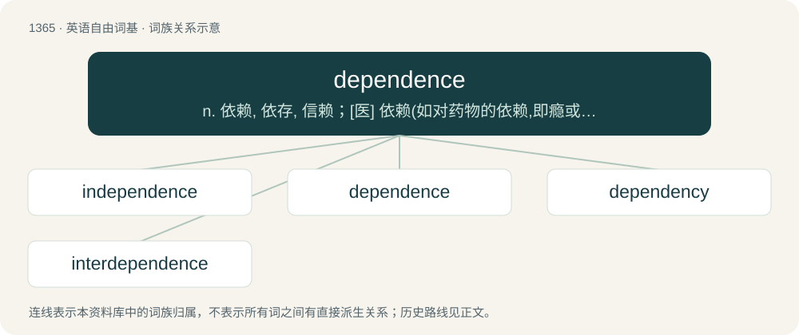

# 1453 · dependence — n. 依赖, 依存, 信赖；\[医\] 依赖(如对药物的依赖,即瘾或癖), 从属, 偏利共生

[总目录](../00_总目录_按常用程度.md)

**类型**：英语自由词基　｜　**来源语言**：见词源记录

## 核心含义与来源

- 核心含义：n. 依赖, 依存, 信赖；\[医\] 依赖(如对药物的依赖,即瘾或癖), 从属, 偏利共生
- 英文含义：The state of being dependent, of relying upon another.
- 词形：dependence

**来源记录 1**（名词；The state of being dependent, of relying upon another.）

From Middle French dépendance. Morphologically depend + -ence.

## 词族图

## 单词速览（常用到不常用）

| 单词 | 音标 | 释义 |
|---|---|---|
| [independence](#w-1) | /ˌɪn.dɪˈpɛn.dəns/ | n. 独立, 自立, 自主；\[医\] 自主性, 独立性 |
| [dependence](#w-2) | 英 /dɪˈpɛndəns/ | n. 依赖, 依存, 信赖；\[医\] 依赖(如对药物的依赖,即瘾或癖), 从属, 偏利共生 |
| [dependency](#w-3) | 英 /dɪˈpɛndənsi/ | n. 属国, 保护地, 从属物；\[医\] 从属, 从属部 |
| [interdependence](#w-4) | /.intədiˈpendəns.-dənsi/ | n. 互相依赖 |

## 逐词详解

### 1. independence

**词性**：名词　｜　**音标**：/ˌɪn.dɪˈpɛn.dəns/

**中文释义**：n. 独立, 自立, 自主；\[医\] 自主性, 独立性

**英文义项**：The quality or state of being independent; lack of dependence; the state of not being reliant on, or controlled by, others. / The state of having sufficient means for a comfortable livelihood.

**构词拆分**：in- + de- + pend + -ence；in- + dependence

**词源与演化**：

From French indépendance. Analyzable as in- + de- + pend + -ence or in- + dependence.

**例句**：

> In 1947, India gained independence from the British Empire.

该用例对应义项：The quality or state of being independent; lack of dependence; the state of not being reliant on, or controlled by, others.

### 2. dependence

**词性**：名词　｜　**音标**：英 /dɪˈpɛndəns/

**中文释义**：n. 依赖, 依存, 信赖；\[医\] 依赖(如对药物的依赖,即瘾或癖), 从属, 偏利共生

**英文义项**：The state of being dependent, of relying upon another. / An irresistible physical or psychological need, especially for a chemical substance.

**构词拆分**：depend + -ence

**词源与演化**：

From Middle French dépendance. Morphologically depend + -ence.

**例句**：

> He had a deep dependence on her for guidance.

该用例对应义项：The state of being dependent, of relying upon another.

### 3. dependency

**词性**：名词　｜　**音标**：英 /dɪˈpɛndənsi/

**中文释义**：n. 属国, 保护地, 从属物；\[医\] 从属, 从属部

**英文义项**：A state of dependence; a refusal to exercise initiative. / Something dependent on, or subordinate to, something else

**构词拆分**：dependent + -cy；dependence + -y；depend + -ency

**词源与演化**：

From dependent + -cy or dependence + -y or depend + -ency.

**例句**：

> In the United States' governmental structure, the military is conceived as a dependency under the executive branch.

该用例对应义项：Something dependent on, or subordinate to, something else

### 4. interdependence

**词性**：名词　｜　**音标**：/.intədiˈpendəns.-dənsi/

**中文释义**：n. 互相依赖

**英文义项**：The condition of being interdependent.

**构词拆分**：inter- + dependence

**词源与演化**：

From inter- + dependence.

**例句**：

> Human interdependence is our only way to survive.
