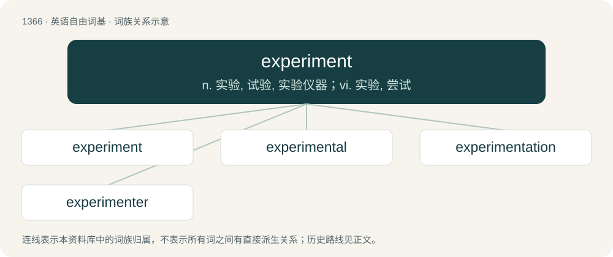

# 1454 · experiment — n. 实验, 试验, 实验仪器；vi. 实验, 尝试

[总目录](../00_总目录_按常用程度.md)

**类型**：英语自由词基　｜　**来源语言**：见词源记录

## 核心含义与来源

- 核心含义：n. 实验, 试验, 实验仪器；vi. 实验, 尝试
- 英文含义：A test under controlled conditions made to either demonstrate a known truth, examine the validity of a hypothesis, or determine the efficacy or likelihood of something previously untried.
- 词形：experiment

**来源记录 1**（名词；A test under controlled conditions made to either demonstrate a known truth, examine the validity of a hypothesis, or determine the efficacy or likelihood of something previously untried.）

From Middle English experiment, from Old French esperiment (French expérience), from Latin experimentum (“experience, attempt, experiment”), from experior (“to experience, to attempt”), itself from ex + \*perior, in turn from Proto-Indo-European \*per-.

## 词族图

## 单词速览（常用到不常用）

| 单词 | 音标 | 释义 |
|---|---|---|
| [experiment](#w-1) | 英 /ɪkˈspɛɹ.ɪ.mənt/；美 /ɪkˈspɛɹ.ə.mənt/ | n. 实验, 试验, 实验仪器；vi. 实验, 尝试 |
| [experimental](#w-2) | /ɪkspɛɹəˈmɛntəl/ | a. 实验的, 根据实验的；\[医\] 实验的 |
| [experimentation](#w-3) | 英 /ɪkˌspɛɹ.ɪ.mənˈteɪ.ʃən/；美 /ɪkˌspɛɹ.ə.mənˈteɪ.ʃən/ | n. 实验, 试验, 实验法；\[化\] 实验; 实验过程 |
| [experimenter](#w-4) | 英 /ɪkˈspɛɹ.ɪ.mɛn.tə/；美 /ɪkˈspɛɹ.ə.mɛn.tɚ/ | n. 实验者, 试验者 |

## 逐词详解

### 1. experiment

**词性**：名词　｜　**音标**：英 /ɪkˈspɛɹ.ɪ.mənt/；美 /ɪkˈspɛɹ.ə.mənt/

**中文释义**：n. 实验, 试验, 实验仪器；vi. 实验, 尝试

**英文义项**：A test under controlled conditions made to either demonstrate a known truth, examine the validity of a hypothesis, or determine the efficacy or likelihood of something previously untried.

**词源与演化**：

From Middle English experiment, from Old French esperiment (French expérience), from Latin experimentum (“experience, attempt, experiment”), from experior (“to experience, to attempt”), itself from ex + \*perior, in turn from Proto-Indo-European \*per-.

**用法示例／搭配（非完整句）**：

> perform a scientific experiment

该用例对应义项：A test under controlled conditions made to either demonstrate a known truth, examine the validity of a hypothesis, or determine the efficacy or likelihood of something previously untried.

### 2. experimental

**词性**：形容词　｜　**音标**：/ɪkspɛɹəˈmɛntəl/

**中文释义**：a. 实验的, 根据实验的；\[医\] 实验的

**英文义项**：Pertaining to or founded on experiment. / Serving to be experimented upon; used in an experiment.

**构词拆分**：experiment + -al

**词源与演化**：

From experiment + -al.

**例句**：

> Chemistry is an experimental science.

该用例对应义项：Pertaining to or founded on experiment.

### 3. experimentation

**词性**：名词　｜　**音标**：英 /ɪkˌspɛɹ.ɪ.mənˈteɪ.ʃən/；美 /ɪkˌspɛɹ.ə.mənˈteɪ.ʃən/

**中文释义**：n. 实验, 试验, 实验法；\[化\] 实验; 实验过程

**英文义项**：The act of experimenting; practice by experiment. / A set of actions and observations, performed to verify or falsify a hypothesis or to research a causal relationship between phenomena.

**构词拆分**：experiment + -ation

**词源与演化**：

From Latin ex- + -periri (akin to periculum), "attempt". Morphologically experiment + -ation.

**例句**：

> The bear was about to be sold to a laboratory for scientific experimentation.

### 4. experimenter

**词性**：名词　｜　**音标**：英 /ɪkˈspɛɹ.ɪ.mɛn.tə/；美 /ɪkˈspɛɹ.ə.mɛn.tɚ/

**中文释义**：n. 实验者, 试验者

**英文义项**：A person who experiments.

**构词拆分**：experiment + -er

**词源与演化**：

From experiment + -er.

**例句**：

> She was an experimenter in new forms of poetry.

该用例对应义项：a person who enjoys testing innovative ideas
