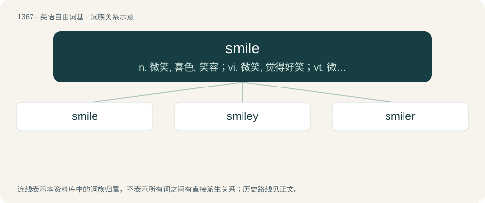

# 1456 · smile — n. 微笑, 喜色, 笑容；vi. 微笑, 觉得好笑；vt. 微笑着表示

[总目录](../00_总目录_按常用程度.md)

**类型**：英语自由词基　｜　**来源语言**：见词源记录

## 核心含义与来源

- 核心含义：n. 微笑, 喜色, 笑容；vi. 微笑, 觉得好笑；vt. 微笑着表示
- 英文含义：A facial expression comprised by flexing the muscles of both ends of one's mouth, often showing the front teeth, without vocalisation, and in humans is a common involuntary or voluntary expression of happiness, pleasure, amusement, goodwill, or anxiety.
- 词形：smile

**来源记录 1**（名词；A facial expression comprised by flexing the muscles of both ends of one's mouth, often showing the front teeth, without vocalisation, and in humans is a common involuntary or voluntary expression of happiness, pleasure, amusement, goodwill, or anxiety.）

From Middle English smilen (“to smile”), from Middle Low German \*smîlen (“to smile”), from Middle High German smielen, from Old High German smielēn, from Proto-West Germanic \*smīlēn, from Proto-Germanic \*smīlāną (“to smile”), from Proto-Indo-European \*smey- (“to laugh, be glad, wonder”). Cognate with Danish smile, Swedish smila, Faroese smíla (“to smile”); also Saterland Frisian smielje (“to smile”), Low German smielen (“to smile”), Dutch smuilen (“to smile”), Middle High German smielen (“to smile”). Related also to Old High German smierōn (“to smile”), Old English smerian (“to laugh at”), Old English smercian, smearcian ("to smile"; &gt; English smirk), Latin mīror (“to wonder at”).

## 词族图

## 单词速览（常用到不常用）

| 单词 | 音标 | 释义 |
|---|---|---|
| [smile](#w-1) | /ˈsmaɪl/ | n. 微笑, 喜色, 笑容；vi. 微笑, 觉得好笑；vt. 微笑着表示 |
| [smiley](#w-2) | /ˈsmaɪli/ | \[计\] 微笑符 |
| [smiler](#w-3) |  | n. 微笑者 |

## 逐词详解

### 1. smile

**词性**：名词　｜　**音标**：/ˈsmaɪl/

**中文释义**：n. 微笑, 喜色, 笑容；vi. 微笑, 觉得好笑；vt. 微笑着表示

**英文义项**：A facial expression comprised by flexing the muscles of both ends of one's mouth, often showing the front teeth, without vocalisation, and in humans is a common involuntary or voluntary expression of happiness, pleasure, amusement, goodwill, or anxiety. / Favour; propitious regard.

**词源与演化**：

From Middle English smilen (“to smile”), from Middle Low German \*smîlen (“to smile”), from Middle High German smielen, from Old High German smielēn, from Proto-West Germanic \*smīlēn, from Proto-Germanic \*smīlāną (“to smile”), from Proto-Indo-European \*smey- (“to laugh, be glad, wonder”). Cognate with Danish smile, Swedish smila, Faroese smíla (“to smile”); also Saterland Frisian smielje (“to smile”), Low German smielen (“to smile”), Dutch smuilen (“to smile”), Middle High German smielen (“to smile”). Related also to Old High German smierōn (“to smile”), Old English smerian (“to laugh at”), Old English smercian, smearcian ("to smile"; &gt; English smirk), Latin mīror (“to wonder at”).

**例句**：

> He always puts a smile on my face.

该用例对应义项：A facial expression comprised by flexing the muscles of both ends of one's mouth, often showing the front teeth, without vocalisation, and in humans is a common involuntary or voluntary expression of happiness, pleasure, amusement, goodwill, or anxiety.

### 2. smiley

**词性**：形容词　｜　**音标**：/ˈsmaɪli/

**中文释义**：\[计\] 微笑符

**英文义项**：Cheerful and happy; smiling. / Having one's throat slit from side to side.

**构词拆分**：smile + -y (adjectival suffix)

**词源与演化**：

From smile + -y (adjectival suffix). The noun is from the adjective, after smiley face.

**用法示例／搭配（非完整句）**：

> have a smiley demeanor

该用例对应义项：Cheerful and happy; smiling.

### 3. smiler

**词性**：名词

**中文释义**：n. 微笑者

**英文义项**：Someone who smiles. / The mouth.

**构词拆分**：smile + -er

**词源与演化**：

From Middle English smyler, smylere; equivalent to smile + -er.

**例句**：

> You're asking for a punch in the smiler!

该用例对应义项：The mouth.
