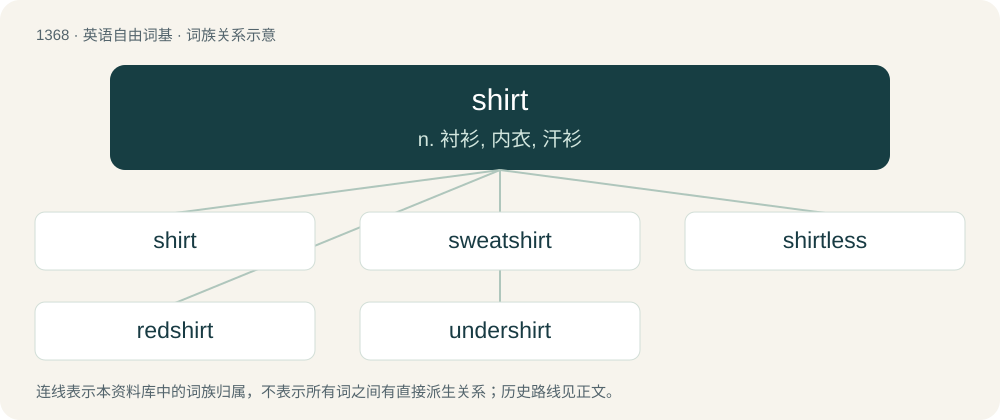

# 1458 · shirt — n. 衬衫, 内衣, 汗衫

[总目录](../00_总目录_按常用程度.md)

**类型**：英语自由词基　｜　**来源语言**：见词源记录

## 核心含义与来源

- 核心含义：n. 衬衫, 内衣, 汗衫
- 英文含义：An article of clothing that is worn on the upper part of the body, often with sleeves that cover some or all of the arms.
- 词形：shirt

**多个词源／构词路径**：同一拼写可能有不同来源；以下按词性和含义分别列出。

**来源记录 1**（名词；An article of clothing that is worn on the upper part of the body, often with sleeves that cover some or all of the arms.）

From Middle English schirt, schirte, schuirte, schyrtte, seorte, shearte, shert, shirt, sseorte, from Old English sċyrte (“a short garment; skirt; kirtle”), from Proto-West Germanic \*skurtijā, from Proto-Germanic \*skurtijǭ (“a short garment, skirt, apron”), from \*skurtaz (“short”), from \*skertaną (“to cut off”), from Proto-Indo-European \*(s)ker- (“to cut off; to divide”). Doublet of skirt. Cognates Cognate with Yola shoorth, skoorth (“shirt”), North Frisian Sjürt (“shirt”), Saterland Frisian Schoarte (“apron”), Dutch schort (“apron”), German Schürze (“apron”), Danish, Norwegian Bokmål, and Norwegian Nynorsk skjorte (“shirt”), Faroese skjúrta (“shirt”), Icelandic skyrta (“shirt”), Swedish skjorta (“shirt”), Irish sciorta (“skirt; strip”), Welsh sgert (“skirt”); also Irish curach, currach (“coracle, currach”), Welsh corwg (“coracle”), Latin carō (“flesh; pulp of a fruit; soft part of a precious stone”), Umbrian 𐌊𐌀𐌓𐌖 (karu, “part”), Ancient Greek κείρω (keírō, “to shave; to waste; to consume; to cut short”), Albanian shqerr (“to tear; to scratch”), Latvian šķērst (“cut dead animal or human so as to expose internal organs”), Lithuanian sker̃sti (“to slaughter; to massacre; to cut”), Belarusian кара́ (kará, “bark; crust”), Bulgarian, Carpathian Rusyn, Macedonian, Russian, and Ukrainian кора́ (korá, “bark”), Czech kůra (“bark( crust; cortex; rind”), Kashubian kóra (“bark; crust”), Lower Sorbian škóra (“bark; crust”), Polish kora (“bark; crust; cortex”), Serbo-Croatian ко̏ра, kȍra (“bark; crust”), Slovak kôra (“bark; crust”), Upper Sorbian skora (“bark; crust”), Armenian քերել (kʻerel, “to scrape, scrub”), Central Kurdish چەرم (çerm, “skin”), Northern Kurdish çerm (“skin”), Ossetian царм (carm, “skin”), Persian چرم (čarm, “leather”), Hittite 𒅗𒊑𒄑𒍣 (kariezzi, “to cover”), Kamkata-viri čom, čum (“skin; hide”), Sanskrit चर्मन् (carman, “skin; pelt”). Doublet of skirt via Old Norse; further related to short.

**来源记录 2**（动词；To cover or clothe with a shirt, or as if with a shirt.）

From Middle English schirten, from the noun (see above).

## 词族图

## 单词速览（常用到不常用）

| 单词 | 音标 | 释义 |
|---|---|---|
| [shirt](#w-1) | 英 /ʃɜːt/；美 /ʃɜɹt/ | n. 衬衫, 内衣, 汗衫 |
| [sweatshirt](#w-2) | /ˈswɛtʃəːt/ | n. 园领长袖运动衫 |
| [shirtless](#w-3) | 英 /ˈʃɜːtləs/；美 /ˈʃɝtləs/ | a. 赤膊的；无上装的 |
| [redshirt](#w-4) | 英 /ˈɹɛd.ʃəː(ɹ)t/ | \[体\]大学生选手 |
| [undershirt](#w-5) | /ˈʌndəʃəːt/ | n. 汗衫 |

## 逐词详解

### 1. shirt

**词性**：名词　｜　**音标**：英 /ʃɜːt/；美 /ʃɜɹt/

**中文释义**：n. 衬衫, 内衣, 汗衫

**英文义项**：An article of clothing that is worn on the upper part of the body, often with sleeves that cover some or all of the arms. / An interior lining in a blast furnace.

**词源与演化**：

From Middle English schirt, schirte, schuirte, schyrtte, seorte, shearte, shert, shirt, sseorte, from Old English sċyrte (“a short garment; skirt; kirtle”), from Proto-West Germanic \*skurtijā, from Proto-Germanic \*skurtijǭ (“a short garment, skirt, apron”), from \*skurtaz (“short”), from \*skertaną (“to cut off”), from Proto-Indo-European \*(s)ker- (“to cut off; to divide”). Doublet of skirt. Cognates Cognate with Yola shoorth, skoorth (“shirt”), North Frisian Sjürt (“shirt”), Saterland Frisian Schoarte (“apron”), Dutch schort (“apron”), German Schürze (“apron”), Danish, Norwegian Bokmål, and Norwegian Nynorsk skjorte (“shirt”), Faroese skjúrta (“shirt”), Icelandic skyrta (“shirt”), Swedish skjorta (“shirt”), Irish sciorta (“skirt; strip”), Welsh sgert (“skirt”); also Irish curach, currach (“coracle, currach”), Welsh corwg (“coracle”), Latin carō (“flesh; pulp of a fruit; soft part of a precious stone”), Umbrian 𐌊𐌀𐌓𐌖 (karu, “part”), Ancient Greek κείρω (keírō, “to shave; to waste; to consume; to cut short”), Albanian shqerr (“to tear; to scratch”), Latvian šķērst (“cut dead animal or human so as to expose internal organs”), Lithuanian sker̃sti (“to slaughter; to massacre; to cut”), Belarusian кара́ (kará, “bark; crust”), Bulgarian, Carpathian Rusyn, Macedonian, Russian, and Ukrainian кора́ (korá, “bark”), Czech kůra (“bark( crust; cortex; rind”), Kashubian kóra (“bark; crust”), Lower Sorbian škóra (“bark; crust”), Polish kora (“bark; crust; cortex”), Serbo-Croatian ко̏ра, kȍra (“bark; crust”), Slovak kôra (“bark; crust”), Upper Sorbian skora (“bark; crust”), Armenian քերել (kʻerel, “to scrape, scrub”), Central Kurdish چەرم (çerm, “skin”), Northern Kurdish çerm (“skin”), Ossetian царм (carm, “skin”), Persian چرم (čarm, “leather”), Hittite 𒅗𒊑𒄑𒍣 (kariezzi, “to cover”), Kamkata-viri čom, čum (“skin; hide”), Sanskrit चर्मन् (carman, “skin; pelt”). Doublet of skirt via Old Norse; further related to short.

**例句**：

> He went to the mall to find a decent shirt for his interview.

该用例对应义项：An article of clothing that is worn on the upper part of the body, often with sleeves that cover some or all of the arms.

### 2. sweatshirt

**词性**：名词　｜　**音标**：/ˈswɛtʃəːt/

**中文释义**：n. 园领长袖运动衫

**英文义项**：A loose shirt, usually made of a knit fleece, for athletic wear and now often used as casual apparel. / A shirt worn against the skin, usually under other clothing, to absorb sweat.

**构词拆分**：sweat + shirt

**词源与演化**：

From sweat + shirt.

**例句**：

> The suspect was last seen wearing blue jeans and an orange sweatshirt.

### 3. shirtless

**词性**：形容词　｜　**音标**：英 /ˈʃɜːtləs/；美 /ˈʃɝtləs/

**中文释义**：a. 赤膊的；无上装的

**英文义项**：Without a shirt. / Not wearing a shirt; having a bare torso, barechested.

**构词拆分**：shirt + -less

**词源与演化**：

From shirt + -less.

**用法示例／搭配（非完整句）**：

> a shirtless wardrobe

该用例对应义项：Without a shirt.

### 4. redshirt

**词性**：名词　｜　**音标**：英 /ˈɹɛd.ʃəː(ɹ)t/

**中文释义**：\[体\]大学生选手

**英文义项**：A college athlete who spends a year not participating in official athletic activities, but does not lose his or her eligibility to participate in following years. / An unimportant character introduced only to be killed in order to underscore the peril to the important characters; an expendable character.

**构词拆分**：red + shirt

**词源与演化**：

Calque of Italian camicia rossa, equivalent to red + shirt. In later senses with reference to the uniforms or outfits worn by such people. The fandom slang sense emerged from the tendency of red-uniformed Starfleet officers to die in episodes of Star Trek: The Original Series.

**例句**：

> Sensing danger, Captain Kirk decided to beam down to the surface with Spock, McCoy, and a couple of redshirts.

该用例对应义项：An unimportant character introduced only to be killed in order to underscore the peril to the important characters; an expendable character.

### 5. undershirt

**词性**：名词　｜　**音标**：/ˈʌndəʃəːt/

**中文释义**：n. 汗衫

**英文义项**：An undergarment worn beneath a shirt, often collarless and sleeveless.

**构词拆分**：under- + shirt

**词源与演化**：

From under- + shirt.

**例句**：

> He put on his undershirt inside out.
