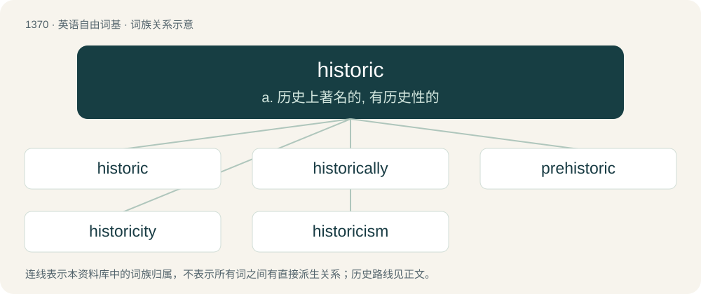

# 1459 · historic — a. 历史上著名的, 有历史性的

[总目录](../00_总目录_按常用程度.md)

**类型**：英语自由词基　｜　**来源语言**：见词源记录

## 核心含义与来源

- 核心含义：a. 历史上著名的, 有历史性的
- 英文含义：Very important; noteworthy: having importance or significance in history.
- 词形：historic

**来源记录 1**（形容词；Very important; noteworthy: having importance or significance in history.）

From Latin historicus (“historical”), from Ancient Greek ἱστορικός (historikós, “exact; historical”). Cognate with French historique. By surface analysis, history + -ic.

## 词族图

## 单词速览（常用到不常用）

| 单词 | 音标 | 释义 |
|---|---|---|
| [historic](#w-1) | 英 /hɪˈstɒɹɪk/；美 /hɪˈstoɹɪk/ | a. 历史上著名的, 有历史性的 |
| [historically](#w-2) | 英 /hɪˈstɒɹɪkli/；美 /hɪˈstɔɹɪkli/ | adv. 历史上地；从历史观点上说 |
| [prehistoric](#w-3) | 美 /ˌpɹiː.hɪsˈtoɹ.ɪk/ | a. 历史以前的, 史前的 |
| [historicity](#w-4) | /ˌhɪstəˈɹɪsɪti/ | n. 史实性, 实际存在 |
| [historicism](#w-5) | /hisˈtɔːrisizəm/ | n. 历史相对论 |

## 逐词详解

### 1. historic

**词性**：形容词　｜　**音标**：英 /hɪˈstɒɹɪk/；美 /hɪˈstoɹɪk/

**中文释义**：a. 历史上著名的, 有历史性的

**英文义项**：Very important; noteworthy: having importance or significance in history. / Old-fashioned, untouched by modernity.

**词源与演化**：

From Latin historicus (“historical”), from Ancient Greek ἱστορικός (historikós, “exact; historical”). Cognate with French historique. By surface analysis, history + -ic.

**例句**：

> The historical works of Lord Macaulay and Edward Gibbon are in and of themselves historic.

该用例对应义项：Very important; noteworthy: having importance or significance in history.

### 2. historically

**词性**：副词　｜　**音标**：英 /hɪˈstɒɹɪkli/；美 /hɪˈstɔɹɪkli/

**中文释义**：adv. 历史上地；从历史观点上说

**英文义项**：In a historic manner; with reference to history or the historical record. / According to history: formerly, in the past, traditionally.

**构词拆分**：historical + -ly；historic + -ally

**词源与演化**：

From historical + -ly or historic + -ally.

**例句**：

> Historically speaking, this company has always collected payment before starting work.

该用例对应义项：In a historic manner; with reference to history or the historical record.

### 3. prehistoric

**词性**：形容词　｜　**音标**：美 /ˌpɹiː.hɪsˈtoɹ.ɪk/

**中文释义**：a. 历史以前的, 史前的

**英文义项**：Of or relating to the epoch before written record. / Ancient; very old, outdated, etc.

**构词拆分**：pre- + historic；pre- (“before”) + historic

**词源与演化**：

From pre- (“before”) + historic, q.v., similar to slightly earlier ante-historic.

**例句**：

> In this part of the Algerian Sahara, you can see prehistoric petroglyphs.

### 4. historicity

**词性**：名词　｜　**音标**：/ˌhɪstəˈɹɪsɪti/

**中文释义**：n. 史实性, 实际存在

**英文义项**：Historical quality or authenticity based on fact. / The characteristic of having appeared or developed in history, as opposed to being natural or universal.

**构词拆分**：Latin historicus + -ity；historic + -ity

**词源与演化**：

Probably from French historicité, or from Latin historicus + -ity. Equivalent to historic + -ity.

**例句**：

> This particular school places great emphasis on the historicity of ideas, practices, or institutions.

该用例对应义项：The characteristic of having appeared or developed in history, as opposed to being natural or universal.

### 5. historicism

**词性**：名词　｜　**音标**：/hisˈtɔːrisizəm/

**中文释义**：n. 历史相对论

**英文义项**：A theory that events are influenced by historical conditions, rather than by people. / The use of historical styles in contemporary art.

**构词拆分**：historic + -ism

**词源与演化**：

Calque of German Historismus, historic + -ism.
