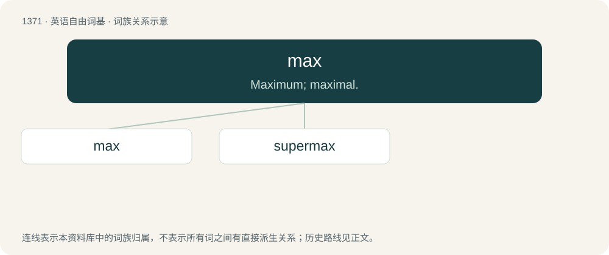

# 1460 · max — Maximum; maximal.

[总目录](../00_总目录_按常用程度.md)

**类型**：英语自由词基　｜　**来源语言**：见词源记录

## 核心含义与来源

- 核心含义：Maximum; maximal.
- 英文含义：Maximum; maximal.
- 词形：max

**来源记录 1**（形容词；Maximum; maximal.）

Abbreviation of maximum.

## 词族图

## 单词速览（常用到不常用）

| 单词 | 音标 | 释义 |
|---|---|---|
| [max](#w-1) | /mæks/ | 【英文】An extreme, a great extent. |
| [supermax](#w-2) |  | n. 超最大值；速伯玛公司（经销及出口胶乳手套的公司） |

## 逐词详解

### 1. max

**词性**：名词　｜　**音标**：/mæks/

**英文义项**：An extreme, a great extent.

**词源与演化**：

Abbreviation of maximum.

**例句**：

> He pushed himself to the max.

该用例对应义项：An extreme, a great extent.

### 2. supermax

**词性**：名词

**中文释义**：n. 超最大值；速伯玛公司（经销及出口胶乳手套的公司）

**英文义项**：A prison with the highest possible level of security.

**构词拆分**：super- + max

**词源与演化**：

From super- + max (as in maximum security prison).
