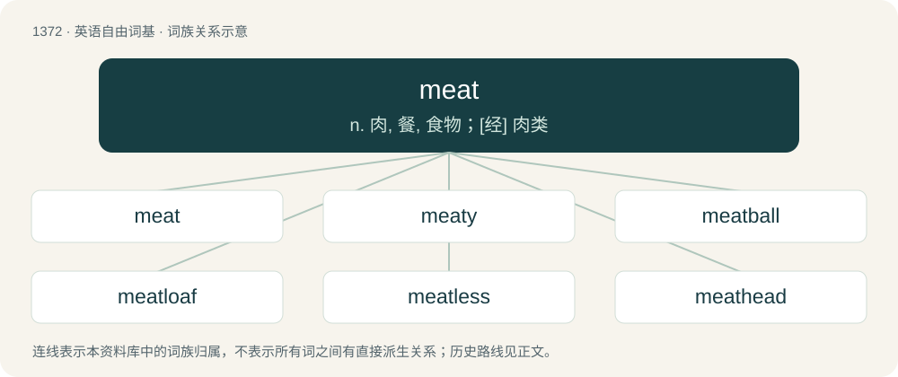

# 1461 · meat — n. 肉, 餐, 食物；\[经\] 肉类

[总目录](../00_总目录_按常用程度.md)

**类型**：英语自由词基　｜　**来源语言**：见词源记录

## 核心含义与来源

- 核心含义：n. 肉, 餐, 食物；\[经\] 肉类
- 英文含义：The flesh (muscle tissue) of a killed animal used as food.
- 词形：meat

**来源记录 1**（名词；The flesh (muscle tissue) of a killed animal used as food.）

Inherited from Middle English mete (“food”), from Old English mete (“food”), from Proto-West Germanic \*mati (“food”), from Proto-Germanic \*matiz (“food”), from Proto-Indo-European \*meh₂d- (“to be wet; grease, fat”). Cognates Cognate with North Frisian Miit (“meat”), Danish mad (“food”), Faroese and Icelandic matur (“food, meal”), Norn mader (“food”), Norwegian Bokmål, Norwegian Nynorsk, and Swedish mat (“food”), Gothic 𐌼𐌰𐍄𐍃 (mats, “food”). A -ja- derivation from the same base is found in Middle Dutch and Middle Low German met (“lean pork”), from which Dutch met (“minced pork”) and German Mett (“minced meat”) derive, respectively. Compare also Old Irish mess (“animal feed”) and Welsh mes (“acorns”), English mast (“fodder for swine and other animals”), which are probably from the same root.

## 词族图

## 单词速览（常用到不常用）

| 单词 | 音标 | 释义 |
|---|---|---|
| [meat](#w-1) | 美 /mit/；/miːt/ | n. 肉, 餐, 食物；\[经\] 肉类 |
| [meaty](#w-2) | /ˈmiːti/ | a. 肉的, 似肉的, 多肉的 |
| [meatball](#w-3) | /ˈmiːtbɒːl/ | n. 肉团, 愚蠢, 飞机降落目标 |
| [meatloaf](#w-4) | 英 /ˈmiːt.ləʊf/；美 /ˈmit.loʊf/ | n. 烘肉卷 |
| [meatless](#w-5) | /ˈmiːtləs/ | a. 无肉的, 无内容的 |
| [meathead](#w-6) | 美 /ˈmitˌhɛd/ | n. 笨蛋 |
| [meatpacking](#w-7) | /ˈmiːt,pækiŋ/ | n. 肉类加工业 |
| [mincemeat](#w-8) | 美 /ˈmɪnsˌmit/ | n. 剁碎的肉, 肉馅, 百果馅 |

## 逐词详解

### 1. meat

**词性**：名词　｜　**音标**：美 /mit/；/miːt/

**中文释义**：n. 肉, 餐, 食物；\[经\] 肉类

**英文义项**：The flesh (muscle tissue) of a killed animal used as food. / A food designed to replicate its taste and texture (such as plant-based meat).

**词源与演化**：

Inherited from Middle English mete (“food”), from Old English mete (“food”), from Proto-West Germanic \*mati (“food”), from Proto-Germanic \*matiz (“food”), from Proto-Indo-European \*meh₂d- (“to be wet; grease, fat”). Cognates Cognate with North Frisian Miit (“meat”), Danish mad (“food”), Faroese and Icelandic matur (“food, meal”), Norn mader (“food”), Norwegian Bokmål, Norwegian Nynorsk, and Swedish mat (“food”), Gothic 𐌼𐌰𐍄𐍃 (mats, “food”). A -ja- derivation from the same base is found in Middle Dutch and Middle Low German met (“lean pork”), from which Dutch met (“minced pork”) and German Mett (“minced meat”) derive, respectively. Compare also Old Irish mess (“animal feed”) and Welsh mes (“acorns”), English mast (“fodder for swine and other animals”), which are probably from the same root.

**例句**：

> The homesteading teenager shot a deer to supply his family with wild meat for the winter.

该用例对应义项：The flesh (muscle tissue) of a killed animal used as food.

### 2. meaty

**词性**：形容词　｜　**音标**：/ˈmiːti/

**中文释义**：a. 肉的, 似肉的, 多肉的

**英文义项**：Of, relating to, or containing meat. / Resembling meat in flavour, smell, etc.

**构词拆分**：meat + -y

**词源与演化**：

From meat + -y.

**例句**：

> He scored a meaty role in the film, with plenty of action and dialogue.

该用例对应义项：Substantial.

### 3. meatball

**词性**：名词　｜　**音标**：/ˈmiːtbɒːl/

**中文释义**：n. 肉团, 愚蠢, 飞机降落目标

**英文义项**：A ball of minced or ground meat, seasoned and cooked. / A stupid person; a meathead.

**构词拆分**：meat + ball

**词源与演化**：

From meat + ball.

**例句**：

> Meatballs were on the menu for lunch.

该用例对应义项：A ball of minced or ground meat, seasoned and cooked.

### 4. meatloaf

**词性**：名词　｜　**音标**：英 /ˈmiːt.ləʊf/；美 /ˈmit.loʊf/

**中文释义**：n. 烘肉卷

**英文义项**：A dish of ground meat (usually made from ground beef, although lamb, pork, veal, venison, poultry and seafood are also used) formed into a loaf shape, mixed with egg and breadcrumbs, then baked or smoked, and usually served in slices.

**构词拆分**：meat + loaf

**词源与演化**：

Compound of meat + loaf.

**例句**：

> For his meatloaf, he mixed the meat, eggs, chopped onion, breadcrumbs, tomato sauce and a can of beer according to the instructions, then diced in an apple he had lying around.

该用例对应义项：A dish of ground meat (usually made from ground beef, although lamb, pork, veal, venison, poultry and seafood are also used) formed into a loaf shape, mixed with egg and breadcrumbs, then baked or smoked, and usually served in slices.

### 5. meatless

**词性**：形容词　｜　**音标**：/ˈmiːtləs/

**中文释义**：a. 无肉的, 无内容的

**英文义项**：Without meat.

**构词拆分**：meat + -less

**词源与演化**：

From Middle English meteles, from Old English metelēas (“foodless”), equivalent to meat + -less.

**例句**：

> Tom was the only one of us who chose a meatless meal.

### 6. meathead

**词性**：名词　｜　**音标**：美 /ˈmitˌhɛd/

**中文释义**：n. 笨蛋

**英文义项**：An ungainly, dull, or stupid person; someone who is lazy, disrespectful, and/or whose beliefs and philosophies clash with those of another. / A large, muscular, stupid man, especially an athlete.

**构词拆分**：meat + head

**词源与演化**：

From meat + head. The term meathead is often said to come from the popular sitcom All In The Family (first aired 1971), wherein main character Archie Bunker uses the nickname to address his son-in-law Michael Stivic, but there are numerous earlier attestations of the word, some as early as 1863.

**例句**：

> Gary was a hulking meathead who, when he wasn't playing football, was either hunting, fishing or getting drunk and rowdy in some topless bar.

该用例对应义项：A large, muscular, stupid man, especially an athlete.

### 7. meatpacking

**词性**：名词　｜　**音标**：/ˈmiːt,pækiŋ/

**中文释义**：n. 肉类加工业

**英文义项**：The slaughter and further processing of animals for meat.

**构词拆分**：meat + packing

**词源与演化**：

From meat + packing.

### 8. mincemeat

**词性**：名词　｜　**音标**：美 /ˈmɪnsˌmit/

**中文释义**：n. 剁碎的肉, 肉馅, 百果馅

**英文义项**：A mixture of fruit, spices and suet used as a filling for mince pies. / Minced meat, mince.

**构词拆分**：mince + meat

**词源与演化**：

An alteration of earlier minced meat; equivalent to mince + meat.

**例句**：

> Mickey Conners made mincemeat of his opponent in the ring.
