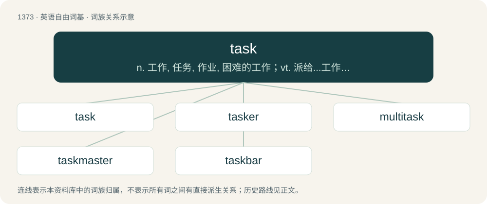

# 1462 · task — n. 工作, 任务, 作业, 困难的工作；vt. 派给...工作, 使辛劳；\[计\] 任务

[总目录](../00_总目录_按常用程度.md)

**类型**：英语自由词基　｜　**来源语言**：见词源记录

## 核心含义与来源

- 核心含义：n. 工作, 任务, 作业, 困难的工作；vt. 派给...工作, 使辛劳；\[计\] 任务
- 英文含义：A piece of work done as part of one’s duties.
- 词形：task

**来源记录 1**（名词；A piece of work done as part of one’s duties.）

From Middle English taske (“task, tax”), from Old Northern French tasque, (compare Old French variant tasche), from Medieval Latin tasca, alteration of taxa, from Latin taxō (“to censure; to charge”). Doublet of tax.

## 词族图

## 单词速览（常用到不常用）

| 单词 | 音标 | 释义 |
|---|---|---|
| [task](#w-1) | 英 /tɑːsk/；美 /tæsk/ | n. 工作, 任务, 作业, 困难的工作；vt. 派给...工作, 使辛劳；\[计\] 任务 |
| [tasker](#w-2) |  | \[人名\] \[英格兰人姓氏\] 塔斯克职业名称, 计件工, 来源于盎格鲁诺曼底法语, 含义是“任务”(task)+er; \[地名\] \[尼日尔\] 塔斯凯尔 |
| [multitask](#w-3) | /ˈmʌlti.tɑːsk/ | n. 多重任务；vt. 使处理多重任务 |
| [taskmaster](#w-4) | 美 /ˈtæskˌmæstɚ/ | n. 工头 |
| [taskbar](#w-5) | 美 /ˈtæskˌbɑɹ/ | 任务栏, 任务条 |

## 逐词详解

### 1. task

**词性**：名词　｜　**音标**：英 /tɑːsk/；美 /tæsk/

**中文释义**：n. 工作, 任务, 作业, 困难的工作；vt. 派给...工作, 使辛劳；\[计\] 任务

**英文义项**：A piece of work done as part of one’s duties. / A state of diligence in work on a task.

**词源与演化**：

From Middle English taske (“task, tax”), from Old Northern French tasque, (compare Old French variant tasche), from Medieval Latin tasca, alteration of taxa, from Latin taxō (“to censure; to charge”). Doublet of tax.

**例句**：

> I'm currently working on the task she gave me, alphabetizing all of those print files.

该用例对应义项：A difficult or tedious undertaking; a substantial project.

### 2. tasker

**词性**：名词

**中文释义**：\[人名\] \[英格兰人姓氏\] 塔斯克职业名称, 计件工, 来源于盎格鲁诺曼底法语, 含义是“任务”(task)+er; \[地名\] \[尼日尔\] 塔斯凯尔

**英文义项**：One who imposes a task. / One who performs a task, such as a day-labourer.

**构词拆分**：task + -er

**词源与演化**：

From task + -er.

### 3. multitask

**词性**：形容词　｜　**音标**：/ˈmʌlti.tɑːsk/

**中文释义**：n. 多重任务；vt. 使处理多重任务

**英文义项**：Handling or involving multiple tasks at once.

**构词拆分**：multi- + task

**词源与演化**：

From multi- + task. The adjectival sense in computing first appears c. 1965 in the publications of B.I. Witt. The verbal sense first appears c. 1986 in the Daily Telegraph.

**例句**：

> I always have to multitask here.

### 4. taskmaster

**词性**：名词　｜　**音标**：美 /ˈtæskˌmæstɚ/

**中文释义**：n. 工头

**英文义项**：Someone who supervises workers, especially one who imposes hard or burdensome work. / A source of hard work or responsibility.

**构词拆分**：task + master

**词源与演化**：

From task + master.

### 5. taskbar

**词性**：名词　｜　**音标**：美 /ˈtæskˌbɑɹ/

**中文释义**：任务栏, 任务条

**英文义项**：A bar on a computer desktop used to launch and monitor applications.

**构词拆分**：task + bar

**词源与演化**：

From task + bar.

**例句**：

> Cortana appears next to the Start button on the taskbar.
