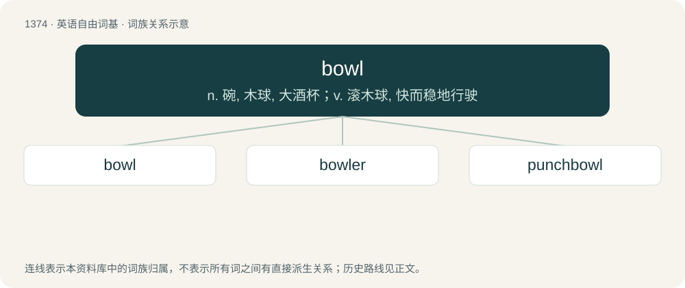

# 1463 · bowl — n. 碗, 木球, 大酒杯；v. 滚木球, 快而稳地行驶

[总目录](../00_总目录_按常用程度.md)

**类型**：英语自由词基　｜　**来源语言**：见词源记录

## 核心含义与来源

- 核心含义：n. 碗, 木球, 大酒杯；v. 滚木球, 快而稳地行驶
- 英文含义：As much as is held by a bowl.
- 词形：bowl

**多个词源／构词路径**：同一拼写可能有不同来源；以下按词性和含义分别列出。

**来源记录 1**（名词；As much as is held by a bowl.）

From Middle English bolle, from Old English bolla, bolle (“bowl, cup, pot, beaker, measure”), from Proto-West Germanic \*bollā, from Proto-Germanic \*bullǭ (“ball, round vessel, bowl”). Cognate with North Frisian bol (“bun, bread roll”), Middle Low German bolle, bole (“round object”), Dutch bol (“ball, sphere, scoop, dot”), German Bolle (“bulb”), Danish bolle (“bowl, bread roll”), Icelandic bolli (“cup”). Doublet of boule and pulla.

**来源记录 2**（名词；The ball rolled by players in the game of lawn bowls.）

From Middle English bowle, boule, from Old French boule (“ball”), from Latin bulla (“bubble, stud, round object”). Doublet of poll.

## 词族图

## 单词速览（常用到不常用）

| 单词 | 音标 | 释义 |
|---|---|---|
| [bowl](#w-1) | 英 /bəʊl/；美 /boʊl/ | n. 碗, 木球, 大酒杯；v. 滚木球, 快而稳地行驶 |
| [bowler](#w-2) | 英 /ˈbəʊ.lə/；美 /ˈboʊ.lɚ/ | n. 玩滚球的人, 玩球戏的人, 投球手 |
| [punchbowl](#w-3) | 美 /ˈpʌnt͡ʃˌboʊl/ | 潘趣酒碗 |

## 逐词详解

### 1. bowl

**词性**：名词　｜　**音标**：英 /bəʊl/；美 /boʊl/

**中文释义**：n. 碗, 木球, 大酒杯；v. 滚木球, 快而稳地行驶

**英文义项**：As much as is held by a bowl. / A dish comprising a mix of different foods served in a bowl, usually named after the base ingredient at the bottom or after a different dish that it simulates.

**词源与演化**：

From Middle English bolle, from Old English bolla, bolle (“bowl, cup, pot, beaker, measure”), from Proto-West Germanic \*bollā, from Proto-Germanic \*bullǭ (“ball, round vessel, bowl”). Cognate with North Frisian bol (“bun, bread roll”), Middle Low German bolle, bole (“round object”), Dutch bol (“ball, sphere, scoop, dot”), German Bolle (“bulb”), Danish bolle (“bowl, bread roll”), Icelandic bolli (“cup”). Doublet of boule and pulla.

**例句**：

> You can’t have any more soup – you’ve had three bowls already.

该用例对应义项：As much as is held by a bowl.

### 2. bowler

**词性**：名词　｜　**音标**：英 /ˈbəʊ.lə/；美 /ˈboʊ.lɚ/

**中文释义**：n. 玩滚球的人, 玩球戏的人, 投球手

**英文义项**：One who engages in the sport of bowling. / The player currently bowling.

**构词拆分**：bowl + -er

**词源与演化**：

From bowl + -er.

**例句**：

> Guess what they got! A bowler hat for him and leather boots for her!

### 3. punchbowl

**词性**：名词　｜　**音标**：美 /ˈpʌnt͡ʃˌboʊl/

**中文释义**：潘趣酒碗

**英文义项**：A large bowl used for making or serving punch (the beverage).

**构词拆分**：punch + bowl

**词源与演化**：

From punch + bowl.
