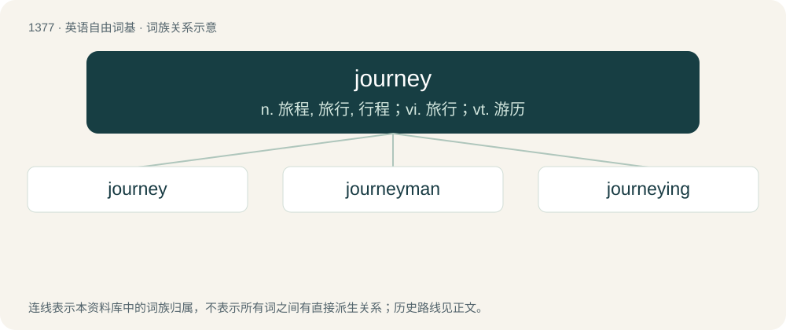

# 1465 · journey — n. 旅程, 旅行, 行程；vi. 旅行；vt. 游历

[总目录](../00_总目录_按常用程度.md)

**类型**：英语自由词基　｜　**来源语言**：见词源记录

## 核心含义与来源

- 核心含义：n. 旅程, 旅行, 行程；vi. 旅行；vt. 游历
- 英文含义：A set amount of travelling, seen as a single unit; a discrete trip, a voyage.
- 词形：journey

**多个词源／构词路径**：同一拼写可能有不同来源；以下按词性和含义分别列出。

**来源记录 1**（名词；A set amount of travelling, seen as a single unit; a discrete trip, a voyage.）

From Middle English journe, from Old French jornee, from Vulgar Latin \*diurnāta, from Late Latin diurnum, from Latin diurnus, from diēs (“day”). Displaced native Old English fær and Old English faru.

**来源记录 2**（名词；The total time spent melting and working one piece.）

Reborrowing from French journée (day's activities), originally an unadapted borrowing from French journée, from Old French jornee, from Vulgar Latin \*diurnāta.

## 词族图

## 单词速览（常用到不常用）

| 单词 | 音标 | 释义 |
|---|---|---|
| [journey](#w-1) | 英 /ˈd͡ʒɜːni/；美 /ˈd͡ʒɝni/ | n. 旅程, 旅行, 行程；vi. 旅行；vt. 游历 |
| [journeyman](#w-2) | 英 /ˈd͡ʒɜːnimən/；美 /ˈd͡ʒɝnimən/ | n. 雇工, 熟练工人, 短工 |
| [journeying](#w-3) |  | vi. 旅行, 出游（journey的现在分词形式） |

## 逐词详解

### 1. journey

**词性**：名词　｜　**音标**：英 /ˈd͡ʒɜːni/；美 /ˈd͡ʒɝni/

**中文释义**：n. 旅程, 旅行, 行程；vi. 旅行；vt. 游历

**英文义项**：A set amount of travelling, seen as a single unit; a discrete trip, a voyage. / Any process or progression likened to a journey, especially one that involves difficulties or personal development.

**词源与演化**：

From Middle English journe, from Old French jornee, from Vulgar Latin \*diurnāta, from Late Latin diurnum, from Latin diurnus, from diēs (“day”). Displaced native Old English fær and Old English faru.

**例句**：

> We need to map out the user journey and make it more efficient.

该用例对应义项：The progress of a customer through a system, often a computer system.

### 2. journeyman

**词性**：名词　｜　**音标**：英 /ˈd͡ʒɜːnimən/；美 /ˈd͡ʒɝnimən/

**中文释义**：n. 雇工, 熟练工人, 短工

**英文义项**：A tradesman who has completed an apprenticeship or equivalent educational path in a trade. / A competent but undistinguished tradesman, especially one who works, and is paid by the day.

**构词拆分**：journey + -man

**词源与演化**：

From Middle English jorneman; from journe (from Old French jornee (“a day's work, a journey”)) and mon; equivalent to journey + -man.

**例句**：

> Everyone must follow safety guidelines whether you're an apprentice, journeyman, or even master electrician.

该用例对应义项：A tradesman who has completed an apprenticeship or equivalent educational path in a trade.

### 3. journeying

**词性**：名词

**中文释义**：vi. 旅行, 出游（journey的现在分词形式）

**英文义项**：travel, travelling

**构词拆分**：journey + -ing

**词源与演化**：

From Middle English journeyinge; equivalent to journey + -ing.

**例句**：

> He is always writing about journeying to other planets.
