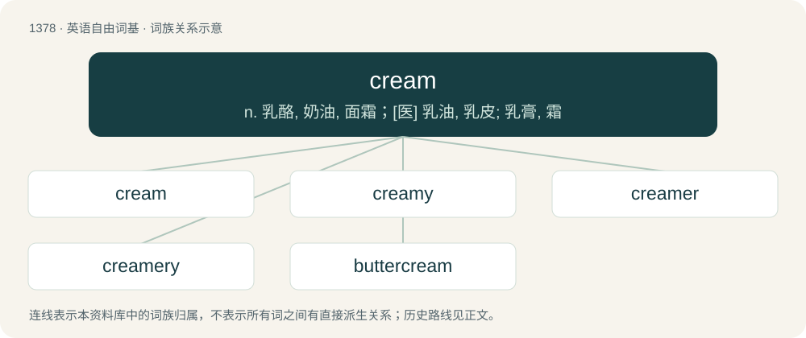

# 1466 · cream — n. 乳酪, 奶油, 面霜；\[医\] 乳油, 乳皮; 乳膏, 霜

[总目录](../00_总目录_按常用程度.md)

**类型**：英语自由词基　｜　**来源语言**：见词源记录

## 核心含义与来源

- 核心含义：n. 乳酪, 奶油, 面霜；\[医\] 乳油, 乳皮; 乳膏, 霜
- 英文含义：The butterfat or milkfat part of milk which rises to the top; this part when separated from the remainder.
- 词形：cream

**来源记录 1**（名词；The butterfat or milkfat part of milk which rises to the top; this part when separated from the remainder.）

From Middle English creime, creme, from Old French creme, cresme, blend of Late Latin chrisma (“ointment”) (from Ancient Greek χρῖσμα (khrîsma, “unguent”)), and Late Latin crāmum (“cream”), from Gaulish \*crama (compare Welsh cramen (“scab, skin”), Breton crammen), from Proto-Indo-European \*(s)krama- (compare Middle Irish screm (“surface, skin”), Dutch schram (“abrasion”), Lithuanian kramas (“scurf”)). Doublet of crema and crème. Displaced native Old English rēam (“cream”) (&gt; modern ream). Figurative sense of "most excellent element or part" appears from 1581. Verb meaning "to beat, thrash, wreck" is 1929, U.S. colloquial. The U.S. standard of identity is from 21 CFR 131.3(a).

## 词族图

## 单词速览（常用到不常用）

| 单词 | 音标 | 释义 |
|---|---|---|
| [cream](#w-1) | 英 /kɹiːm/；美 /kɹim/ | n. 乳酪, 奶油, 面霜；\[医\] 乳油, 乳皮; 乳膏, 霜 |
| [creamy](#w-2) | /ˈkɹiːmi/ | a. 含乳脂的, 乳脂状的, 奶油色的；\[建\] 含乳油的, 似乳油的 |
| [creamer](#w-3) | 英 /ˈkɹiː.mə(ɹ)/；美 /ˈkɹiː.mɚ/ | n. 分离奶油的器具, 盛奶油的器皿, 撇奶油用的薄盆子, 做奶油的人 |
| [creamery](#w-4) | /ˈkriːməri/ | n. 乳品厂, 乳制品商店；\[建\] 乳油制造厂 |
| [buttercream](#w-5) | /ˈbʌtəkriːm/ | n. 甜奶油酱 |

## 逐词详解

### 1. cream

**词性**：名词　｜　**音标**：英 /kɹiːm/；美 /kɹim/

**中文释义**：n. 乳酪, 奶油, 面霜；\[医\] 乳油, 乳皮; 乳膏, 霜

**英文义项**：The butterfat or milkfat part of milk which rises to the top; this part when separated from the remainder. / The liquid separated from milk, possibly with certain other milk products added, and with at least eighteen percent of it milkfat.

**词源与演化**：

From Middle English creime, creme, from Old French creme, cresme, blend of Late Latin chrisma (“ointment”) (from Ancient Greek χρῖσμα (khrîsma, “unguent”)), and Late Latin crāmum (“cream”), from Gaulish \*crama (compare Welsh cramen (“scab, skin”), Breton crammen), from Proto-Indo-European \*(s)krama- (compare Middle Irish screm (“surface, skin”), Dutch schram (“abrasion”), Lithuanian kramas (“scurf”)). Doublet of crema and crème. Displaced native Old English rēam (“cream”) (&gt; modern ream). Figurative sense of "most excellent element or part" appears from 1581. Verb meaning "to beat, thrash, wreck" is 1929, U.S. colloquial. The U.S. standard of identity is from 21 CFR 131.3(a).

**例句**：

> You look really sunburnt; you should apply some cream.

该用例对应义项：A viscous aqueous oil or fat emulsion with a medicament added, used to apply that medicament to the skin. (compare with ointment)

### 2. creamy

**词性**：形容词　｜　**音标**：/ˈkɹiːmi/

**中文释义**：a. 含乳脂的, 乳脂状的, 奶油色的；\[建\] 含乳油的, 似乳油的

**英文义项**：Containing cream. / Of food or drink, having the rich taste or thick, smooth texture of cream, whether or not it actually contains cream.

**构词拆分**：cream + -y

**词源与演化**：

From Middle English cremy, equivalent to cream + -y. Piecewise doublet of cremey.

**用法示例／搭配（非完整句）**：

> creamy chocolate

该用例对应义项：Of food or drink, having the rich taste or thick, smooth texture of cream, whether or not it actually contains cream.

### 3. creamer

**词性**：名词　｜　**音标**：英 /ˈkɹiː.mə(ɹ)/；美 /ˈkɹiː.mɚ/

**中文释义**：n. 分离奶油的器具, 盛奶油的器皿, 撇奶油用的薄盆子, 做奶油的人

**英文义项**：A jug for holding cream. / A separator for removing cream from milk to leave skimmed milk.

**构词拆分**：cream + -er

**词源与演化**：

From cream + -er.

**用法示例／搭配（非完整句）**：

> nondairy creamer

该用例对应义项：A nondairy product that adds a creamy texture to coffee.

### 4. creamery

**词性**：名词　｜　**音标**：/ˈkriːməri/

**中文释义**：n. 乳品厂, 乳制品商店；\[建\] 乳油制造厂

**英文义项**：A place where dairy products are prepared or sold. / An ice cream parlor.

**构词拆分**：cream + -ery

**词源与演化**：

From French crémerie, reformed as cream + -ery.

### 5. buttercream

**词性**：名词　｜　**音标**：/ˈbʌtəkriːm/

**中文释义**：n. 甜奶油酱

**英文义项**：A type of thick, sweet icing or cake-filling made by creaming butter (or sometimes another fat, such as margarine) with powdered sugar.

**构词拆分**：butter + cream

**词源与演化**：

From butter + cream.

**例句**：

> The pastry chef is decorating a cake with green owls made of buttercream frosting.
