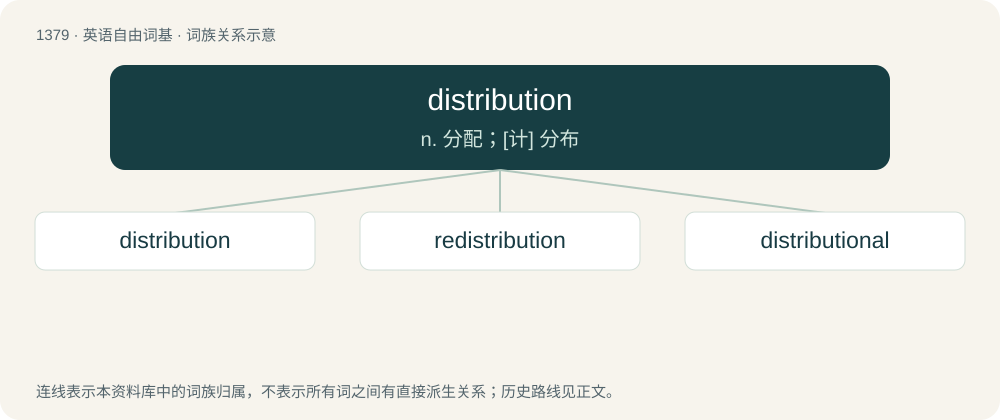

# 1467 · distribution — n. 分配；\[计\] 分布

[总目录](../00_总目录_按常用程度.md)

**类型**：英语自由词基　｜　**来源语言**：见词源记录

## 核心含义与来源

- 核心含义：n. 分配；\[计\] 分布
- 英文含义：An act of distributing or state of being distributed.
- 词形：distribution

**来源记录 1**（名词；An act of distributing or state of being distributed.）

From Old French distribution, from Latin distributio, from distribuere 'to distribute', itself from dis- 'apart' + tribuere 'to' (from tribus). By surface analysis, distribute + -ion.

## 词族图

## 单词速览（常用到不常用）

| 单词 | 音标 | 释义 |
|---|---|---|
| [distribution](#w-1) | 英 /ˌdɪstɹɪˈbjuːʃən/；美 /ˌdɪstɹɪˈbjuʃən/ | n. 分配；\[计\] 分布 |
| [redistribution](#w-2) | /ˌɹiːdɪstɹəˈbjuːʃən/ | n. 重新分配, 再分发；\[计\] 重新分配 |
| [distributional](#w-3) | /ˌdɪs.tɹəˈbjuː.ʃə.nəl/ | \[计\] 分布的 |

## 逐词详解

### 1. distribution

**词性**：名词　｜　**音标**：英 /ˌdɪstɹɪˈbjuːʃən/；美 /ˌdɪstɹɪˈbjuʃən/

**中文释义**：n. 分配；\[计\] 分布

**英文义项**：An act of distributing or state of being distributed. / An apportionment by law (of funds, property).

**词源与演化**：

From Old French distribution, from Latin distributio, from distribuere 'to distribute', itself from dis- 'apart' + tribuere 'to' (from tribus). By surface analysis, distribute + -ion.

**例句**：

> The wealth distribution became extremely skewed in the kleptocracy.

该用例对应义项：The apportionment of income or wealth in a population.

### 2. redistribution

**词性**：名词　｜　**音标**：/ˌɹiːdɪstɹəˈbjuːʃən/

**中文释义**：n. 重新分配, 再分发；\[计\] 重新分配

**英文义项**：The act of changing the distribution of resources. / The further distribution of something received or purchased.

**构词拆分**：re- + distribution

**词源与演化**：

From re- + distribution.

**例句**：

> The redistribution of wealth between the rich and poor has been tried many times.

该用例对应义项：The act of changing the distribution of resources.

### 3. distributional

**词性**：形容词　｜　**音标**：/ˌdɪs.tɹəˈbjuː.ʃə.nəl/

**中文释义**：\[计\] 分布的

**英文义项**：Of or pertaining to distribution / Having an uneven distribution.

**构词拆分**：From distribution + -al.

**词源与演化**：

From distribution + -al.
