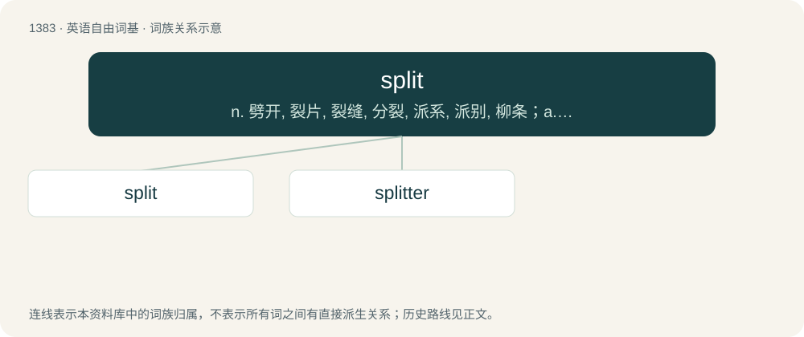

# 1470 · split — n. 劈开, 裂片, 裂缝, 分裂, 派系, 派别, 柳条；a. 劈开的；vi. 分离, 分开, 裂开, 被劈开

[总目录](../00_总目录_按常用程度.md)

**类型**：英语自由词基　｜　**来源语言**：见词源记录

## 核心含义与来源

- 核心含义：n. 劈开, 裂片, 裂缝, 分裂, 派系, 派别, 柳条；a. 劈开的；vi. 分离, 分开, 裂开, 被劈开
- 英文含义：To divide fully or partly along a more or less straight line.
- 词形：split

**来源记录 1**（动词；To divide fully or partly along a more or less straight line.）

Attested since about 1567, from Middle Dutch splitten (“to split”) and/or Middle Low German splitten (“to split”), both ultimately from Proto-West Germanic \*splittjan, an intensive form of Proto-West Germanic \*splītan (“to split”), from Proto-Germanic \*splītaną (whence Danish splitte, Low German splieten, German spleißen), from Proto-Indo-European \*(s)pley- (“to split, splice”). Compare Middle English ysplett (“split”, past participle of splatten (“to split”)), Old English speld (“splinter”), Old High German spaltan (“to split”), Middle Irish slis (“splinter”), Lithuanian spaliai (“flax sheaves”), Czech půl (“half”), Old Church Slavonic рас-плитати (ras-plitati, “to cleave, split”).

## 词族图

## 单词速览（常用到不常用）

| 单词 | 音标 | 释义 |
|---|---|---|
| [split](#w-1) | /splɪt/ | n. 劈开, 裂片, 裂缝, 分裂, 派系, 派别, 柳条；a. 劈开的；vi. 分离, 分开, 裂开, 被劈开 |
| [splitter](#w-2) | 英 /ˈsplɪtə(ɹ)/；美 /ˈsplɪtɚ/ | n. 进行劈(切、割)的人, 劈裂机, 分离机, 分解器；\[化\] 分流器; 导流板; 片皮机 |

## 逐词详解

### 1. split

**词性**：动词　｜　**音标**：/splɪt/

**中文释义**：n. 劈开, 裂片, 裂缝, 分裂, 派系, 派别, 柳条；a. 劈开的；vi. 分离, 分开, 裂开, 被劈开

**英文义项**：To divide fully or partly along a more or less straight line. / Of something solid, particularly wood, to break along the grain fully or partly along a more or less straight line.

**词源与演化**：

Attested since about 1567, from Middle Dutch splitten (“to split”) and/or Middle Low German splitten (“to split”), both ultimately from Proto-West Germanic \*splittjan, an intensive form of Proto-West Germanic \*splītan (“to split”), from Proto-Germanic \*splītaną (whence Danish splitte, Low German splieten, German spleißen), from Proto-Indo-European \*(s)pley- (“to split, splice”). Compare Middle English ysplett (“split”, past participle of splatten (“to split”)), Old English speld (“splinter”), Old High German spaltan (“to split”), Middle Irish slis (“splinter”), Lithuanian spaliai (“flax sheaves”), Czech půl (“half”), Old Church Slavonic рас-плитати (ras-plitati, “to cleave, split”).

**例句**：

> Boston split with Philadelphia in a doubleheader, winning the first game 3-1 before losing 2-0 in the nightcap.

该用例对应义项：For both teams involved in a doubleheader to win one game each and lose another.

### 2. splitter

**词性**：名词　｜　**音标**：英 /ˈsplɪtə(ɹ)/；美 /ˈsplɪtɚ/

**中文释义**：n. 进行劈(切、割)的人, 劈裂机, 分离机, 分解器；\[化\] 分流器; 导流板; 片皮机

**英文义项**：A person or a thing that splits. / A wedge used to cut logs down the middle.

**构词拆分**：split + -er

**词源与演化**：

From split + -er.

**例句**：

> A splitter is used for thick wood; a pin chisel is used for concrete.
