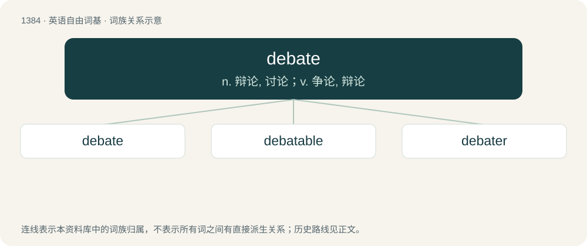

# 1471 · debate — n. 辩论, 讨论；v. 争论, 辩论

[总目录](../00_总目录_按常用程度.md)

**类型**：英语自由词基　｜　**来源语言**：见词源记录

## 核心含义与来源

- 核心含义：n. 辩论, 讨论；v. 争论, 辩论
- 英文含义：To participate in a debate; to dispute, argue, especially in a public arena.
- 词形：debate

**多个词源／构词路径**：同一拼写可能有不同来源；以下按词性和含义分别列出。

**来源记录 1**（动词；To participate in a debate; to dispute, argue, especially in a public arena.）

From Middle English debaten, from Old French debatre (“to fight, contend, debate, also literally to beat down”), from Romanic desbattere, from Latin dis- (“apart, in different directions”) + battuō (“to beat, to fence”).

**来源记录 2**（名词；An argument, or discussion, usually in an ordered or formal setting, often with more than two people, generally ending with a vote or other decision.）

From Middle English debat, borrowed from Old French debat, deverbal of debatre, see Etymology 1 for more.

## 词族图

## 单词速览（常用到不常用）

| 单词 | 音标 | 释义 |
|---|---|---|
| [debate](#w-1) | 英 /dɪˈbeɪt/；美 /dɪˈbeɪt/ | n. 辩论, 讨论；v. 争论, 辩论 |
| [debatable](#w-2) | /diˈbeitəbl/ | a. 可争论的, 成问题的, 未决定的 |
| [debater](#w-3) | 英 /dɪˈbeɪtə(ɹ)/ | n. 辩论家, 讨论者 |

## 逐词详解

### 1. debate

**词性**：动词　｜　**音标**：英 /dɪˈbeɪt/；美 /dɪˈbeɪt/

**中文释义**：n. 辩论, 讨论；v. 争论, 辩论

**英文义项**：To participate in a debate; to dispute, argue, especially in a public arena. / To consider (to oneself), to think over, to attempt to decide

**词源与演化**：

From Middle English debaten, from Old French debatre (“to fight, contend, debate, also literally to beat down”), from Romanic desbattere, from Latin dis- (“apart, in different directions”) + battuō (“to beat, to fence”).

**例句**：

> "Debate me, coward!" snarled the completely normal intellectual.

该用例对应义项：To participate in a debate; to dispute, argue, especially in a public arena.

### 2. debatable

**词性**：形容词　｜　**音标**：/diˈbeitəbl/

**中文释义**：a. 可争论的, 成问题的, 未决定的

**英文义项**：Open to debate; not fully proved or confirmed. / Able to be debated; up for discussion.

**构词拆分**：debate + -able

**词源与演化**：

From Old French debatable (French débattable), equivalent to debate + -able.

**例句**：

> Those data are debatable: no one has been able to replicate them.

该用例对应义项：Open to debate; not fully proved or confirmed.

### 3. debater

**词性**：名词　｜　**音标**：英 /dɪˈbeɪtə(ɹ)/

**中文释义**：n. 辩论家, 讨论者

**英文义项**：One who debates or participates in a debate; one who argues.

**构词拆分**：From debate + -er.

**词源与演化**：

From debate + -er.

**例句**：

> William is a great debater.

该用例对应义项：One who debates or participates in a debate; one who argues.
