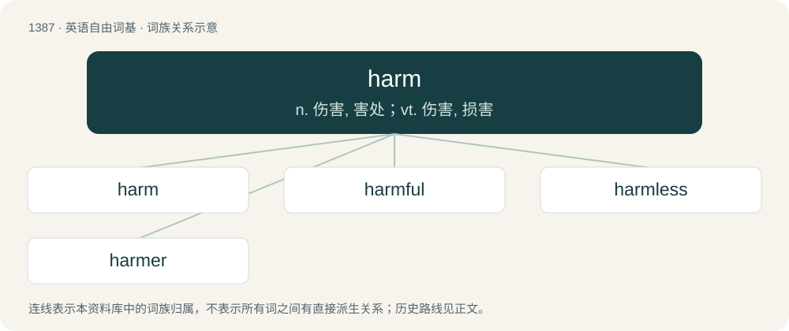

# 1473 · harm — n. 伤害, 害处；vt. 伤害, 损害

[总目录](../00_总目录_按常用程度.md)

**类型**：英语自由词基　｜　**来源语言**：见词源记录

## 核心含义与来源

- 核心含义：n. 伤害, 害处；vt. 伤害, 损害
- 英文含义：Physical injury; hurt; damage.
- 词形：harm

**来源记录 1**（名词；Physical injury; hurt; damage.）

From Middle English harm, herm, from Old English hearm, from Proto-West Germanic \*harm, from Proto-Germanic \*harmaz (“harm; shame; pain”). Cognate with Dutch harm (“harm”), German Harm (“harm”), Danish harme (“indignation, resentment”), Icelandic harmur (“sorrow, grief”), Swedish harm (“anger, indignation, harm”).

## 词族图

## 单词速览（常用到不常用）

| 单词 | 音标 | 释义 |
|---|---|---|
| [harm](#w-1) | 英 /hɑːm/；美 /hɑɹm/ | n. 伤害, 害处；vt. 伤害, 损害 |
| [harmful](#w-2) | 英 /ˈhɑːmfl̩/；美 /ˈhɑɹmfl̩/ | a. 有害的, 伤害的 |
| [harmless](#w-3) | 英 /ˈhɑːmləs/；美 /ˈhɑɹmləs/ | a. 无害处的, 未受损害的, 无辜的, 无恶意的；\[法\] 无害的, 无恶意的, 无损害的 |
| [harmer](#w-4) |  | 【英文】One who harms. |

## 逐词详解

### 1. harm

**词性**：名词　｜　**音标**：英 /hɑːm/；美 /hɑɹm/

**中文释义**：n. 伤害, 害处；vt. 伤害, 损害

**英文义项**：Physical injury; hurt; damage. / Emotional or figurative hurt.

**词源与演化**：

From Middle English harm, herm, from Old English hearm, from Proto-West Germanic \*harm, from Proto-Germanic \*harmaz (“harm; shame; pain”). Cognate with Dutch harm (“harm”), German Harm (“harm”), Danish harme (“indignation, resentment”), Icelandic harmur (“sorrow, grief”), Swedish harm (“anger, indignation, harm”).

**例句**：

> Although not physically injured in the car accident, she received some psychological harm.

该用例对应义项：Emotional or figurative hurt.

### 2. harmful

**词性**：形容词　｜　**音标**：英 /ˈhɑːmfl̩/；美 /ˈhɑɹmfl̩/

**中文释义**：a. 有害的, 伤害的

**英文义项**：Causing or likely to cause harm or damage; injurious.

**构词拆分**：harm + -ful

**词源与演化**：

From Middle English harmful, from Old English \*hearmful (suggested by hearmfullīċ (“harmful; hurtful”)), equivalent to harm + -ful. Cognate with German harmvoll, Danish harmfuld, Swedish harmfull.

**例句**：

> Wear a hat to protect your skin from harmful sunlight.

该用例对应义项：Causing or likely to cause harm or damage; injurious.

### 3. harmless

**词性**：形容词　｜　**音标**：英 /ˈhɑːmləs/；美 /ˈhɑɹmləs/

**中文释义**：a. 无害处的, 未受损害的, 无辜的, 无恶意的；\[法\] 无害的, 无恶意的, 无损害的

**英文义项**：Incapable of causing harm or danger; safe. / Not intended to harm; inoffensive.

**构词拆分**：harm + -less

**词源与演化**：

From Middle English harmles, from Old English \*hearmlēas, from Proto-Germanic \*harmalausaz (“without harm; harmless”), equivalent to harm + -less. Cognate with German harmlos (“harmless”), Danish harmløs (“harlmess”), Swedish harmlös (“harmless”).

**例句**：

> This snake looks nearly the same as its poisonous cousin but is harmless.

该用例对应义项：Incapable of causing harm or danger; safe.

### 4. harmer

**词性**：名词

**英文义项**：One who harms.

**构词拆分**：harm + -er

**词源与演化**：

From harm + -er.
