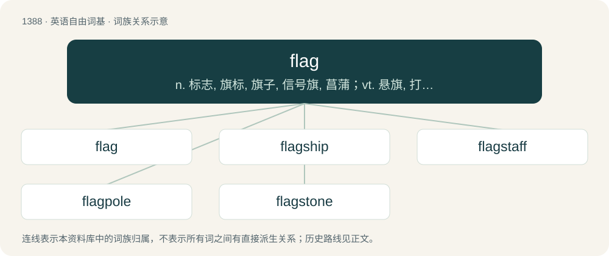

# 1474 · flag — n. 标志, 旗标, 旗子, 信号旗, 菖蒲；vt. 悬旗, 打旗号, 铺石板；vi. 无力地下垂

[总目录](../00_总目录_按常用程度.md)

**类型**：英语自由词基　｜　**来源语言**：见词源记录

## 核心含义与来源

- 核心含义：n. 标志, 旗标, 旗子, 信号旗, 菖蒲；vt. 悬旗, 打旗号, 铺石板；vi. 无力地下垂
- 英文含义：A piece of cloth, often decorated with an emblem, used as a visual signal or symbol.
- 词形：flag

**多个词源／构词路径**：同一拼写可能有不同来源；以下按词性和含义分别列出。

**来源记录 1**（名词；A piece of cloth, often decorated with an emblem, used as a visual signal or symbol.）

From Middle English flag, flagge (“flag”), further etymology uncertain. Perhaps from or related to early Middle English flage (name for a baby's garment) and Old English flagg, flacg (“cataplasm, poultice, plaster”). Or, perhaps ultimately imitative, or otherwise drawn from Proto-Germanic \*flaką (“something flat”), from Proto-Indo-European \*pleh₂- (“flat, broad, plain”), referring to the shape. Germanic cognates include Saterland Frisian Flaage (“flag”), West Frisian flagge (“flag”), Dutch vlag (“flag”), German Flagge (“flag”), Swedish flagga (“flag”), Danish flag (“flag, ship's flag”). Compare also Middle English flacken (“to flutter, palpitate”), Swedish dialectal flage (“to flutter in the wind”), Old Norse flögra (“to flap about”). Akin to Old High German flogarōn (“to flutter”), Old High German flogezen (“to flutter, flicker”), Middle English flakeren (“to move quickly to and fro”), Old English flacor (“fluttering, flying”). More at flack, flacker.

**来源记录 2**（动词；To weaken, become feeble.）

Perhaps from a variant of flack (“to hang loose”), from Middle English flacken; or perhaps from Old Norse. Compare Middle Dutch flaggheren, vlaggheren (“to droop, flag”).

**来源记录 3**（名词；Any of various plants with sword-shaped leaves, especially irises; specifically, Iris pseudacorus.）

From Middle English flagge, of uncertain origin, perhaps from North Germanic; compare Danish flæg (“yellow iris”). Or, possibly from sense 1, referring to its motion in the wind. Compare also Dutch vlag.

**来源记录 4**（名词；A slice of turf; a sod.）

From Middle English flag, flagge, probably of Scandinavian/North Germanic origin; compare Icelandic flag.

## 词族图

## 单词速览（常用到不常用）

| 单词 | 音标 | 释义 |
|---|---|---|
| [flag](#w-1) | 英 /flæɡ/；/flæɡ/ | n. 标志, 旗标, 旗子, 信号旗, 菖蒲；vt. 悬旗, 打旗号, 铺石板；vi. 无力地下垂 |
| [flagship](#w-2) | /ˈflæɡʃɪp/ | n. 旗舰 |
| [flagstaff](#w-3) | 英 /ˈflæɡstɑːf/；美 /ˈflæɡstæf/ | n. 旗竿 |
| [flagpole](#w-4) | 美 /ˈflæɡˌpoʊl/ | n. 旗竿 |
| [flagstone](#w-5) | 英 /ˈflæɡ.stəʊn/；美 /ˈflæɡˌstoʊn/ | n. 石板 |

## 逐词详解

### 1. flag

**词性**：名词　｜　**音标**：英 /flæɡ/；/flæɡ/

**中文释义**：n. 标志, 旗标, 旗子, 信号旗, 菖蒲；vt. 悬旗, 打旗号, 铺石板；vi. 无力地下垂

**英文义项**：A piece of cloth, often decorated with an emblem, used as a visual signal or symbol. / The design that could be placed on a flag, typically a rectangular graphic that is used to represent an entity (like a country, organisation or group of people) or an idea.

**词源与演化**：

From Middle English flag, flagge (“flag”), further etymology uncertain. Perhaps from or related to early Middle English flage (name for a baby's garment) and Old English flagg, flacg (“cataplasm, poultice, plaster”). Or, perhaps ultimately imitative, or otherwise drawn from Proto-Germanic \*flaką (“something flat”), from Proto-Indo-European \*pleh₂- (“flat, broad, plain”), referring to the shape. Germanic cognates include Saterland Frisian Flaage (“flag”), West Frisian flagge (“flag”), Dutch vlag (“flag”), German Flagge (“flag”), Swedish flagga (“flag”), Danish flag (“flag, ship's flag”). Compare also Middle English flacken (“to flutter, palpitate”), Swedish dialectal flage (“to flutter in the wind”), Old Norse flögra (“to flap about”). Akin to Old High German flogarōn (“to flutter”), Old High German flogezen (“to flutter, flicker”), Middle English flakeren (“to move quickly to and fro”), Old English flacor (“fluttering, flying”). More at flack, flacker.

**例句**：

> The flag of France has three vertical stripes.

该用例对应义项：The design that could be placed on a flag, typically a rectangular graphic that is used to represent an entity (like a country, organisation or group of people) or an idea.

### 2. flagship

**词性**：名词　｜　**音标**：/ˈflæɡʃɪp/

**中文释义**：n. 旗舰

**英文义项**：The ship occupied by the fleet's commander (usually an admiral); it denotes this by flying his flag. / The ship regarded as most important out of a group, e.g. a nation's navy or company's fleet.

**构词拆分**：flag + ship

**词源与演化**：

From flag + ship.

**例句**：

> The retail company's store in London is their flagship.

该用例对应义项：The most important one out of a related group.

### 3. flagstaff

**词性**：名词　｜　**音标**：英 /ˈflæɡstɑːf/；美 /ˈflæɡstæf/

**中文释义**：n. 旗竿

**英文义项**：A pole on which a flag is raised.

**构词拆分**：flag + staff

**词源与演化**：

From flag + staff.

### 4. flagpole

**词性**：名词　｜　**音标**：美 /ˈflæɡˌpoʊl/

**中文释义**：n. 旗竿

**英文义项**：A tall pole up which one or more flags may be raised and flown.

**构词拆分**：flag + pole

**词源与演化**：

From flag + pole.

**例句**：

> Let's run it up the flagpole and see if anyone salutes it.

### 5. flagstone

**词性**：名词　｜　**音标**：英 /ˈflæɡ.stəʊn/；美 /ˈflæɡˌstoʊn/

**中文释义**：n. 石板

**英文义项**：A flat, rectangular piece of rock or stone used for paving or roofing. / One of several types of rock easily split and suitable for making flagstones.

**构词拆分**：flag + stone

**词源与演化**：

From flag + stone.
