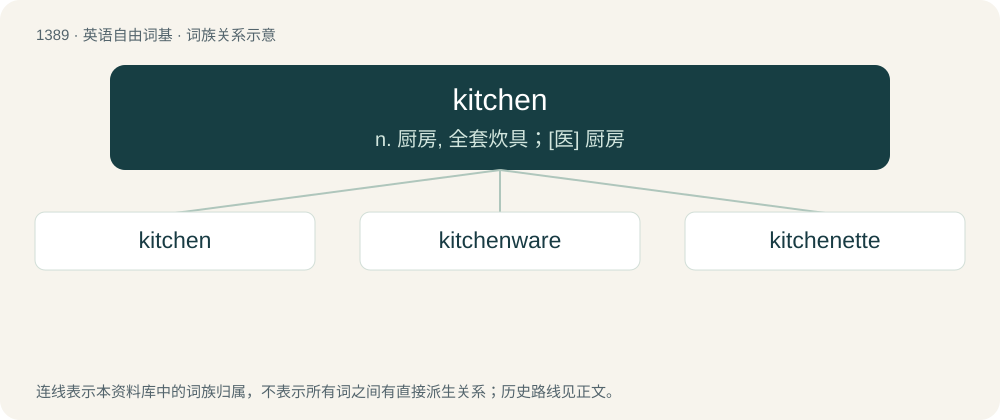

# 1475 · kitchen — n. 厨房, 全套炊具；\[医\] 厨房

[总目录](../00_总目录_按常用程度.md)

**类型**：英语自由词基　｜　**来源语言**：见词源记录

## 核心含义与来源

- 核心含义：n. 厨房, 全套炊具；\[医\] 厨房
- 英文含义：A room or area for preparing food.
- 词形：kitchen

**来源记录 1**（名词；A room or area for preparing food.）

From Middle English kichene, kichen, from Old English cyċen, cyċene, from Proto-West Germanic \*kukinā, a borrowing from Late Latin cocīna, from earlier coquīna (“kitchen; cuisine”), from coquō (“to cook”), from Proto-Indo-European \*pekʷ- (“to cook, become ripe”). In other languages, the cognate term often refers both to the room and the type of cooking. In English, the distinction is generally made via the etymological twins kitchen (“room”) (Latin via Germanic) and cuisine (“type of cooking”) (Latin via French).

## 词族图

## 单词速览（常用到不常用）

| 单词 | 音标 | 释义 |
|---|---|---|
| [kitchen](#w-1) | 英 /ˈkɪt͡ʃ(ɪ)n/；美 /ˈkɪt͡ʃ(ə)n/ | n. 厨房, 全套炊具；\[医\] 厨房 |
| [kitchenware](#w-2) | /ˈkitʃinwєə/ | n. 厨房用具 |
| [kitchenette](#w-3) | /ˌkɪt͡ʃəˈnɛt/ | n. 小厨房, 房间内用作厨房的一部分 |

## 逐词详解

### 1. kitchen

**词性**：名词　｜　**音标**：英 /ˈkɪt͡ʃ(ɪ)n/；美 /ˈkɪt͡ʃ(ə)n/

**中文释义**：n. 厨房, 全套炊具；\[医\] 厨房

**英文义项**：A room or area for preparing food. / Cuisine; style of cooking.

**词源与演化**：

From Middle English kichene, kichen, from Old English cyċen, cyċene, from Proto-West Germanic \*kukinā, a borrowing from Late Latin cocīna, from earlier coquīna (“kitchen; cuisine”), from coquō (“to cook”), from Proto-Indo-European \*pekʷ- (“to cook, become ripe”). In other languages, the cognate term often refers both to the room and the type of cooking. In English, the distinction is generally made via the etymological twins kitchen (“room”) (Latin via Germanic) and cuisine (“type of cooking”) (Latin via French).

**例句**：

> We cook in the kitchen.

该用例对应义项：A room or area for preparing food.

### 2. kitchenware

**词性**：名词　｜　**音标**：/ˈkitʃinwєə/

**中文释义**：n. 厨房用具

**英文义项**：Instruments and utensils found in a kitchen, particularly those associated with the preparation and serving of food.

**构词拆分**：kitchen + -ware

**词源与演化**：

From kitchen + -ware.

**例句**：

> The new chef reorganized the space where we keep the pots, pans, and other kitchenware.

该用例对应义项：Instruments and utensils found in a kitchen, particularly those associated with the preparation and serving of food.

### 3. kitchenette

**词性**：名词　｜　**音标**：/ˌkɪt͡ʃəˈnɛt/

**中文释义**：n. 小厨房, 房间内用作厨房的一部分

**英文义项**：A small kitchen or area for preparing food, often just a part of a room.

**构词拆分**：kitchen + -ette

**词源与演化**：

From kitchen + -ette (diminutive suffix).
