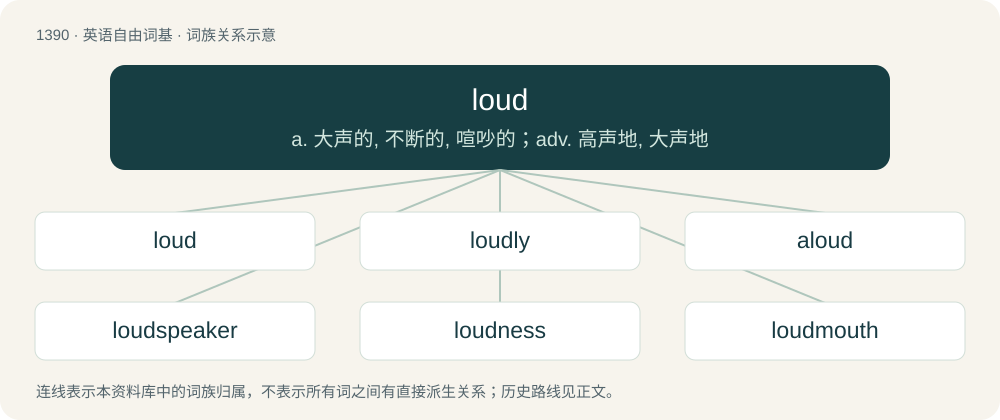

# 1478 · loud — a. 大声的, 不断的, 喧吵的；adv. 高声地, 大声地

[总目录](../00_总目录_按常用程度.md)

**类型**：英语自由词基　｜　**来源语言**：见词源记录

## 核心含义与来源

- 核心含义：a. 大声的, 不断的, 喧吵的；adv. 高声地, 大声地
- 英文含义：Of great intensity.
- 词形：loud

**多个词源／构词路径**：同一拼写可能有不同来源；以下按词性和含义分别列出。

**来源记录 1**（形容词；Of great intensity.）

From Middle English loude, loud, lud, from Old English hlūd (“loud, noisy, sounding, sonorous”), from Proto-West Germanic \*hlūd, from Proto-Germanic \*hlūdaz, \*hlūþaz (“heard”), from Proto-Indo-European \*ḱlewtos (“heard, famous”), from Proto-Indo-European \*ḱlew- (“to hear”). More at listen. Cognates Akin to Scots loud, lowd (“loud”), Swedish ljud, Danish, Norwegian Bokmål, and Norwegian Nynorsk lyd, Faroese ljóð, Icelandic hljóð, West Frisian lûd (“loud”), Dutch luid (“loud”), Low German lud (“loud”), German laut (“loud”), Irish clú (“repute”), Welsh clywed (“heard”), clod (“praise”), Latin laudare (“praise”), Tocharian A/B klots/klautso 'ear', klyostär 'heard', Ancient Greek κλυτός (klutós, “famous”), Albanian quaj (“to name, call”), shquar (“famous, notorious”), Old Armenian լու (lu, “the act of hearing”), Old Church Slavonic слава (slava, “glory”), слово (slovo, “word”), Sanskrit श्रव (śráva, “glory”).

**来源记录 2**（副词；Loudly.）

From Middle English loude, from Old English hlūde (“loudly”), from Proto-Germanic \*hlūda, \*hlūdô (“loudly”), related to Etymology 1.

## 词族图

## 单词速览（常用到不常用）

| 单词 | 音标 | 释义 |
|---|---|---|
| [loud](#w-1) | 英 /ˈlaʊ̯d/；/ˈlæʊ̯d/ | a. 大声的, 不断的, 喧吵的；adv. 高声地, 大声地 |
| [loudly](#w-2) | /ˈlaʊdli/ | adv. 高声地, 大声地, 吵闹地 |
| [aloud](#w-3) | /əˈlaʊd/ | adv. 出声地, 大声地 |
| [loudspeaker](#w-4) | 英 /laʊdˈspiːkə/；美 /ˈlaʊdspiːkɚ/ | n. 扩音器, 喇叭；\[电\] 扬声器 |
| [loudness](#w-5) | /ˈlaudnis/ | n. 响度, 高声, 大声, 吵闹；\[电\] 响度 |
| [loudmouth](#w-6) | /ˈlaʊdˌmaʊθ/ | n. 咭咭呱呱说个不停的人, 多嘴的人 |
| [louden](#w-7) | 英 /ˈlaʊdn̩/ | v. (使声音)变响亮 |

## 逐词详解

### 1. loud

**词性**：形容词　｜　**音标**：英 /ˈlaʊ̯d/；/ˈlæʊ̯d/

**中文释义**：a. 大声的, 不断的, 喧吵的；adv. 高声地, 大声地

**英文义项**：Of great intensity. / Noisy.

**词源与演化**：

From Middle English loude, loud, lud, from Old English hlūd (“loud, noisy, sounding, sonorous”), from Proto-West Germanic \*hlūd, from Proto-Germanic \*hlūdaz, \*hlūþaz (“heard”), from Proto-Indo-European \*ḱlewtos (“heard, famous”), from Proto-Indo-European \*ḱlew- (“to hear”). More at listen. Cognates Akin to Scots loud, lowd (“loud”), Swedish ljud, Danish, Norwegian Bokmål, and Norwegian Nynorsk lyd, Faroese ljóð, Icelandic hljóð, West Frisian lûd (“loud”), Dutch luid (“loud”), Low German lud (“loud”), German laut (“loud”), Irish clú (“repute”), Welsh clywed (“heard”), clod (“praise”), Latin laudare (“praise”), Tocharian A/B klots/klautso 'ear', klyostär 'heard', Ancient Greek κλυτός (klutós, “famous”), Albanian quaj (“to name, call”), shquar (“famous, notorious”), Old Armenian լու (lu, “the act of hearing”), Old Church Slavonic слава (slava, “glory”), слово (slovo, “word”), Sanskrit श्रव (śráva, “glory”).

**例句**：

> What was that? It sounded like a really loud sneeze.

该用例对应义项：Of great intensity.

### 2. loudly

**词性**：副词　｜　**音标**：/ˈlaʊdli/

**中文释义**：adv. 高声地, 大声地, 吵闹地

**英文义项**：In a loud manner; at a high volume. / In a loud manner; gaudily, showily.

**构词拆分**：loud + -ly

**词源与演化**：

From Middle English loudly, equivalent to loud + -ly.

**例句**：

> He spoke loudly so that his brother could hear him from across the street.

该用例对应义项：In a loud manner; at a high volume.

### 3. aloud

**词性**：副词　｜　**音标**：/əˈlaʊd/

**中文释义**：adv. 出声地, 大声地

**英文义项**：With a loud voice, or great noise; loudly; audibly. / Audibly, as opposed to silently/quietly.

**构词拆分**：a- + loud；a- + loude (“sound”)

**词源与演化**：

From Middle English aloud, a loude (“aloud”), equivalent to a- + loud or a- + loude (“sound”).

**例句**：

> Try speaking aloud rather than whispering.

该用例对应义项：With a loud voice, or great noise; loudly; audibly.

### 4. loudspeaker

**词性**：名词　｜　**音标**：英 /laʊdˈspiːkə/；美 /ˈlaʊdspiːkɚ/

**中文释义**：n. 扩音器, 喇叭；\[电\] 扬声器

**英文义项**：An electromechanical transducer that converts an electrical signal into audible sound. / Any such transducer that is loud, as opposed to quiet ones such as those found in headphones.

**构词拆分**：loud + speaker

**词源与演化**：

From loud + speaker.

**例句**：

> The police used a drone with a loudspeaker to disperse the crowd.

### 5. loudness

**词性**：名词　｜　**音标**：/ˈlaudnis/

**中文释义**：n. 响度, 高声, 大声, 吵闹；\[电\] 响度

**英文义项**：The perceptual strength or amplitude of sound pressure, measured in sones or phons. / The physical strength of the sound pressure level, measured in decibels.

**构词拆分**：loud + -ness

**词源与演化**：

From Middle English loudnesse, lowdenesse, from Old English hlūdnes, equivalent to loud + -ness.

**例句**：

> We perceive the amplitude of a sound wave as loudness.

### 6. loudmouth

**词性**：名词　｜　**音标**：/ˈlaʊdˌmaʊθ/

**中文释义**：n. 咭咭呱呱说个不停的人, 多嘴的人

**英文义项**：One who talks too much or too loudly, especially in a boastful or self-important manner.

**构词拆分**：loud + mouth

**词源与演化**：

From loud + mouth.

**例句**：

> I hear every word spoken by the loudmouth in the next office.

该用例对应义项：One who talks too much or too loudly, especially in a boastful or self-important manner.

### 7. louden

**词性**：动词　｜　**音标**：英 /ˈlaʊdn̩/

**中文释义**：v. (使声音)变响亮

**英文义项**：To become louder.

**构词拆分**：loud + -en

**词源与演化**：

From loud + -en.

**例句**：

> Billings had backheeled Louden Powers just as he got to the door, and now was kneeling on the chest of the discomfited scoundrel.
