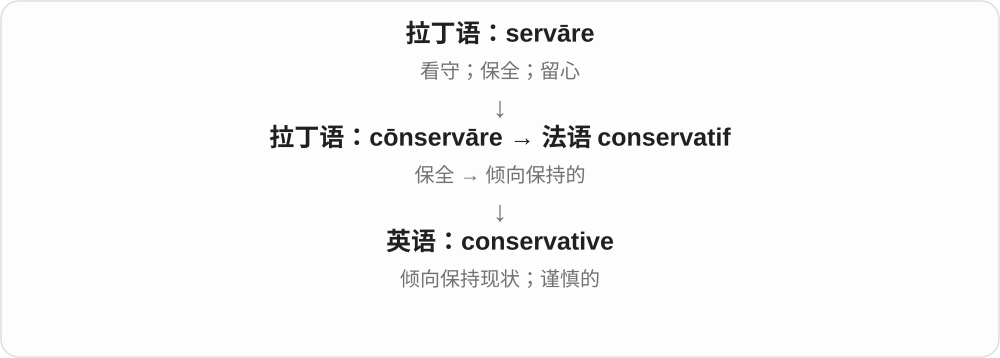

# 1479 · conservative — 保留、守护的倾向及谨慎做事风格

[逐词精讲目录](../00_逐词精讲目录.md) · [总目录](../00_总目录_按常用程度.md)

## 核心词根与来源

政治传统与一般谨慎估计分语境，穿得保守也不等于已经声明政治立场。

**CONSERVATIVE：先守住已有，再谨慎对待改变**

conservative → conservatism、conservatively；neoconservative 接特定政治思想背景。

- **基础、思想与做事方式**：conservative · conservatism · conservatively
- **特定思想名称**：neoconservative
- **conservative → conservatives：倾向保留现有安排的人**：conserve · conservative · conservatives

## 词形与演化规律

conservāre、conservātīvus 经法语 → conservative；conservative 对应 conservatism；conservative + -ly；neo- + conservative。

法语 conservatif 接拉丁 conservare，性质词转为人物称呼，再加 s。

## 单词速览（按词族由简到繁）

同一基础词的相关扩展放在一起，先读基础形式，再读扩展；各组之间优先读常用的。具体词源关系见各词讲解。

| 单词 | 音标 | 核心意思 |
|---|---|---|
| [conserve](#w-6) | 动词：英 /kənˈsɜːv/、美 /kənˈsɜːrv/；食品名词常 /ˈkɒnsɜːv/（英） | 节约；保护；保存；果酱 |
| [conservative](#w-1) | 英 /kənˈsɜːvətɪv/；美 /kənˈsɜːrvətɪv/ | 保守的；审慎的；保守派 |
| [conservatives](#w-5) | 英 /kənˈsɜːvətɪvz/；美 /kənˈsɜːrvətɪvz/ | 保守的人；保守派〔复数〕 |
| [conservatism](#w-2) | 英 /kənˈsɜːvətɪzəm/；美 /kənˈsɜːrvətɪzəm/ | 保守主义、保守思想；谨慎保守的倾向 |
| [conservatively](#w-3) | 英 /kənˈsɜːvətɪvli/；美 /kənˈsɜːrvətɪvli/ | 保守地；谨慎地、往稳妥方向地 |
| [neoconservative](#w-4) | 英 /ˌniːəʊkənˈsɜːvətɪv/；美 /ˌniːoʊkənˈsɜːrvətɪv/ | 新保守主义者；新保守主义的 |

## 逐词讲解

### 1. conserve — 节约；保护；保存；果酱

**音标**：动词：英 /kənˈsɜːv/、美 /kənˈsɜːrv/；食品名词常 /ˈkɒnsɜːv/（英）

**先抓住这个画面**

手里的水、体力和自然资源都有限，别白白消耗，让它们留得更久。

**怎么拆**

拉丁语 cōnservāre，经法语 conserver；con- 在这里加强保全的动作，不必逐字译成一起服务。

**怎么变成今天的意思**

conserve water 是节约水，conserve wildlife 是保护野生生物。食品名词 conserve 是一种果酱，沿保存食物的意思发展。

**常见搭配与例句**

conserve energy；conserve water；conserve natural habitats。

> We turned off the lights to conserve energy.

我们关掉灯以节约能源。

> The project aims to conserve the wetland habitat.

这个项目旨在保护湿地栖息地。

**别混淆**

conserve 常突出节制使用、妥善管理；preserve 常突出保持完整。实际搭配可以有重叠。

### 2. conservative — 保守的；审慎的；保守派

**音标**：英 /kənˈsɜːvətɪv/；美 /kənˈsɜːrvətɪv/

**先抓住这个画面**

变化来了，先倾向保住现有做法；估数字时，则宁愿稳一点，不把结果说得过大。

**怎么拆**

经法语 conservatif 来自拉丁语 cōnservāre“保持”；现代可联系 conserve 与 -ative。

**怎么变成今天的意思**

可指政治立场、传统风格或审慎估计。a conservative estimate 是偏稳妥的估计，不是有政治立场的估计。

**常见搭配与例句**

conservative views；conservative clothing；a conservative estimate。

> That is a conservative estimate of the time required.

这是对所需时间的一个谨慎估计。

> He prefers conservative styles of clothing.

他偏爱传统稳重的衣着风格。

**别混淆**

conservation 是保护；conservative 是保守或审慎。环保工作者不因此自动属于某种政治保守派。

### 3. conservatives — 保守的人；保守派〔复数〕

**音标**：英 /kənˈsɜːvətɪvz/；美 /kənˈsɜːrvətɪvz/

**先抓住这个画面**

面对变化，更倾向先保留已有安排、传统或做法的人，可以叫 conservatives。政治中也有相应立场、派别名称，具体内容随社会而不同。

**怎么拆**

conservative + -s，/v/ 后读 /z/。conservative 经法语 conservatif 接拉丁 conservare 保持，性质词再转称持这种态度、立场的人。

**怎么变成今天的意思**

**拉丁 conservare → 法语 conservatif → conservative**  
保持、保留 → 倾向维持已有安排的性质

↓

**人物名词 conservative + -s → conservatives**  
多位持保守态度或相应政治立场的人

political conservatives 政治保守派；social conservatives 社会保守派；conservatives in a debate 辩论中的保守一方。

**常见搭配与例句**

conservatives and reformers 保守派与改革派；fiscal conservatives 财政上持保守立场的人。

> The proposal divided conservatives and reformers.

提案使保守派与改革派产生分歧。

> Some conservatives argued for keeping the old system.

一些保守派主张保留旧制度。

**别混淆**

conservatives 作为普通名词可说一类立场；大写 Conservatives 可能是特定政党、团体成员。conserve 是保留、保护的动作，不是同一个人物名词。

### 4. conservatism — 保守主义、保守思想；谨慎保守的倾向

**音标**：英 /kənˈsɜːvətɪzəm/；美 /kənˈsɜːrvətɪzəm/

**先抓住这个画面**

先把已有的做法、秩序守住，再谨慎看变化；政治里是一大类传统，普通工作里也可说不愿冒进的态度。

**怎么拆**

通常对应 conservative + -ism，词形调整为 conservatism，历史也有其他相近构词分析。较早 conservāre 是保存、守护，不是 conserve 果酱才生出政治。

**怎么变成今天的意思**

**拉丁 conservāre、conservātīvus → 法语 conservatif → conservative**  
保存、守护 → 倾向保留

↓

**政治与一般做事风格**  
保守思想；谨慎、不激进的估计和穿着

↓

**conservative 对应 -ism → conservatism**  
保守思想；一般谨慎保守倾向

political conservatism 政治保守主义，cultural conservatism 文化保守倾向，financial conservatism 财务上的谨慎态度。

**常见搭配与例句**

political conservatism；cultural conservatism；a tendency towards conservatism。

> The book traces the history of political conservatism.

这本书追溯政治保守主义的历史。

> The company’s conservatism slowed the adoption of new methods.

公司的保守态度拖慢了新方法的采用。

**别混淆**

conservatism 政治含义因历史传统不同，不自动等于每个国家某个政党；日常谨慎态度也不保证政治立场相同。

### 5. conservatively — 保守地；谨慎地、往稳妥方向地

**音标**：英 /kənˈsɜːvətɪvli/；美 /kənˈsɜːrvətɪvli/

**先抓住这个画面**

穿得保守不张扬，估计不把结果说得太满，都可 conservatively；不一定每次在谈政治。

**怎么拆**

conservative + -ly，副词修饰做事、估算、穿着等方式，接的是整个形容词而非只接 con-。

**怎么变成今天的意思**

**拉丁 conservāre、conservātīvus → 法语 conservatif → conservative**  
保存、守护 → 倾向保留

↓

**政治与一般做事风格**  
保守思想；谨慎、不激进的估计和穿着

↓

**conservative + -ly → conservatively**  
以保守、谨慎方式

dress conservatively 穿着保守，estimate conservatively 保守估计，act conservatively 谨慎行事。

**常见搭配与例句**

dress conservatively；estimate conservatively；act conservatively。

> She dressed conservatively for the interview.

她为面试穿得比较保守。

> The repairs were conservatively estimated to take a month.

保守估计，修理需要一个月。

**别混淆**

conservatively estimated 常是避免夸大的估法，但保守方向要看对象；收入低估、成本留余量等不必都对应同一数字方向。

### 6. neoconservative — 新保守主义者；新保守主义的

**音标**：英 /ˌniːəʊkənˈsɜːvətɪv/；美 /ˌniːoʊkənˈsɜːrvətɪv/

**先抓住这个画面**

一种有具体思想历史的政治标签，不是泛指刚开始持保守观点的人。

**怎么拆**

现代 neo- 新 + conservative 保守派、保守的；标签在不同时期有过不同所指，不能只靠字面定义一套永远不变的主张。

**怎么变成今天的意思**

**希腊 neos 新的 → neo-**  
新的、较新的，或对旧事物作新发展

↓

**英语 neo- + conservative → neoconservative**  
现代政治流派标签，后来常见于美国政治讨论

在美国外交政策讨论中，neoconservative 常与积极运用美国力量、包括军事力量干预国际事务的主张相连。也能作形容词，说 neoconservative ideas。

**常见搭配与例句**

a neoconservative thinker；neoconservative foreign policy；neoconservative ideas。

> The essay traces the influence of neoconservative thinkers on foreign policy.

这篇文章追溯了新保守主义思想家对外交政策的影响。

> The panel included a neoconservative and a critic of military intervention.

座谈会请来了一位新保守主义者和一位反对军事干预的评论者。

**别混淆**

conservative 范围更宽；neoconservative 指其中有特定历史背景的思想群体。neoliberal 是另一政治经济标签，不与它自动等同。

## 这一组要分清什么

conservatism 政治与一般态度；conservatively 数字方向依对象；neoconservative 不能只按所有新的保守者直译。

## 串起来练习

The conservatively dressed speaker discussed the history of conservatism.

那位穿着保守的讲者讨论了保守主义历史。
