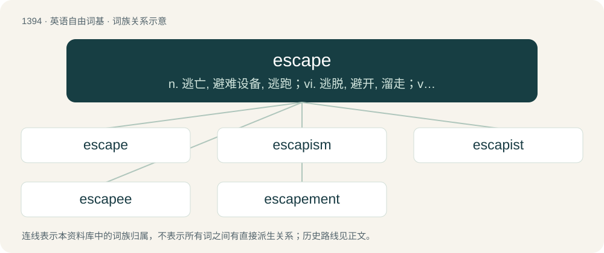

# 1481 · escape — n. 逃亡, 避难设备, 逃跑；vi. 逃脱, 避开, 溜走；vt. 逃避, 避免, 被...忘掉

[总目录](../00_总目录_按常用程度.md)

**类型**：英语自由词基　｜　**来源语言**：见词源记录

## 核心含义与来源

- 核心含义：n. 逃亡, 避难设备, 逃跑；vi. 逃脱, 避开, 溜走；vt. 逃避, 避免, 被...忘掉
- 英文含义：To get free; to free oneself.
- 词形：escape

**来源记录 1**（动词；To get free; to free oneself.）

From Middle English escapen, from Anglo-Norman and Old Northern French escaper ( = Old French eschaper, modern French échapper), from Vulgar Latin \*excappāre (“to escape a garment, get out of one's clothing”, literally “to free oneself from one's cape”), from Latin ex- (“out”) + Late Latin cappa (“cape, cloak”). Cognate with escapade. Also doublet of scape.

## 词族图

## 单词速览（常用到不常用）

| 单词 | 音标 | 释义 |
|---|---|---|
| [escape](#w-1) | 英 /ɪˈskeɪp/；美 /ɪˈskeɪp/ | n. 逃亡, 避难设备, 逃跑；vi. 逃脱, 避开, 溜走；vt. 逃避, 避免, 被...忘掉 |
| [escapism](#w-2) | /ɪˈskeɪpɪzəm/ | n. 逃避现实, 逃避主义 |
| [escapist](#w-3) | /isˈkeipist/ | a. 逃避现实的；n. 逃避现实者 |
| [escapee](#w-4) | 美 /ˌɛsˌkeɪˈpi/ | n. 逃亡者, 逃避者；\[法\] 脱逃者 |
| [escapement](#w-5) | /ɪˈskeɪpmənt/ | n. 钟/表的司行轮, 棘轮装置, 摆轮；\[计\] 擒纵机构, 棘轮装置, 走格, 跳行, 移动 |

## 逐词详解

### 1. escape

**词性**：动词　｜　**音标**：英 /ɪˈskeɪp/；美 /ɪˈskeɪp/

**中文释义**：n. 逃亡, 避难设备, 逃跑；vi. 逃脱, 避开, 溜走；vt. 逃避, 避免, 被...忘掉

**英文义项**：To get free; to free oneself. / To break out of confinement.

**词源与演化**：

From Middle English escapen, from Anglo-Norman and Old Northern French escaper ( = Old French eschaper, modern French échapper), from Vulgar Latin \*excappāre (“to escape a garment, get out of one's clothing”, literally “to free oneself from one's cape”), from Latin ex- (“out”) + Late Latin cappa (“cape, cloak”). Cognate with escapade. Also doublet of scape.

**例句**：

> When using the "bash" shell, you can escape the ampersand character with a backslash.

该用例对应义项：To cause (a single character, or all such characters in a string) to be interpreted literally, instead of with any special meaning it would usually have in the same context, often by prefixing with another character.

### 2. escapism

**词性**：名词　｜　**音标**：/ɪˈskeɪpɪzəm/

**中文释义**：n. 逃避现实, 逃避主义

**英文义项**：An inclination to escape from routine or reality into fantasy. / A genre of book, film etc. that one uses to indulge this tendency.

**构词拆分**：escape + -ism

**词源与演化**：

From escape + -ism.

**例句**：

> His alcohol problem was a form of escapism.

该用例对应义项：an inclination to retreat from unpleasant realities through diversion or fantasy

### 3. escapist

**词性**：形容词　｜　**音标**：/isˈkeipist/

**中文释义**：a. 逃避现实的；n. 逃避现实者

**英文义项**：Intended for or tending toward escape; especially, used to avoid, deny, or forget about reality, as through fantasy.

**构词拆分**：escape + -ist

**词源与演化**：

From escape + -ist.

**例句**：

> He enjoys reading escapist fiction in his free time.

该用例对应义项：Intended for or tending toward escape; especially, used to avoid, deny, or forget about reality, as through fantasy.

### 4. escapee

**词性**：名词　｜　**音标**：美 /ˌɛsˌkeɪˈpi/

**中文释义**：n. 逃亡者, 逃避者；\[法\] 脱逃者

**英文义项**：Someone who has become free through escaping imprisonment. / Someone who has escaped.

**构词拆分**：From escape + -ee.

**词源与演化**：

From escape + -ee.

**例句**：

> Police officers are on the hunt for the escapee.

### 5. escapement

**词性**：名词　｜　**音标**：/ɪˈskeɪpmənt/

**中文释义**：n. 钟/表的司行轮, 棘轮装置, 摆轮；\[计\] 擒纵机构, 棘轮装置, 走格, 跳行, 移动

**英文义项**：The linkage in a (watch) that gives impulses to the timekeeping element and periodically releases the gear train to move forward, advancing the clock's hands. / A mechanism found in devices such as a typewriter or printer which controls lateral motion of the carriage.

**构词拆分**：escape + -ment

**词源与演化**：

From escape + -ment. The watch component is so called because it allows a tooth to escape from a pallet at each vibration.

**例句**：

> The escapement is the reason why clocks tick.

该用例对应义项：The linkage in a (watch) that gives impulses to the timekeeping element and periodically releases the gear train to move forward, advancing the clock's hands.
