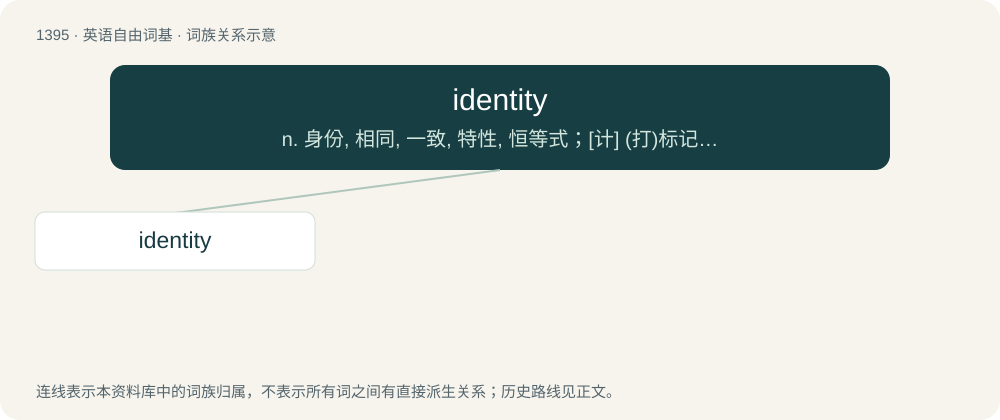

# 1482 · identity — n. 身份, 相同, 一致, 特性, 恒等式；\[计\] (打)标记, 标识

[总目录](../00_总目录_按常用程度.md)

**类型**：英语自由词基　｜　**来源语言**：见词源记录

## 核心含义与来源

- 核心含义：n. 身份, 相同, 一致, 特性, 恒等式；\[计\] (打)标记, 标识
- 英文含义：Sameness, identicalness; the quality or fact of (several specified things) being the same.
- 词形：identity

**来源记录 1**（名词；Sameness, identicalness; the quality or fact of (several specified things) being the same.）

From Middle English ydemptite, from Middle French identité and its etymon Late Latin idemptitās, identitās, from idem (“the same”) + -tās (suffix forming abstract nouns) as a calque of Ancient Greek ταὐτότης (tautótēs, “sameness”).

## 词族图

## 单词速览（常用到不常用）

| 单词 | 音标 | 释义 |
|---|---|---|
| [identity](#w-1) | 英 /aɪˈdɛntɪti/；美 /aɪˈdɛn(t)ɪti/ | n. 身份, 相同, 一致, 特性, 恒等式；\[计\] (打)标记, 标识 |

## 逐词详解

### 1. identity

**词性**：名词　｜　**音标**：英 /aɪˈdɛntɪti/；美 /aɪˈdɛn(t)ɪti/

**中文释义**：n. 身份, 相同, 一致, 特性, 恒等式；\[计\] (打)标记, 标识

**英文义项**：Sameness, identicalness; the quality or fact of (several specified things) being the same. / The difference or character that marks off an individual or collective from the rest of the same kind; selfhood; the sense of who something or someone or oneself is, or the recurring characteristics that enable the recognition of such an individual or group by others or themselves.

**词源与演化**：

From Middle English ydemptite, from Middle French identité and its etymon Late Latin idemptitās, identitās, from idem (“the same”) + -tās (suffix forming abstract nouns) as a calque of Ancient Greek ταὐτότης (tautótēs, “sameness”).

**例句**：

> In this show, the competitor's identity will remain secret until after the vote.

该用例对应义项：A name or persona—a mask or appearance one presents to the world—by which one is known.
