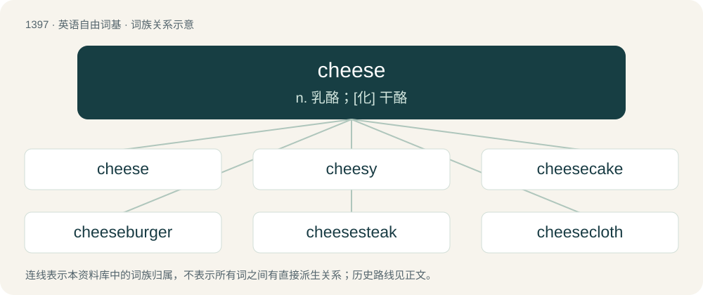

# 1484 · cheese — n. 乳酪；\[化\] 干酪

[总目录](../00_总目录_按常用程度.md)

**类型**：英语自由词基　｜　**来源语言**：见词源记录

## 核心含义与来源

- 核心含义：n. 乳酪；\[化\] 干酪
- 英文含义：A dairy product made from curdled or cultured milk.
- 词形：cheese

**多个词源／构词路径**：同一拼写可能有不同来源；以下按词性和含义分别列出。

**来源记录 1**（名词；A dairy product made from curdled or cultured milk.）

From Middle English chese, from Anglian Old English ċēse, from Proto-West Germanic \*kāsī, borrowed from Latin cāseus. Doublet of queso. Cognate with Saterland Frisian Síes (“cheese”), West Frisian tsiis (“cheese”), Dutch kaas (“cheese”), German Low German Kees (“cheese”), German Käse (“cheese”).

**来源记录 2**（感叹词；Said while being photographed, to give the impression of smiling.）

Perhaps an alteration of cheers.

**来源记录 3**（名词；Wealth, fame, excellence, importance.）

Though commonly claimed to be a borrowing of Persian چیز (čiz, “thing”), the term does not occur earliest in Anglo-Indian sources, but instead is "well recorded in British and Australian sources from the 1840s onwards".

**来源记录 4**（动词；To stop; to refrain from.）

Etymology unknown. Possibly an alteration of cease.

**来源记录 5**（名词；The exploitation, or opportunity for exploitation, of an unintentional video game mechanic.）

From cheesy.

## 词族图

## 单词速览（常用到不常用）

| 单词 | 音标 | 释义 |
|---|---|---|
| [cheese](#w-1) | 美 /t͡ʃiz/；/t͡ʃiːz/ | n. 乳酪；\[化\] 干酪 |
| [cheesy](#w-2) | /ˈt͡ʃiːzi/ | a. 干酪质的, 俊俏的, 优秀的；\[医\] 干酪样的 |
| [cheesecake](#w-3) | 英 /ˈt͡ʃiːzˌkeɪk/；美 /ˈt͡ʃizˌkeɪk/ | n. 干酪饼, 半裸体的女人照片 |
| [cheeseburger](#w-4) | 英 /ˈtʃiːzˌbɜː.ɡə/；美 /ˈtʃizˌbɝ.ɡɚ/ | n. 干酪汉堡包 |
| [cheesesteak](#w-5) |  | n. 费城牛肉芝士三明治 |
| [cheesecloth](#w-6) | /ˈtʃiːzklɒːθ/ | n. 干酪包布 |
| [cheeseman](#w-7) |  | \[人名\] \[英格兰人姓氏\] 奇斯曼职业名称，干酪制作者或销售者，来源于古英语，含义是“干酪+人”(cheese+man) |

## 逐词详解

### 1. cheese

**词性**：名词　｜　**音标**：美 /t͡ʃiz/；/t͡ʃiːz/

**中文释义**：n. 乳酪；\[化\] 干酪

**英文义项**：A dairy product made from curdled or cultured milk. / Any particular variety of cheese.

**词源与演化**：

From Middle English chese, from Anglian Old English ċēse, from Proto-West Germanic \*kāsī, borrowed from Latin cāseus. Doublet of queso. Cognate with Saterland Frisian Síes (“cheese”), West Frisian tsiis (“cheese”), Dutch kaas (“cheese”), German Low German Kees (“cheese”), German Käse (“cheese”).

**例句**：

> Which would you like to have with your bread, butter or cheese?

### 2. cheesy

**词性**：形容词　｜　**音标**：/ˈt͡ʃiːzi/

**中文释义**：a. 干酪质的, 俊俏的, 优秀的；\[医\] 干酪样的

**英文义项**：Of or relating to cheese. / Resembling or containing cheese.

**构词拆分**：cheese + -y

**词源与演化**：

From Middle English chesy, equivalent to cheese + -y. Doublet of caseic. Compare German käsig (“cheesy”).

**例句**：

> This sandwich is full of cheesy goodness.

该用例对应义项：Of or relating to cheese.

### 3. cheesecake

**词性**：名词　｜　**音标**：英 /ˈt͡ʃiːzˌkeɪk/；美 /ˈt͡ʃizˌkeɪk/

**中文释义**：n. 干酪饼, 半裸体的女人照片

**英文义项**：A pie made of sweetened and flavoured cottage cheese or cream cheese, eggs and milk on a crunchy base. / Imagery of scantily clad, sexually attractive young women; pin-ups.

**构词拆分**：cheese + cake

**词源与演化**：

From Middle English chesekake; equivalent to cheese + cake. Compare chess cake.

**例句**：

> Company policy forbids displaying cheesecake in the locker rooms.

该用例对应义项：Imagery of scantily clad, sexually attractive young women; pin-ups.

### 4. cheeseburger

**词性**：名词　｜　**音标**：英 /ˈtʃiːzˌbɜː.ɡə/；美 /ˈtʃizˌbɝ.ɡɚ/

**中文释义**：n. 干酪汉堡包

**英文义项**：A hamburger containing cheese (usually one or more slices of processed cheese). / The BLU-82 bomb.

**构词拆分**：cheese + hamburger

**词源与演化**：

Blend of cheese + hamburger (1928). By surface analysis, cheese + -burger.

**例句**：

> I paid ten dollars for a cheeseburger that has no cheese.

### 5. cheesesteak

**词性**：名词

**中文释义**：n. 费城牛肉芝士三明治

**英文义项**：A Philadelphia snack food consisting of chopped steak and melted cheese in a bread roll.

**构词拆分**：cheese + steak

**词源与演化**：

From cheese + steak.

### 6. cheesecloth

**词性**：名词　｜　**音标**：/ˈtʃiːzklɒːθ/

**中文释义**：n. 干酪包布

**英文义项**：A loosely woven cotton gauze, originally used to wrap cheese, but now used for various culinary tasks and by farmers to shade crops and keep birds off.

**构词拆分**：cheese + cloth

**词源与演化**：

From cheese + cloth.

**例句**：

> Cheesecloth is probably cheaper at hardware stores than culinary specialty stores.

### 7. cheeseman

**词性**：名词

**中文释义**：\[人名\] \[英格兰人姓氏\] 奇斯曼职业名称，干酪制作者或销售者，来源于古英语，含义是“干酪+人”(cheese+man)

**英文义项**：A man who makes cheese.

**构词拆分**：cheese + -man

**词源与演化**：

From cheese + -man.
