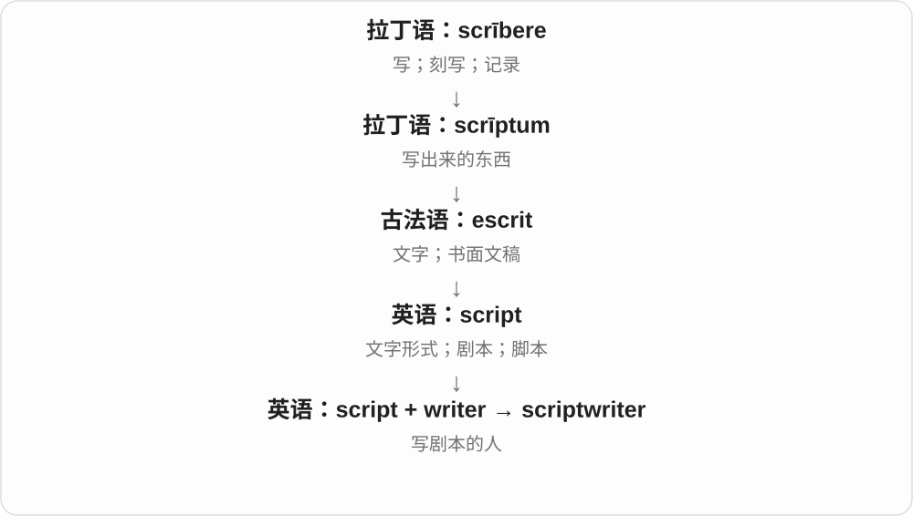

# 1484 · writer — 写作者与按作品、协作方式分出的角色

[逐词精讲目录](../00_逐词精讲目录.md) · [总目录](../00_总目录_按常用程度.md)

## 核心词根与来源

不要看到 -writer 就全译作家：广告文案、演讲稿、剧本各有对象，typewriter 更是打字机。ghostwriter 的幕后关系也不等于所有合作都秘密。

**WRITER：先看写什么，再看以谁的名字出现**

writer 为基础；songwriter、screenwriter、scriptwriter、copywriter、speechwriter 按作品分；ghostwriter 按合作角色分；typewriter 是器物支线。

- **基础角色**：writer
- **按作品区分**：songwriter · screenwriter · scriptwriter · copywriter · speechwriter
- **按协作区分**：ghostwriter
- **机器名称**：typewriter
- **writer 的机器组合 typewriter 及复数**：writer · typewriter · typewriters
- **write → writer 与 songwriter 的人物名称**：songwriter · songwriters

## 词形与演化规律

write + -er；作品名 + writer；ghost + writer；typewriter 中 -writer 指写出文字的机器。

write 去 e 加 er，复合词末再加复数 s。

write 去末尾 e，加完整 -er 得 writer；songwriter 的复数变化在最后。

## 单词速览（按词族由简到繁）

同一基础词的相关扩展放在一起，先读基础形式，再读扩展；各组之间优先读常用的。具体词源关系见各词讲解。

| 单词 | 音标 | 核心意思 |
|---|---|---|
| [writer](#w-1) | 英 /ˈraɪtə/；美 /ˈraɪtər/ | 作者；作家；写作者 |
| [songwriter](#w-2) | 英 /ˈsɒŋraɪtə/；美 /ˈsɔːŋraɪtər/ | 歌曲创作者；词曲作者 |
| [songwriters](#w-10) | 英 /ˈsɒŋraɪtəz/；美 /ˈsɔːŋraɪtərz/ | 歌曲创作者〔复数〕 |
| [typewriter](#w-3) | 英 /ˈtaɪpraɪtə/；美 /ˈtaɪpraɪtər/ | 打字机 |
| [typewriters](#w-9) | 英 /ˈtaɪpraɪtəz/；美 /ˈtaɪpraɪtərz/ | 打字机〔复数〕 |
| [screenwriter](#w-4) | 英 /ˈskriːnraɪtə/；美 /ˈskriːnraɪtər/ | 电影、电视编剧 |
| [copywriter](#w-5) | 英 /ˈkɒpiraɪtə/；美 /ˈkɑːpiraɪtər/ | 文案撰稿人 |
| [ghostwriter](#w-6) | 英 /ˈɡəʊstraɪtə/；美 /ˈɡoʊstraɪtər/ | 代笔者、代笔作家 |
| [speechwriter](#w-7) | 英 /ˈspiːtʃraɪtə/；美 /ˈspiːtʃraɪtər/ | 演讲稿撰写人 |
| [scriptwriter](#w-8) | 英 /ˈskrɪptraɪtə/；美 /ˈskrɪptraɪtər/ | 编剧；剧本作者 |

## 逐词讲解

### 1. writer — 作者；作家；写作者

**音标**：英 /ˈraɪtə/；美 /ˈraɪtər/

**先抓住这个画面**

把想法变成文字的人，不一定只写长篇小说，也可能写剧本、报道、技术说明。

**怎么拆**

write 去掉末尾 e 后加 -er，上接古英语 wrītere 等。-er 表写的人，也可能用于写入设备等技术名称，具体看后接对象。

**怎么变成今天的意思**

**古英语 wrītan → 中古英语 writen**  
刻划、写出文字

↓

**古英语 wrītere → 中古英语 writer → writer**  
记录、创作文字的人

a fiction writer 是小说作者，a technical writer 是技术文档作者，a freelance writer 是自由撰稿人。有没有出版作品、是不是职业写作，靠上下文。

**常见搭配与例句**

a freelance writer；a technical writer；a writer of fiction。

> She works as a technical writer.

她从事技术文档写作。

> The writer visited the town before beginning the novel.

作者动笔写小说前到访了小镇。

**别混淆**

writer 范围很宽，novelist 特指小说家，author 常强调某作品作者；一本说明书的撰稿者也可以是 writer。

### 2. songwriter — 歌曲创作者；词曲作者

**音标**：英 /ˈsɒŋraɪtə/；美 /ˈsɔːŋraɪtər/

**先抓住这个画面**

负责把一首歌写出来的人：可能写旋律、歌词，也可能与别人分工。

**怎么拆**

song 歌 + writer 作者。歌曲由歌词和音乐等部分组成，songwriter 的具体贡献按作品、署名情况，不强定人人必须独写全部。

**怎么变成今天的意思**

**song 歌曲；writer 作者**  
并列构词部分

↓

**songwriter**  
创作歌曲的人

a singer-songwriter 创作型歌手，a team of songwriters 歌曲创作团队；连字符组合可在搭配中理解，当前不另开标题。

**常见搭配与例句**

a talented songwriter；a team of songwriters；a songwriter’s work。

> The songwriter worked with a singer on the new album.

词曲作者与一位歌手合作制作新专辑。

> She is best known as a songwriter.

她最为人熟知的身份是歌曲创作者。

**别混淆**

songwriter 写歌，singer 唱歌；同一个人可以两者都是，但演唱一首歌不自动拥有其创作署名。

### 3. songwriters — 歌曲创作者〔复数〕

**音标**：英 /ˈsɒŋraɪtəz/；美 /ˈsɔːŋraɪtərz/

**先抓住这个画面**

唱出来的人是 singer，写出歌的人是 songwriter；同一个人可以同时做这两件事。songwriters 是几位歌曲创作者。

**怎么拆**

song 歌 + writer 写作者 → songwriter，再加 -s。writer 由 write 去 e 加完整 -er；整个复合词只在最后变复数。

**怎么变成今天的意思**

**write + -er → writer〔去 e〕**  
写作者

↓

**song + writer → songwriter → songwriters**  
写歌的人；多位歌曲创作者

songwriters 可写词、写曲或合作完成歌曲，不一定每个人独力包办全部。

**常见搭配与例句**

a team of songwriters 歌曲创作团队；young songwriters 年轻的歌曲创作者。

> The two songwriters worked on the chorus together.

两位歌曲创作者一起修改副歌。

> The festival gives new songwriters a chance to perform.

音乐节给新的歌曲创作者登台机会。

**别混淆**

composer 更常突出作曲，lyricist 明确说写歌词；songwriter 常用于歌曲创作，实际贡献看具体作品。

### 4. typewriter — 打字机

**音标**：英 /ˈtaɪpraɪtə/；美 /ˈtaɪpraɪtər/

**先抓住这个画面**

按一个键，让对应字形通过机械或电动装置印到纸上，文字一行行出现。

**怎么拆**

英语 type 字模、印刷字符 + writer 写字者或装置。writer 在组合中变成替人写字的机器。

**怎么变成今天的意思**

**古希腊 typtein / typtō → typos**  
敲击 → 打出的印记；形状、样式

↓

**拉丁 typus → 中古英语 type → 英语 type**  
形象、象征 → 类型；印刷字模；后有打字动词

↓

**英语 type + writer → typewriter**  
用字模写字的装置 → 打字机

传统打字机直接在纸上留下字，改错方式与文字处理软件不同。旧文偶尔也用来指打字的人，但现代通常指机器。

**常见搭配与例句**

a manual typewriter；a typewriter ribbon；a portable typewriter。

> The novelist kept an old typewriter on her desk.

小说家在桌上保留了一台旧打字机。

> He replaced the ribbon in the typewriter.

他更换了打字机的色带。

**别混淆**

keyboard 是输入用的键盘部件；typewriter 是整台把文字打到纸上的机器。

### 5. typewriters — 打字机〔复数〕

**音标**：英 /ˈtaɪpraɪtəz/；美 /ˈtaɪpraɪtərz/

**先抓住这个画面**

按下字符键，机器把字写到纸上，是 typewriters。type 给排印字符，writer 给执行写字的机器。

**怎么拆**

type + writer → typewriter；writer 对应 write 去 e 加完整 -er。现代整个复合词加 -s，尾 /z/。

**怎么变成今天的意思**

**type + writer → typewriter**  
按排印字符写到纸上的设备

↓

**typewriter + -s → typewriters**  
多台打字机

old typewriters 旧打字机；manual typewriters 手动打字机。

**常见搭配与例句**

typewriters in the museum 博物馆里的打字机；collect typewriters 收藏打字机。

> The museum displayed several old typewriters.

博物馆展出几台旧打字机。

> Manual typewriters stood on the desks.

桌上放着手动打字机。

**别混淆**

writer 在这里作为机器名的一部分。typewriters 是设备，typists 才常指从事打字的人。

### 6. screenwriter — 电影、电视编剧

**音标**：英 /ˈskriːnraɪtə/；美 /ˈskriːnraɪtər/

**先抓住这个画面**

把将来要在屏幕上演出来的故事写成剧本的人，不是单纯在屏幕上打字。

**怎么拆**

screen 银幕、影视 + writer 作者；writer 是 write + -er 的人物词。作品 screenplay 与活动 screenwriting 已有精讲。

**怎么变成今天的意思**

**中古英语 screne，接法语相应遮挡物名**  
防火、防风的屏障；更早可能日耳曼来源，路线有讨论

↓

**现代 screen**  
屏障、筛网 → 投影幕、显示屏；遮挡、筛选、放映

↓

**screen + writer → screenwriter**  
为影视作品写剧本的人

a film screenwriter 电影编剧，a television screenwriter 电视编剧，work with a screenwriter 与编剧合作。

**常见搭配与例句**

a film screenwriter；a television screenwriter；an experienced screenwriter。

> The screenwriter revised the ending after the discussion.

讨论后，编剧修改了结尾。

> She worked as a television screenwriter before writing novels.

写小说前，她做过电视编剧。

**别混淆**

screenwriter 写剧本，director 导演负责影片创作组织、执导等；一个人可以兼任，职位含义仍不同。

### 7. copywriter — 文案撰稿人

**音标**：英 /ˈkɒpiraɪtə/；美 /ˈkɑːpiraɪtər/

**先抓住这个画面**

负责写广告、宣传或营销文字的人，工作不等于复制别人的文章。

**怎么拆**

copy 在这里是“文案” + writer“写作者”。

**怎么变成今天的意思**

**拉丁语 copia**  
充足、大量；资源丰盛

↓

**中世纪拉丁语 copia／copiare → 法语 copie／copier**  
副本、抄本；抄写、复制

↓

**英语 copy**  
一份、复制品；复制；供发表的文稿

↓

**copy“文案” + writer → copywriter**  
撰写宣传等文案的人

copywriter 可能写一句广告标题，也可能写产品介绍、网站页面或一封营销邮件。关键是替某个传播目的选择文字，而不只是把已有文字抄过来。职业名称里的 copy 要用“可供发表的文字”那一义来理解。

**常见搭配与例句**

a freelance copywriter；hire a copywriter；an advertising copywriter。

> The copywriter rewrote the headline to make it clearer.

文案撰稿人重写了标题，让它更清楚。

> She works as a copywriter for a travel company.

她在一家旅游公司做文案工作。

**别混淆**

copywriter 是写文案的人；copyright 是版权。writer 的范围更宽，不只写广告。

### 8. ghostwriter — 代笔者、代笔作家

**音标**：英 /ˈɡəʊstraɪtə/；美 /ˈɡoʊstraɪtər/

**先抓住这个画面**

真正把文字写出来的人，作品主要以别人的名字出现；ghost 借看不见的身影来表现幕后写作。

**怎么拆**

ghost 幽灵、隐身的存在 + writer 作者，合成幕后代笔者的名称。两个材料并列组合，不是 ghost 先变成 writer。

**怎么变成今天的意思**

**古英语 wrītan → write**  
刻写、写

↓

**write + -er → writer**  
从事写作的人

↓

**ghost + writer → ghostwriter**  
在署名者背后写作的人

hire a ghostwriter 雇代笔者，work with a ghostwriter 与代笔者合作，a memoir’s ghostwriter 回忆录代笔者。合作可以公开承认，不保证永远没人知道。

**常见搭配与例句**

hire a ghostwriter；work with a ghostwriter；a memoir’s ghostwriter。

> She worked with a ghostwriter on her memoir.

她和一位代笔作家合作完成回忆录。

> The ghostwriter interviewed him before drafting the first chapter.

代笔作家先采访了他，再起草第一章。

**别混淆**

ghostwriter 代笔侧重实际写作与主要署名者分离；editor 编辑侧重整理修改，coauthor 合著者通常共同署名，具体工作仍可重叠。

### 9. speechwriter — 演讲稿撰写人

**音标**：英 /ˈspiːtʃraɪtə/；美 /ˈspiːtʃraɪtər/

**先抓住这个画面**

替发言人把要说的话整理成能讲给听众听的稿子；speech 在这里是一场讲话，不是语言能力本身。

**怎么拆**

speech 演讲 + writer 撰稿者，按写作对象命名。说话的人与写稿的人可以不同。

**怎么变成今天的意思**

**古英语 wrītan → write**  
刻写、写

↓

**write + -er → writer**  
从事写作的人

↓

**speech + writer → speechwriter**  
以演讲稿为工作对象的写作者

a political speechwriter 政治演讲稿撰写人，the chief speechwriter 首席演讲撰稿人，work as a speechwriter 做演讲撰稿工作。

**常见搭配与例句**

a political speechwriter；the chief speechwriter；work as a speechwriter。

> The speechwriter revised the opening paragraph.

演讲撰稿人修改了开头一段。

> A good speechwriter thinks about how the words will sound aloud.

好的演讲撰稿人会考虑文字念出来是什么感觉。

**别混淆**

speechwriter 写稿，speaker 演讲者；speechwriter 可做代笔，但词本身只说稿件类型，不保证署名、合作方式。

### 10. scriptwriter — 编剧；剧本作者

**音标**：英 /ˈskrɪptraɪtə/；美 /ˈskrɪptraɪtər/

**先抓住这个画面**

scriptwriter 是把人物要说的话、故事要怎样展开写成剧本的人。演员负责演，编剧先把内容写出来。

**怎么拆**

script（剧本）+ writer（写作者），两个完整英语词组成复合词。

**怎么变成今天的意思**

可以写电影、电视剧、广播剧或其他节目。这里 script 使用演出稿义，不是泛指所有文字。

**常见搭配与例句**

a television scriptwriter（电视编剧）；work as a scriptwriter（从事编剧工作）。

> The scriptwriter rewrote the final scene.

编剧重写了最后一场戏。

> She began her career as a radio scriptwriter.

她从广播剧编剧开始了职业生涯。

**别混淆**

scriptwriter 范围较广；screenwriter 通常强调影视编剧。director 是导演，主要角色不同。

## 这一组要分清什么

writer/speaker 写与讲；ghostwriter/editor 代笔与编辑；screenwriter 与 scriptwriter 范围重叠但作品场景不同。

## 串起来练习

The speechwriter and the speaker reviewed the draft together.

演讲撰稿人与演讲者一起审阅了草稿。
