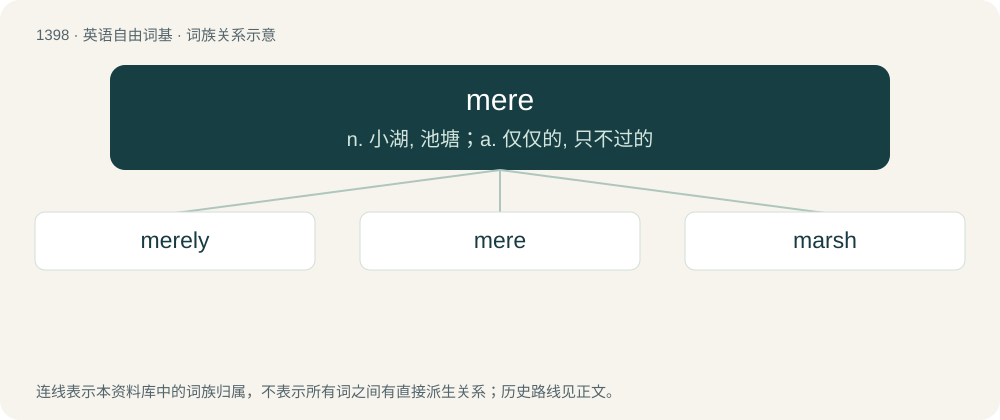

# 1485 · mere — n. 小湖, 池塘；a. 仅仅的, 只不过的

[总目录](../00_总目录_按常用程度.md)

**类型**：英语自由词基　｜　**来源语言**：见词源记录

## 核心含义与来源

- 核心含义：n. 小湖, 池塘；a. 仅仅的, 只不过的
- 英文含义：Just, only; no more than, pure and simple, neither more nor better than might be expected.
- 词形：mere

**多个词源／构词路径**：同一拼写可能有不同来源；以下按词性和含义分别列出。

**来源记录 1**（形容词；Just, only; no more than, pure and simple, neither more nor better than might be expected.）

From Middle English mere, mer, from Anglo-Norman meer, from Old French mier, from Latin merus (“pure, unmixed, undiluted”), from Proto-Indo-European \*mer- (“to sparkle, gleam”). Cognate with Old English āmerian, āmyrian (“to purify, examine, revise”). The Middle English word was perhaps influenced by or conflated with sound-alike Middle English mere (“glorious, noble, splendid, fine, pure”), from Old English mǣre (“famous, great, excellent, sublime, splendid, pure, sterling”), from Proto-West Germanic \*mārī, from Proto-Germanic \*mērijaz.

**来源记录 2**（名词；Boundary, limit; a boundary-marker; boundary-line.）

From Middle English mere, from Old English mǣre, ġemǣre (“boundary; limit”), from Proto-Germanic \*mairiją (“boundary”), from Proto-Indo-European \*mey- (“to fence”). Cognate with Dutch meer (“a limit, boundary”), Icelandic mærr (“borderland”), Swedish landamäre (“border, borderline, boundary”).

**来源记录 3**（名词；A body of standing water, inclusive of lakes, ponds, and pools, especially any broad and shallow one.）

From Middle English mere, from Old English mere (“lake, pool,” in compounds and poetry “sea”), from Proto-West Germanic \*mari (“sea”), from Proto-Germanic \*mari, from Proto-Indo-European \*móri. Cognate with West Frisian mar, 'lake', Dutch meer, 'lake', Low German Meer, and German Meer, 'sea'. Non-Germanic cognates include Latin mare, Breton mor, and Russian мо́ре (móre). Doublet of maar and mare (“a large, dark plain; a lake on Titan”).

**来源记录 4**（名词；A Maori war-club.）

Borrowed from Māori mere (“more”).

## 词族图

## 单词速览（常用到不常用）

| 单词 | 音标 | 释义 |
|---|---|---|
| [merely](#w-1) | 英 /ˈmɪəli/；美 /ˈmɪɹli/ | adv. 只 |
| [mere](#w-2) | 英 /mɪə̯/；美 /mɪɚ/ | n. 小湖, 池塘；a. 仅仅的, 只不过的 |
| [marsh](#w-3) | 英 /mɑːʃ/；美 /mɑɹʃ/ | n. 沼泽, 湿地；a. 沼泽的 |

## 逐词详解

### 1. merely

**词性**：副词　｜　**音标**：英 /ˈmɪəli/；美 /ˈmɪɹli/

**中文释义**：adv. 只

**英文义项**：Without any other reason etc.; only, just, and nothing more.

**构词拆分**：mere + -ly

**词源与演化**：

From Middle English mereli, equivalent to mere + -ly.

**例句**：

> I was merely asking.

该用例对应义项：and nothing more

### 2. mere

**词性**：形容词　｜　**音标**：英 /mɪə̯/；美 /mɪɚ/

**中文释义**：n. 小湖, 池塘；a. 仅仅的, 只不过的

**英文义项**：Just, only; no more than, pure and simple, neither more nor better than might be expected.

**词源与演化**：

From Middle English mere, mer, from Anglo-Norman meer, from Old French mier, from Latin merus (“pure, unmixed, undiluted”), from Proto-Indo-European \*mer- (“to sparkle, gleam”). Cognate with Old English āmerian, āmyrian (“to purify, examine, revise”). The Middle English word was perhaps influenced by or conflated with sound-alike Middle English mere (“glorious, noble, splendid, fine, pure”), from Old English mǣre (“famous, great, excellent, sublime, splendid, pure, sterling”), from Proto-West Germanic \*mārī, from Proto-Germanic \*mērijaz.

**例句**：

> The mere suggestion that the queen’s brother tried to kill your boy would be considered treason.

该用例对应义项：Just, only; no more than, pure and simple, neither more nor better than might be expected.

### 3. marsh

**词性**：名词　｜　**音标**：英 /mɑːʃ/；美 /mɑɹʃ/

**中文释义**：n. 沼泽, 湿地；a. 沼泽的

**英文义项**：An area of low, wet land, often with tall grass or herbaceous plants.

**构词拆分**：mere (“sea, body of water”) + -ish

**词源与演化**：

From Middle English mersch, from Old English mersċ, merisċ, from Proto-West Germanic \*marisk, derived from \*mari, equivalent to mere (“sea, body of water”) + -ish. Doublet of marish, morass, and merse. Cognate with West Frisian mersk, Dutch meers (“grassland, meadow”) and Dutch moeras, German Marsch. More at mere.

**例句**：

> Čepkeliai Marsh consists mainly of bog.

该用例对应义项：An area of low, wet land, often with tall grass or herbaceous plants.
