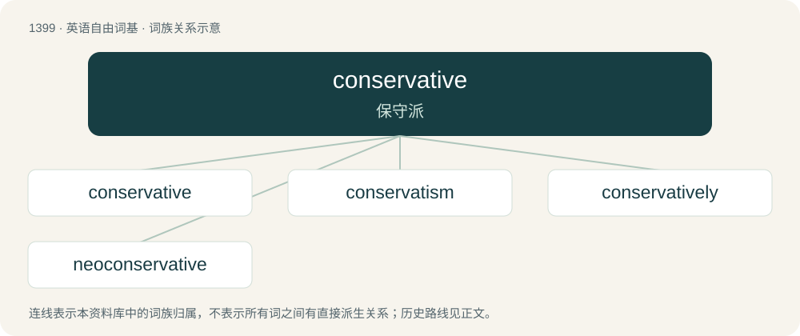

# 1486 · conservative — 保守派

[总目录](../00_总目录_按常用程度.md)

**类型**：英语自由词基　｜　**来源语言**：见词源记录

## 核心含义与来源

- 核心含义：保守派
- 英文含义：A person who favors maintenance of the status quo.
- 词形：conservative

**来源记录 1**（名词；A person who favors maintenance of the status quo.）

Borrowed from Middle French conservatif, from Latin cōnservō (“to preserve”). Equivalent to conserve + -ative.

## 词族图

## 单词速览（常用到不常用）

| 单词 | 音标 | 释义 |
|---|---|---|
| [conservative](#w-1) | 英 /kənˈsɜːvətɪv/；美 /kənˈsɝvətɪv/ | 【英文】Cautious, moderate. |
| [conservatism](#w-2) | 英 /kənˈsɜːvətɪzəm/；美 /kənˈsɝvətɪzəm/ | n. 保守, 守旧性, 保守主义, \[the\]保守党的主张和政策, 保守党；\[医\] 保守性 |
| [conservatively](#w-3) | /kənˈsɜːvətɪvlɪ/ | adv. 保存地; 保守地; 谨慎地 |
| [neoconservative](#w-4) | /,niːəjkənˈs\\\\ːvətiv/ | &lt;美&gt;n.(前自由派在政治上转向保守的) 新保守主义者, 新保守派 |

## 逐词详解

### 1. conservative

**词性**：形容词　｜　**音标**：英 /kənˈsɜːvətɪv/；美 /kənˈsɝvətɪv/

**英文义项**：Cautious, moderate. / Tending to resist change or innovation.

**构词拆分**：conserve + -ative

**词源与演化**：

Borrowed from Middle French conservatif, from Latin cōnservō (“to preserve”). Equivalent to conserve + -ative.

**例句**：

> The curriculum committee at this university is extremely conservative.

该用例对应义项：Tending to resist change or innovation.

### 2. conservatism

**词性**：名词　｜　**音标**：英 /kənˈsɜːvətɪzəm/；美 /kənˈsɝvətɪzəm/

**中文释义**：n. 保守, 守旧性, 保守主义, \[the\]保守党的主张和政策, 保守党；\[医\] 保守性

**英文义项**：A political philosophy that advocates traditional values. / A risk-averse attitude or approach.

**构词拆分**：conservative + -ism；conservate + -ism

**词源与演化**：

Either irregularly from conservative + -ism or from conservate + -ism; ultimately from Latin cōnservāre (“to conserve; to keep, guard, observe”).

**例句**：

> There is a growing trend in religious conservatism in Algeria.

### 3. conservatively

**词性**：副词　｜　**音标**：/kənˈsɜːvətɪvlɪ/

**中文释义**：adv. 保存地; 保守地; 谨慎地

**英文义项**：In a conservative manner.

**构词拆分**：conservative + -ly

**词源与演化**：

From conservative + -ly.

**例句**：

> We estimated the number of demonstrators conservatively at 200,000.

该用例对应义项：in a conservative manner

### 4. neoconservative

**词性**：名词　｜　**音标**：/,niːəjkənˈs\\\\ːvətiv/

**中文释义**：&lt;美&gt;n.(前自由派在政治上转向保守的) 新保守主义者, 新保守派

**英文义项**：A supporter of neoconservatism.

**构词拆分**：neo- + conservative

**词源与演化**：

From neo- + conservative.
