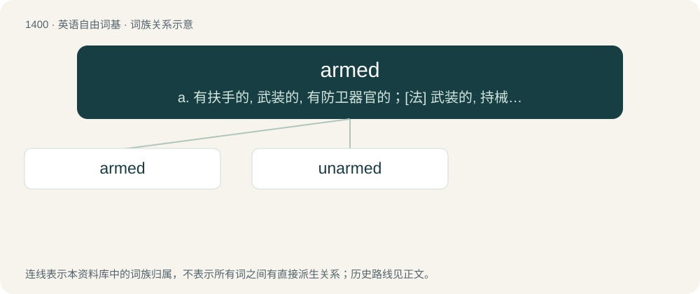

# 1487 · armed — a. 有扶手的, 武装的, 有防卫器官的；\[法\] 武装的, 持械的, "F带武器的

[总目录](../00_总目录_按常用程度.md)

**类型**：英语自由词基　｜　**来源语言**：见词源记录

## 核心含义与来源

- 核心含义：a. 有扶手的, 武装的, 有防卫器官的；\[法\] 武装的, 持械的, "F带武器的
- 英文含义：Equipped, especially with a weapon.
- 词形：armed

**多个词源／构词路径**：同一拼写可能有不同来源；以下按词性和含义分别列出。

**来源记录 1**（形容词；Equipped, especially with a weapon.）

From arm (“to equip with a weapon”) + -ed.

**来源记录 2**（形容词；Having an arm or arms, often of a specified number or type.）

From arm (“the upper limb of the body”) + -ed.

## 词族图

## 单词速览（常用到不常用）

| 单词 | 音标 | 释义 |
|---|---|---|
| [armed](#w-1) | 英 /ɑːmd/；美 /ɑɹmd/ | a. 有扶手的, 武装的, 有防卫器官的；\[法\] 武装的, 持械的, "F带武器的 |
| [unarmed](#w-2) | 美 /ˌʌnˈɑɹmd/ | a. 没有武装的, 非武装的, 徒手的, 手无寸铁的, 无突的, 无刺的 |

## 逐词详解

### 1. armed

**词性**：形容词　｜　**音标**：英 /ɑːmd/；美 /ɑɹmd/

**中文释义**：a. 有扶手的, 武装的, 有防卫器官的；\[法\] 武装的, 持械的, "F带武器的

**英文义项**：Equipped, especially with a weapon. / Equipped with a gun.

**构词拆分**：arm + -ed

**词源与演化**：

From arm (“to equip with a weapon”) + -ed.

**用法示例／搭配（非完整句）**：

> nuclear-armed

该用例对应义项：Equipped, especially with a weapon.

### 2. unarmed

**词性**：形容词　｜　**音标**：美 /ˌʌnˈɑɹmd/

**中文释义**：a. 没有武装的, 非武装的, 徒手的, 手无寸铁的, 无突的, 无刺的

**英文义项**：Defenceless and lacking weapons. / Lacking both weapons and protective armour.

**构词拆分**：un- + armed

**词源与演化**：

From un- + armed.

**例句**：

> An unarmed jellyfish would never capture prey.

该用例对应义项：Not having thorns, claws, or other dangerous appendages.
