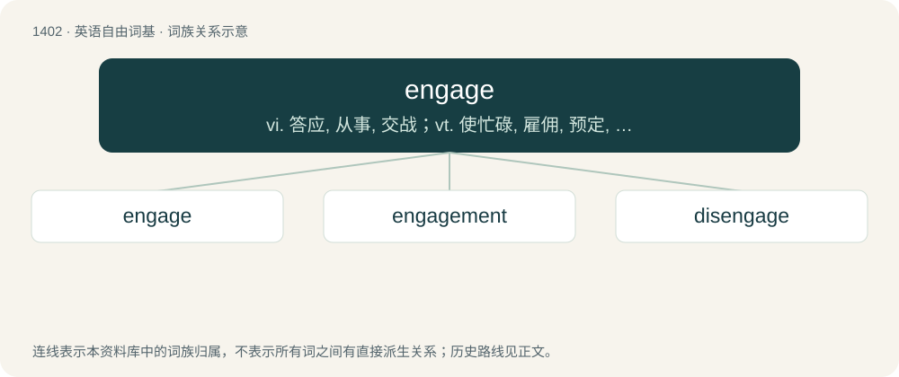

# 1488 · engage — vi. 答应, 从事, 交战；vt. 使忙碌, 雇佣, 预定, 使从事于, 使参加

[总目录](../00_总目录_按常用程度.md)

**类型**：英语自由词基　｜　**来源语言**：见词源记录

## 核心含义与来源

- 核心含义：vi. 答应, 从事, 交战；vt. 使忙碌, 雇佣, 预定, 使从事于, 使参加
- 英文含义：To engross or hold the attention of; to keep busy or occupied.
- 词形：engage

**来源记录 1**（动词；To engross or hold the attention of; to keep busy or occupied.）

From Middle English engagen, from Old French engagier (“to pledge, engage”), from Old French en- (“in, under”) + gage (“pledge”), from Frankish \*wadi (“pledge”), from Proto-Germanic \*wadją (“pledge, guarantee”), from Proto-Indo-European \*wedʰ- (“to pledge, redeem a pledge; guarantee, bail”), equivalent to en- + gage. Cognate with Old English weddian (“to engage, covenant, undertake”), German wetten (“to bet, wager”), Icelandic veðja (“to wager”). More at wed.

## 词族图

## 单词速览（常用到不常用）

| 单词 | 音标 | 释义 |
|---|---|---|
| [engage](#w-1) | /ɪnˈɡeɪd͡ʒ/ | vi. 答应, 从事, 交战；vt. 使忙碌, 雇佣, 预定, 使从事于, 使参加 |
| [engagement](#w-2) | /ɪnˈɡeɪd͡ʒ.mənt/ | n. 诺言, 约会, 婚约, 交战；\[医\] 衔接 |
| [disengage](#w-3) | /ˌdɪsɪŋˈɡeɪd͡ʒ/ | vt. 使脱离, 使松开, 使摆脱约束(或义务等)；vi. 脱离, 解脱 |

## 逐词详解

### 1. engage

**词性**：动词　｜　**音标**：/ɪnˈɡeɪd͡ʒ/

**中文释义**：vi. 答应, 从事, 交战；vt. 使忙碌, 雇佣, 预定, 使从事于, 使参加

**英文义项**：To engross or hold the attention of; to keep busy or occupied. / To draw into conversation.

**构词拆分**：en- + gage

**词源与演化**：

From Middle English engagen, from Old French engagier (“to pledge, engage”), from Old French en- (“in, under”) + gage (“pledge”), from Frankish \*wadi (“pledge”), from Proto-Germanic \*wadją (“pledge, guarantee”), from Proto-Indo-European \*wedʰ- (“to pledge, redeem a pledge; guarantee, bail”), equivalent to en- + gage. Cognate with Old English weddian (“to engage, covenant, undertake”), German wetten (“to bet, wager”), Icelandic veðja (“to wager”). More at wed.

**例句**：

> Whenever I engage the clutch, the car stalls out.

该用例对应义项：To mesh or interlock (of machinery, especially a clutch).

### 2. engagement

**词性**：名词　｜　**音标**：/ɪnˈɡeɪd͡ʒ.mənt/

**中文释义**：n. 诺言, 约会, 婚约, 交战；\[医\] 衔接

**英文义项**：An appointment, especially to speak or perform. / Connection or attachment.

**构词拆分**：engage + -ment

**词源与演化**：

From French engagement. Equivalent to engage + -ment.

**例句**：

> After engagement it quickly became clear which of the fencers was going to prevail.

该用例对应义项：The point at which the fencers are close enough to join blades, or to make an effective attack during an encounter.

### 3. disengage

**词性**：名词　｜　**音标**：/ˌdɪsɪŋˈɡeɪd͡ʒ/

**中文释义**：vt. 使脱离, 使松开, 使摆脱约束(或义务等)；vi. 脱离, 解脱

**英文义项**：A circular movement of the blade that avoids the opponent's parry

**构词拆分**：dis- + engage

**词源与演化**：

From Middle French désengager ; dis- + engage.
