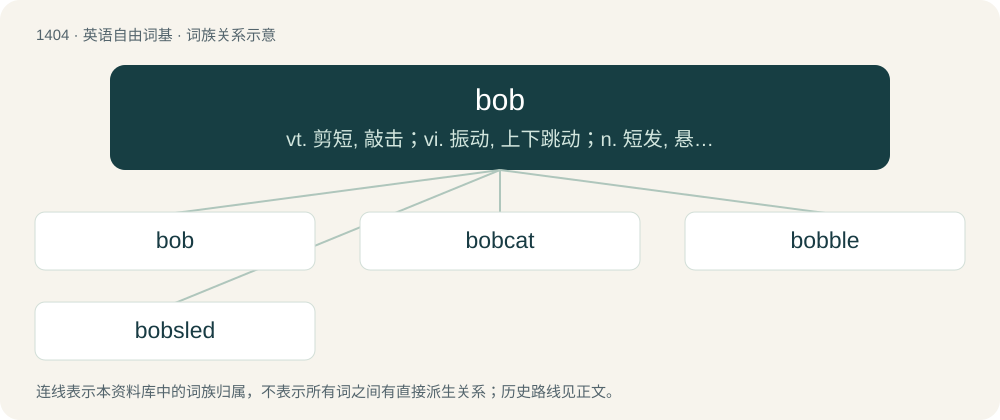

# 1490 · bob — vt. 剪短, 敲击；vi. 振动, 上下跳动；n. 短发, 悬挂的饰品, 浮子, 摆动, 轻敲, 5便士

[总目录](../00_总目录_按常用程度.md)

**类型**：英语自由词基　｜　**来源语言**：见词源记录

## 核心含义与来源

- 核心含义：vt. 剪短, 敲击；vi. 振动, 上下跳动；n. 短发, 悬挂的饰品, 浮子, 摆动, 轻敲, 5便士
- 英文含义：To move gently and vertically, in either a single motion or repeatedly up and down, at or near the surface of a body of water, or similar medium.
- 词形：bob

**多个词源／构词路径**：同一拼写可能有不同来源；以下按词性和含义分别列出。

**来源记录 1**（动词；To move gently and vertically, in either a single motion or repeatedly up and down, at or near the surface of a body of water, or similar medium.）

From Middle English bobben (“to move up and down or back and forth”), of uncertain origin. Compare Scots bob (“to mark, dance with a bobbing motion”), Icelandic boppa (“to wave up and down”), Swedish bobba (“to bob”), Faroese bøbbur (“something that rises or stands up; top”), Dutch dobberen (“to float, bob”).

**来源记录 2**（名词；A bob haircut.）

From Middle English bobbe (“a cluster (of fruit); a twig with its leaves, a spray”), perhaps of Celtic origin (compare Irish baban "tassel, cluster," Gaelic babag).

**来源记录 3**（名词；A graphical element, resembling a hardware sprite, that can be blitted around the screen in large numbers.）

Blend of blitter object.

## 词族图

## 单词速览（常用到不常用）

| 单词 | 音标 | 释义 |
|---|---|---|
| [bob](#w-1) | 英 /bɒb/；美 /bɑb/ | vt. 剪短, 敲击；vi. 振动, 上下跳动；n. 短发, 悬挂的饰品, 浮子, 摆动, 轻敲, 5便士 |
| [bobcat](#w-2) | 英 /ˈbɒb.kæt/；美 /ˈbɔb.kæt/ | n. 红猫, 短尾猫 |
| [bobble](#w-3) | /ˈbɒbəl/ | n. 在篮圈上跳动, 漏接, 漏踢, 失误 |
| [bobsled](#w-4) | /ˈbɑbˌslɛd/ | n. 长橇 |

## 逐词详解

### 1. bob

**词性**：动词　｜　**音标**：英 /bɒb/；美 /bɑb/

**中文释义**：vt. 剪短, 敲击；vi. 振动, 上下跳动；n. 短发, 悬挂的饰品, 浮子, 摆动, 轻敲, 5便士

**英文义项**：To move gently and vertically, in either a single motion or repeatedly up and down, at or near the surface of a body of water, or similar medium. / To move (something) as though it were bobbing in water.

**词源与演化**：

From Middle English bobben (“to move up and down or back and forth”), of uncertain origin. Compare Scots bob (“to mark, dance with a bobbing motion”), Icelandic boppa (“to wave up and down”), Swedish bobba (“to bob”), Faroese bøbbur (“something that rises or stands up; top”), Dutch dobberen (“to float, bob”).

**用法示例／搭配（非完整句）**：

> bob one’s head

该用例对应义项：To move (something) as though it were bobbing in water.

### 2. bobcat

**词性**：名词　｜　**音标**：英 /ˈbɒb.kæt/；美 /ˈbɔb.kæt/

**中文释义**：n. 红猫, 短尾猫

**英文义项**：A North American wildcat (Lynx rufus), having tufted ears and a short tail.

**构词拆分**：bob (short hair; with reference to its tail) + cat

**词源与演化**：

From bob (short hair; with reference to its tail) + cat.

**例句**：

> Pounce is an amber and gold bobcat with light brown eyes facial markings and a pink nose.

### 3. bobble

**词性**：名词　｜　**音标**：/ˈbɒbəl/

**中文释义**：n. 在篮圈上跳动, 漏接, 漏踢, 失误

**英文义项**：A furry ball attached on top of a hat. / Elasticated band used for securing hair (for instance in a ponytail), a hair tie

**构词拆分**：bob + -le (diminutive suffix)；bob + -le (frequentative suffix)

**词源与演化**：

\* (noun): from bob + -le (diminutive suffix). \* (verb): from bob + -le (frequentative suffix). Compare bauble.

**例句**：

> Mary watch the figurine's head bobble.

### 4. bobsled

**词性**：名词　｜　**音标**：/ˈbɑbˌslɛd/

**中文释义**：n. 长橇

**英文义项**：Synonym of bobsleigh: a sled used to go down a bob track. / Synonym of bobsleigh: the sport of travelling down a bob track as fast as possible.

**构词拆分**：bob + sled

**词源与演化**：

From bob + sled.

**例句**：

> Benedito wants to ride the bobsled.
