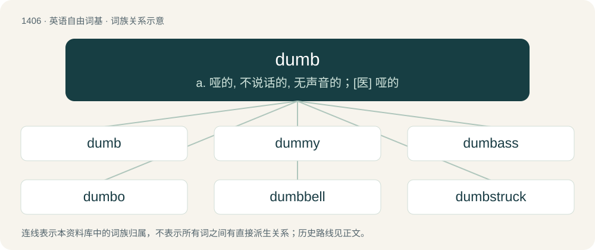

# 1492 · dumb — a. 哑的, 不说话的, 无声音的；\[医\] 哑的

[总目录](../00_总目录_按常用程度.md)

**类型**：英语自由词基　｜　**来源语言**：见词源记录

## 核心含义与来源

- 核心含义：a. 哑的, 不说话的, 无声音的；\[医\] 哑的
- 英文含义：Unable to speak; lacking power of speech.
- 词形：dumb

**多个词源／构词路径**：同一拼写可能有不同来源；以下按词性和含义分别列出。

**来源记录 1**（形容词；Unable to speak; lacking power of speech.）

From Middle English dumb (“silent, speechless, mute, ineffectual”), from Old English dumb (“silent, speechless, mute, unable to speak”), from Proto-West Germanic \*dumb, from Proto-Germanic \*dumbaz (“dull, dumb”), from Proto-Indo-European \*dʰewbʰ- (“to whisk, smoke, darken, obscure”). The senses of stupid, unintellectual, and pointless, which are found regularly since the 19th century only, probably developed under the influence of German dumm and Dutch dom. Just like the English word, these originally meant "lacking the power of speech", but they developed the mentioned senses early on. Cognates Cognate with Scots dumb (“dumb, silent”), North Frisian dom, domme (“dumb, stupid”), West Frisian dom (“dumb, stupid”), Dutch dom (“dumb, stupid”), German dumm (“dumb, stupid”), Danish dum (“stupid”), Swedish dum (“stupid”), Icelandic dumbur (“dumb, mute”). See also deaf.

**来源记录 2**（动词；To silence.）

From Middle English dumben, from Old English \*dumbian (found in the compound ādumbian (“to become mute or dumb; keep silence; hold one’s peace”)), from Proto-Germanic \*dumbijaną, \*dumbōną (“to be silent, become dumb”), from Proto-Indo-European \*dʰewbʰ- (“to whisk, smoke, darken, obscure”). Cognate with German verdummen (“to become dumb”).

**来源记录 3**（副词；Very, extremely.）

A minced oath of damn.

## 词族图

## 单词速览（常用到不常用）

| 单词 | 音标 | 释义 |
|---|---|---|
| [dumb](#w-1) | /dʌm/ | a. 哑的, 不说话的, 无声音的；\[医\] 哑的 |
| [dummy](#w-2) | /ˈdʌmi/ | n. 傀儡, 假人, 仿制品；a. 虚设的, 假的, 名义上的 |
| [dumbass](#w-3) | /ˈdʌm.æs/ | n. （俚）笨蛋, 傻子 |
| [dumbo](#w-4) | 英 /ˈdʌmbəʊ/；美 /ˈdʌmboʊ/ | \[美口\]救护(搜索)飞机 |
| [dumbbell](#w-5) | /ˈdʌm.bɛl/ | n. 哑铃；\[医\] 哑铃 |
| [dumbstruck](#w-6) | 美 /ˈdʌmˌstɹʌk/ | a. 被吓得发愣的, 惊呆的 |

## 逐词详解

### 1. dumb

**词性**：形容词　｜　**音标**：/dʌm/

**中文释义**：a. 哑的, 不说话的, 无声音的；\[医\] 哑的

**英文义项**：Unable to speak; lacking power of speech. / Having no input or voice in running things.

**词源与演化**：

From Middle English dumb (“silent, speechless, mute, ineffectual”), from Old English dumb (“silent, speechless, mute, unable to speak”), from Proto-West Germanic \*dumb, from Proto-Germanic \*dumbaz (“dull, dumb”), from Proto-Indo-European \*dʰewbʰ- (“to whisk, smoke, darken, obscure”). The senses of stupid, unintellectual, and pointless, which are found regularly since the 19th century only, probably developed under the influence of German dumm and Dutch dom. Just like the English word, these originally meant "lacking the power of speech", but they developed the mentioned senses early on. Cognates Cognate with Scots dumb (“dumb, silent”), North Frisian dom, domme (“dumb, stupid”), West Frisian dom (“dumb, stupid”), Dutch dom (“dumb, stupid”), German dumm (“dumb, stupid”), Danish dum (“stupid”), Swedish dum (“stupid”), Icelandic dumbur (“dumb, mute”). See also deaf.

**例句**：

> This is dumb! We're driving in circles! We should have asked for directions an hour ago!

该用例对应义项：Pointless, foolish, lacking intellectual content or value.

### 2. dummy

**词性**：名词　｜　**音标**：/ˈdʌmi/

**中文释义**：n. 傀儡, 假人, 仿制品；a. 虚设的, 假的, 名义上的

**英文义项**：A silent person; a person who does not talk. / A stupid person.

**构词拆分**：dumb + -y

**词源与演化**：

From dumb + -y. Pacifier sense from dummy teat where dummy is in the sense of a nonfunctional replica.

**例句**：

> To understand the effects of the accident, we dropped a dummy from the rooftop.

该用例对应义项：Something constructed with the size and form of a human, to be used in place of a person.

### 3. dumbass

**词性**：名词　｜　**音标**：/ˈdʌm.æs/

**中文释义**：n. （俚）笨蛋, 傻子

**英文义项**：A stupid or foolish person.

**构词拆分**：dumb + ass

**词源与演化**：

From dumb + ass. It is likely that ¹ass (= donkey), not ²ass (= buttocks), was the original sense within this compound noun (solid compound or open compound), but neither sense is precluded, and many people today may uncritically parse the term in the latter way, even if it is misapprehensive. Apparent analogy with forms such as hard-ass and big-ass would naturally lend support to the second parsing. A similar synergy can be seen in the fact that the terms buttload and assload originated as literally meaning a cartload and the load transportable by a single donkey (respectively), but probably most English speakers today would assume that their derivation involves the buttocks.

**例句**：

> The dumbass walked off with my car keys and left me hers.

该用例对应义项：A stupid or foolish person.

### 4. dumbo

**词性**：名词　｜　**音标**：英 /ˈdʌmbəʊ/；美 /ˈdʌmboʊ/

**中文释义**：\[美口\]救护(搜索)飞机

**英文义项**：A stupid person.

**构词拆分**：dumb + -o

**词源与演化**：

From dumb + -o.

### 5. dumbbell

**词性**：名词　｜　**音标**：/ˈdʌm.bɛl/

**中文释义**：n. 哑铃；\[医\] 哑铃

**英文义项**：A weight training implement consisting of a short bar with weight counterpoised on each end. / A stupid person.

**构词拆分**：dumb (“silent”) + bell (“a resonating instrument”)

**词源与演化**：

From dumb (“silent”) + bell (“a resonating instrument”). The term "dumbbell" originated in 16th-century England to describe silent exercise apparatus used in practicing the motions of ringing church bells noiselessly. To aid them in the practice of their physically demanding vocation, bellringers originally used weighted ropes on fixed pulleys to mimic the motion of ringing a church bell; since such apparatus made no noise while imitating the motion of ringing a swinging bell via a fixed pulley, they were called "dumb bells". Later, the rope-and-pulley weights evolved into simple hand-held weights used by ringers for strengthening the shoulder and back muscles heavily used in tower bellringing, and the term "'dumb bell'" evolved into the compound word "'dumbbell'".

**例句**：

> He was exercising with the dumbbells in gym class today.

该用例对应义项：A weight training implement consisting of a short bar with weight counterpoised on each end.

### 6. dumbstruck

**词性**：形容词　｜　**音标**：美 /ˈdʌmˌstɹʌk/

**中文释义**：a. 被吓得发愣的, 惊呆的

**英文义项**：So shocked as to be unable to speak.

**构词拆分**：dumb + struck

**词源与演化**：

From dumb + struck. Comapare strike dumb.
