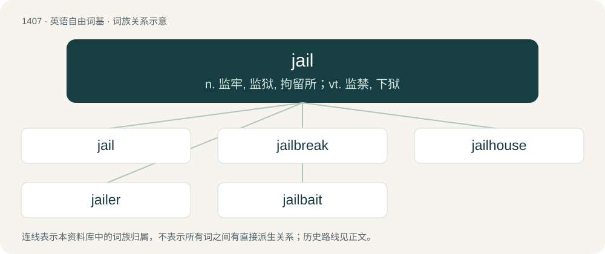

# 1493 · jail — n. 监牢, 监狱, 拘留所；vt. 监禁, 下狱

[总目录](../00_总目录_按常用程度.md)

**类型**：英语自由词基　｜　**来源语言**：见词源记录

## 核心含义与来源

- 核心含义：n. 监牢, 监狱, 拘留所；vt. 监禁, 下狱
- 英文含义：A place or institution for the confinement of persons held against their will in lawful custody or detention, especially (in US usage) a place where people are held for minor offenses or with reference to some future judicial proceeding.
- 词形：jail

**来源记录 1**（名词；A place or institution for the confinement of persons held against their will in lawful custody or detention, especially (in US usage) a place where people are held for minor offenses or with reference to some future judicial proceeding.）

Inherited from Middle English gayole, borrowed from Anglo-Norman jaiole, from Late Latin caveola, from Latin cavea (“cage”) + -ola (diminutive ending). Doublet of caveola and related to cage. More at cajole. Fully displaced native Middle English quartern (“prison, jail, cell”), from Old English cweartern (“jail, prison”). Partially displaced native Middle English lok, from Old English loc (“enclosure, pen; jail, prison”), whence lock; and Middle English carcern, from Old English carcern, from Latin carcer (“prison, jail”). Compare these Old English words, all meaning “jail”: heaþor, heolstorloca (means also “jail cell”), clūstorloc, dung (also “dungeon”), hlinræced, nirwþ, nīedcleofa, hearmloca, and nearu.

## 词族图

## 单词速览（常用到不常用）

| 单词 | 音标 | 释义 |
|---|---|---|
| [jail](#w-1) | /d͡ʒeɪl/ | n. 监牢, 监狱, 拘留所；vt. 监禁, 下狱 |
| [jailbreak](#w-2) | /ˈd͡ʒeɪlˌbɹeɪk/ | n. 越狱 |
| [jailhouse](#w-3) | 美 /ˈd͡ʒeɪlˌhaʊs/ | n. 监狱 |
| [jailer](#w-4) | /ˈd͡ʒeɪlə(ɹ)/ | n. 看守监狱的人, 狱卒；\[法\] 看守, 狱卒, 监狱管理员 |
| [jailbait](#w-5) | /ˈd͡ʒeɪlbeɪt/ | \[法\] 未成年女子, 诱惑, 性感女子 |

## 逐词详解

### 1. jail

**词性**：名词　｜　**音标**：/d͡ʒeɪl/

**中文释义**：n. 监牢, 监狱, 拘留所；vt. 监禁, 下狱

**英文义项**：A place or institution for the confinement of persons held against their will in lawful custody or detention, especially (in US usage) a place where people are held for minor offenses or with reference to some future judicial proceeding. / Confinement in a jail.

**词源与演化**：

Inherited from Middle English gayole, borrowed from Anglo-Norman jaiole, from Late Latin caveola, from Latin cavea (“cage”) + -ola (diminutive ending). Doublet of caveola and related to cage. More at cajole. Fully displaced native Middle English quartern (“prison, jail, cell”), from Old English cweartern (“jail, prison”). Partially displaced native Middle English lok, from Old English loc (“enclosure, pen; jail, prison”), whence lock; and Middle English carcern, from Old English carcern, from Latin carcer (“prison, jail”). Compare these Old English words, all meaning “jail”: heaþor, heolstorloca (means also “jail cell”), clūstorloc, dung (also “dungeon”), hlinræced, nirwþ, nīedcleofa, hearmloca, and nearu.

**例句**：

> She visited her brother in jail.

该用例对应义项：A place or institution for the confinement of persons held against their will in lawful custody or detention, especially (in US usage) a place where people are held for minor offenses or with reference to some future judicial proceeding.

### 2. jailbreak

**词性**：名词　｜　**音标**：/ˈd͡ʒeɪlˌbɹeɪk/

**中文释义**：n. 越狱

**英文义项**：An escape from prison. / A modification to a closed platform's technical restrictions that enables installation or execution of software (or OS modification) the platform's original design was intended to prevent. Typical devices are iPhones and game consoles.

**构词拆分**：jail + break

**词源与演化**：

From jail + break.

### 3. jailhouse

**词性**：名词　｜　**音标**：美 /ˈd͡ʒeɪlˌhaʊs/

**中文释义**：n. 监狱

**英文义项**：A building containing a prison.

**构词拆分**：jail + house

**词源与演化**：

From jail + house.

**例句**：

> The quadruplets are only distinguishable by little jailhouse tattoos behind their ears.

### 4. jailer

**词性**：名词　｜　**音标**：/ˈd͡ʒeɪlə(ɹ)/

**中文释义**：n. 看守监狱的人, 狱卒；\[法\] 看守, 狱卒, 监狱管理员

**英文义项**：One who enforces confinement in a jail or prison.

**构词拆分**：By surface analysis, jail + -er

**词源与演化**：

Inherited from Middle English gayoler, gayler, jayler, from Old French jaiolier, gaiolier, from jaiole. By surface analysis, jail + -er.

**例句**：

> Conformity is the jailer of freedom and the enemy of growth.

### 5. jailbait

**词性**：名词　｜　**音标**：/ˈd͡ʒeɪlbeɪt/

**中文释义**：\[法\] 未成年女子, 诱惑, 性感女子

**英文义项**：A sexually mature person below, or appearing to be below, the legal age of consent, who is regarded, usually by an adult, as being sexually attractive and/or seductive.

**构词拆分**：jail + bait

**词源与演化**：

From jail + bait, from the fact that statutory rape can result, for the adult committing it, in incarceration.

**例句**：

> My ex's new girlfriend looks like jailbait.
