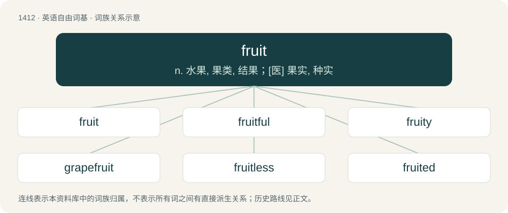

# 1494 · fruit — n. 水果, 果类, 结果；\[医\] 果实, 种实

[总目录](../00_总目录_按常用程度.md)

**类型**：英语自由词基　｜　**来源语言**：见词源记录

## 核心含义与来源

- 核心含义：n. 水果, 果类, 结果；\[医\] 果实, 种实
- 英文含义：A product of fertilization in a plant, specifically
- 词形：fruit

**来源记录 1**（名词；A product of fertilization in a plant, specifically）

From Middle English fruyt, frut (“fruits and vegetables”), from Old French fruit (“produce, fruits and vegetables”), from Latin fruitus (“enjoyment, proceeds, profits, produce, income”), frūctus and frūx (“crop, produce, fruit”) (compare Latin fruor (“have the benefit of, to use, to enjoy”)). Cognate with English brook (“to bear, tolerate”) and German brauchen (“to need”). Partially displaced native Old English wæstm, ofett and æppel (whence modern ovest and apple). Compare Dutch vrucht, German Frucht, Norwegian Bokmål, Norwegian Nynorsk, and Swedish frukt, Danish frugt. In the derogatory senses of “crazy person” and “homosexual or effeminate man”, possibly a shortening of fruitcake, or of independent origin, compare Fruit (slang).

## 词族图

## 单词速览（常用到不常用）

| 单词 | 音标 | 释义 |
|---|---|---|
| [fruit](#w-1) | 英 /fɹuːt/；美 /fɹut/ | n. 水果, 果类, 结果；\[医\] 果实, 种实 |
| [fruitful](#w-2) | /ˈfɹuːtfl̩/ | a. 结果实的, 多实的, 产量多的 |
| [fruity](#w-3) | /ˈfɹuːti/ | a. 水果的, 有果味的, 有(低级)趣味的, 圆润的 |
| [grapefruit](#w-4) | 英 /ˈɡɹeɪ̯pfɹuːt/；美 /ˈɡɹeɪ̯pfɹut/ | n. 葡萄轴 |
| [fruitless](#w-5) | 英 /ˈfɹuːtləs/；美 /ˈfɹutləs/ | a. 不结果的, 不长果实的, 无子的 |
| [fruited](#w-6) |  | a. 结有果实的, 加水果(调味)的 |

## 逐词详解

### 1. fruit

**词性**：名词　｜　**音标**：英 /fɹuːt/；美 /fɹut/

**中文释义**：n. 水果, 果类, 结果；\[医\] 果实, 种实

**英文义项**：A product of fertilization in a plant, specifically / The seed-bearing part of a plant; often edible, colourful, fragrant, and sweet or sour; produced from a floral ovary after fertilization.

**词源与演化**：

From Middle English fruyt, frut (“fruits and vegetables”), from Old French fruit (“produce, fruits and vegetables”), from Latin fruitus (“enjoyment, proceeds, profits, produce, income”), frūctus and frūx (“crop, produce, fruit”) (compare Latin fruor (“have the benefit of, to use, to enjoy”)). Cognate with English brook (“to bear, tolerate”) and German brauchen (“to need”). Partially displaced native Old English wæstm, ofett and æppel (whence modern ovest and apple). Compare Dutch vrucht, German Frucht, Norwegian Bokmål, Norwegian Nynorsk, and Swedish frukt, Danish frugt. In the derogatory senses of “crazy person” and “homosexual or effeminate man”, possibly a shortening of fruitcake, or of independent origin, compare Fruit (slang).

**例句**：

> His long nights in the office eventually bore fruit when his business boomed and he was given a raise.

该用例对应义项：An end result, effect, or consequence; advantageous or disadvantageous result.

### 2. fruitful

**词性**：形容词　｜　**音标**：/ˈfɹuːtfl̩/

**中文释义**：a. 结果实的, 多实的, 产量多的

**英文义项**：Favourable to the growth of fruit or useful vegetation; not barren. / Being productive in any sense; yielding benefits.

**构词拆分**：fruit + -ful

**词源与演化**：

From Middle English fruitefull, equivalent to fruit + -ful. Compare Dutch vruchtvol, German fruchtvoll, Swedish fruktfull.

**用法示例／搭配（非完整句）**：

> The extra work in the office turned out to be fruitful after all—I got promoted

该用例对应义项：Being productive in any sense; yielding benefits.

### 3. fruity

**词性**：形容词　｜　**音标**：/ˈfɹuːti/

**中文释义**：a. 水果的, 有果味的, 有(低级)趣味的, 圆润的

**英文义项**：Containing fruit or fruit flavoring. / Similar to fruit or tasting of fruit.

**构词拆分**：fruit + -y

**词源与演化**：

From fruit + -y.

**例句**：

> His text message was filled with fruity language.

该用例对应义项：Sexually suggestive.

### 4. grapefruit

**词性**：名词　｜　**音标**：英 /ˈɡɹeɪ̯pfɹuːt/；美 /ˈɡɹeɪ̯pfɹut/

**中文释义**：n. 葡萄轴

**英文义项**：The tree of the species Citrus paradisi, a hybrid of Citrus maxima and sweet orange. / The large spherical tart fruit produced by this tree.

**构词拆分**：grape + fruit + greatfruit；grape + fruit

**词源与演化**：

Widely assumed to be a marketing term from grape + fruit, an allusion to the supposed grapelike clusters of fruit on the tree, early 19th c. Ciardi proposes another theory: one of the pomelo's botanical names is Citrus grandis, meaning “great citrus \[fruit\]”, due to the size of its fruit. A new pomelo variety might first have been called a GRAYT-froot (see greatfruit), and through the process of assimilation, the word came to be pronounced GRAYP-froot.

**例句**：

> Cupping her grapefruits in her hands, she closed her eyes and imagined her date grasping them, exploring their size, weight, and firmness.

该用例对应义项：Large breasts; by extension, a woman with large breasts.

### 5. fruitless

**词性**：形容词　｜　**音标**：英 /ˈfɹuːtləs/；美 /ˈfɹutləs/

**中文释义**：a. 不结果的, 不长果实的, 无子的

**英文义项**：Bearing no fruit; barren. / Unproductive, useless.

**构词拆分**：fruit + -less

**词源与演化**：

Inherited from Middle English fruytles; equivalent to fruit + -less. Compare Middle English withouten fruyt (“fruitless”, literally “without fruit”).

**例句**：

> The unskilled man’s attempt at fixing his car engine was fruitless.

该用例对应义项：Unproductive, useless.

### 6. fruited

**词性**：形容词

**中文释义**：a. 结有果实的, 加水果(调味)的

**英文义项**：Containing fruit; bearing fruit. / Bearing fruit or acorns, typically of a specified tincture.

**构词拆分**：fruit + -ed

**词源与演化**：

From fruit + -ed.
