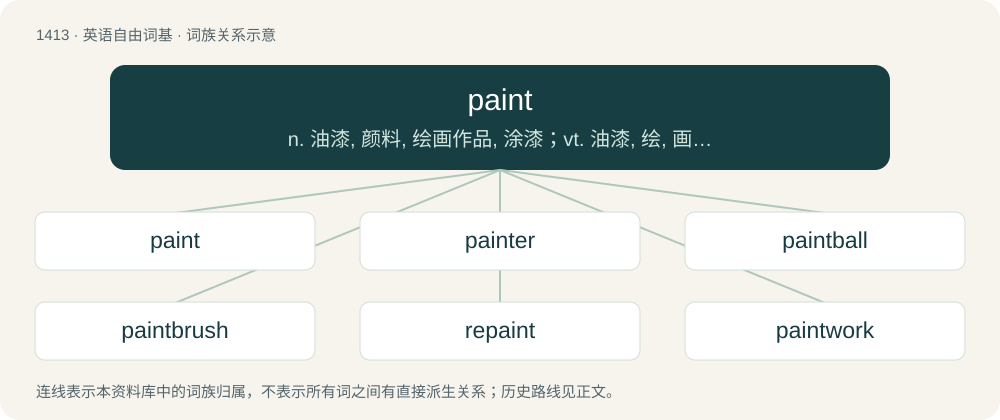

# 1495 · paint — n. 油漆, 颜料, 绘画作品, 涂漆；vt. 油漆, 绘, 画, 描绘, 装饰, 点缀；vi. 绘画, 涂漆

[总目录](../00_总目录_按常用程度.md)

**类型**：英语自由词基　｜　**来源语言**：见词源记录

## 核心含义与来源

- 核心含义：n. 油漆, 颜料, 绘画作品, 涂漆；vt. 油漆, 绘, 画, 描绘, 装饰, 点缀；vi. 绘画, 涂漆
- 英文含义：A substance that is applied as a liquid or paste, and dries into a solid coating that protects or adds colour to an object or surface to which it has been applied.
- 词形：paint

**来源记录 1**（名词；A substance that is applied as a liquid or paste, and dries into a solid coating that protects or adds colour to an object or surface to which it has been applied.）

From Middle English peynten, from Old French peintier, paincter, itself from paint, the past participle of paindre, from Latin pingō (“to paint”) (perfect passive participle pictus). Displaced native Old English tēafor (“paint”), \*tīefran (“to paint”); and Old English mētan (“to paint”) and mǣlan (“to paint, mark with colour”).

## 词族图

## 单词速览（常用到不常用）

| 单词 | 音标 | 释义 |
|---|---|---|
| [paint](#w-1) | /peɪnt/ | n. 油漆, 颜料, 绘画作品, 涂漆；vt. 油漆, 绘, 画, 描绘, 装饰, 点缀；vi. 绘画, 涂漆 |
| [painter](#w-2) | 英 /ˈpeɪntə/；美 /ˈpeɪntɚ/ | n. 画家, 油漆匠；\[机\] 油漆匠, 喷漆匠 |
| [paintball](#w-3) | /ˈpeɪntbɔːl/ | n. 彩弹球；漆弹游戏 |
| [paintbrush](#w-4) | /ˈpeɪntˌbɹʌʃ/ | n. 画笔, 漆刷；\[计\] 画笔 |
| [repaint](#w-5) | /ɹiːˈpeɪnt/ | v. 重漆, 重画；\[计\] 重新绘制 |
| [paintwork](#w-6) | /ˈpeintw\\\\ːk/ | n. 油漆的表面 |

## 逐词详解

### 1. paint

**词性**：名词　｜　**音标**：/peɪnt/

**中文释义**：n. 油漆, 颜料, 绘画作品, 涂漆；vt. 油漆, 绘, 画, 描绘, 装饰, 点缀；vi. 绘画, 涂漆

**英文义项**：A substance that is applied as a liquid or paste, and dries into a solid coating that protects or adds colour to an object or surface to which it has been applied. / A set of containers or blocks of paint of different colors/colours, used for painting pictures.

**词源与演化**：

From Middle English peynten, from Old French peintier, paincter, itself from paint, the past participle of paindre, from Latin pingō (“to paint”) (perfect passive participle pictus). Displaced native Old English tēafor (“paint”), \*tīefran (“to paint”); and Old English mētan (“to paint”) and mǣlan (“to paint, mark with colour”).

**例句**：

> The Nimrods are strong on the outside, but not very good in the paint.

该用例对应义项：The free-throw lane, construed with the.

### 2. painter

**词性**：名词　｜　**音标**：英 /ˈpeɪntə/；美 /ˈpeɪntɚ/

**中文释义**：n. 画家, 油漆匠；\[机\] 油漆匠, 喷漆匠

**英文义项**：An artist who paints pictures. / A laborer or workman who paints surfaces using a paintbrush or other means.

**构词拆分**：paint + -er

**词源与演化**：

Inherited from Middle English peyntour, from Old French peintor, equivalent to paint + -er.

**例句**：

> Not everyone who has a paintbrush in their hand is a painter.

### 3. paintball

**词性**：名词　｜　**音标**：/ˈpeɪntbɔːl/

**中文释义**：n. 彩弹球；漆弹游戏

**英文义项**：A sport where teams shoot each other with gelatin capsules filled with paint-like dye. / The dye-filled capsule fired in the sport of paintball.

**构词拆分**：paint + ball

**词源与演化**：

From paint + ball.

**例句**：

> Tom had a paintball gun in his hand.

### 4. paintbrush

**词性**：名词　｜　**音标**：/ˈpeɪntˌbɹʌʃ/

**中文释义**：n. 画笔, 漆刷；\[计\] 画笔

**英文义项**：A thin brush for applying paint.

**构词拆分**：paint + brush

**词源与演化**：

From paint + brush.

**例句**：

> Tom picked up a paintbrush and started helping Mary paint the fence.

### 5. repaint

**词性**：动词　｜　**音标**：/ɹiːˈpeɪnt/

**中文释义**：v. 重漆, 重画；\[计\] 重新绘制

**英文义项**：To paint anew or again, especially if recently painted. / To draw or render again on the display.

**构词拆分**：re- + paint

**词源与演化**：

From re- + paint (“verb”).

**用法示例／搭配（非完整句）**：

> to repaint a house; to repaint the ground of a picture

该用例对应义项：To paint anew or again, especially if recently painted.

### 6. paintwork

**词性**：名词　｜　**音标**：/ˈpeintw\\\\ːk/

**中文释义**：n. 油漆的表面

**英文义项**：The painted surface of a car, building, etc.

**构词拆分**：paint + work

**词源与演化**：

From paint + work.
