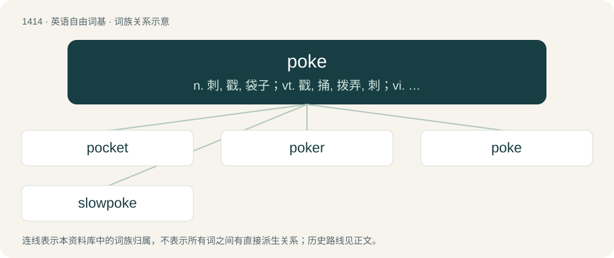

# 1496 · poke — n. 刺, 戳, 袋子；vt. 戳, 捅, 拨弄, 刺；vi. 戳, 刺, 捅, 搜索, 伸出, 行动散慢

[总目录](../00_总目录_按常用程度.md)

**类型**：英语自由词基　｜　**来源语言**：见词源记录

## 核心含义与来源

- 核心含义：n. 刺, 戳, 袋子；vt. 戳, 捅, 拨弄, 刺；vi. 戳, 刺, 捅, 搜索, 伸出, 行动散慢
- 英文含义：To prod or jab with an object such as a finger or a stick.
- 词形：poke

**多个词源／构词路径**：同一拼写可能有不同来源；以下按词性和含义分别列出。

**来源记录 1**（动词；To prod or jab with an object such as a finger or a stick.）

From Middle English poken, perhaps from Middle Dutch poken or Middle Low German poken, both from Proto-West Germanic \*pukōn or similar, which is itself of uncertain origin, but may be from an imitative Proto-Germanic root \*puk-. Doublet of poach. Compare Nordic cognates Swedish påka (“to poke, muck with a stick”), påk (“club, limb; dagger”), pykel (“small poker”), dialectal Norwegian pauka (“to walk stomping, etc”), pauk (“weak, slow person”). Central European noun-cognates refer to “dagger, bad knife, poker (for a fireplace)”, with analog verbs. To a Proto-Germanic \*pauk-, \*puk-, meanig, “to stick, muck with a stick”.

**来源记录 2**（名词；A sack or bag, especially a paper bag.）

From Middle English poke, from Anglo-Norman poke (whence pocket), from Frankish \*poka. More at pocket. Doublet of pouch. First attested in the early 13th c.

**来源记录 3**（名词；Pokeweed, and its berries.）

Clipping of pocan (“pokeweed”) or directly borrowed from Powhatan pocan. See pocan for more.

**来源记录 4**（名词；Slices or cubes of raw fish or other raw seafood, mixed with sesame oil, seaweed, sea salt, herbs, spices, or other flavorful ingredients.）

Borrowed from Hawaiian poke (literally “to cut crosswise into pieces”).

## 词族图

## 单词速览（常用到不常用）

| 单词 | 音标 | 释义 |
|---|---|---|
| [pocket](#w-1) | 英 /ˈpɒk.ɪt/；美 /ˈpɑ.kɪt/ | n. 口袋, 钱袋, 钱, 容器；vt. 装...在口袋里, 隐藏, 抑制, 私吞, 搁置, 击...入袋；a. 袖珍的, 小型的, 压缩的, 金钱上的 |
| [poker](#w-2) | 英 /ˈpəʊkə/；美 /ˈpoʊkɚ/ | n. 戳的人, 拨火棍, 纸牌戏；vt. 烙制 |
| [poke](#w-3) | 英 /pəʊk/；美 /poʊk/ | n. 刺, 戳, 袋子；vt. 戳, 捅, 拨弄, 刺；vi. 戳, 刺, 捅, 搜索, 伸出, 行动散慢 |
| [slowpoke](#w-4) | 美 /ˈsloʊˌpoʊk/ | n. 行动迟缓的人 |

## 逐词详解

### 1. pocket

**词性**：名词　｜　**音标**：英 /ˈpɒk.ɪt/；美 /ˈpɑ.kɪt/

**中文释义**：n. 口袋, 钱袋, 钱, 容器；vt. 装...在口袋里, 隐藏, 抑制, 私吞, 搁置, 击...入袋；a. 袖珍的, 小型的, 压缩的, 金钱上的

**英文义项**：A bag stitched to an item of clothing, used for carrying small items. / A person's financial resources.

**构词拆分**：poke + -et

**词源与演化**：

From Middle English pocket (“bag, sack”), from Anglo-Norman poket, Old Northern French poquet, poquete, diminutive of poque, poke (“bag, sack”) (compare modern Norman pouquette and modern French pochette from Old French pochete, from puche), from Frankish \*pokō (“pouch”), from Proto-Germanic \*puhô (“bag; pouch”), from Proto-Indo-European \*bew- (“to blow, swell”). Equivalent to poke + -et. Doublet of pochette. Cognate with Middle Dutch poke, Alemannic German Pfoch (“purse, bag”), Old English pocca, pohha (“poke, pouch, pocket, bag”), Old Norse poki (“bag, pocket”). Compare the related poke (“sack or bag”). See also Modern French pochette and Latin bucca.

**例句**：

> The drilling expedition discovered a pocket of natural gas.

该用例对应义项：An enclosed volume of one substance surrounded by another.

### 2. poker

**词性**：名词　｜　**音标**：英 /ˈpəʊkə/；美 /ˈpoʊkɚ/

**中文释义**：n. 戳的人, 拨火棍, 纸牌戏；vt. 烙制

**英文义项**：A metal rod, generally of wrought iron, for adjusting the burning logs or coals in a fire; a firestick. / One who pokes.

**构词拆分**：poke + -er

**词源与演化**：

From poke + -er.

**例句**：

> Tom wanted to play poker with us, but Mary wouldn't let him.

### 3. poke

**词性**：动词　｜　**音标**：英 /pəʊk/；美 /poʊk/

**中文释义**：n. 刺, 戳, 袋子；vt. 戳, 捅, 拨弄, 刺；vi. 戳, 刺, 捅, 搜索, 伸出, 行动散慢

**英文义项**：To prod or jab with an object such as a finger or a stick. / To stir up a fire to remove ash or promote burning.

**词源与演化**：

From Middle English poken, perhaps from Middle Dutch poken or Middle Low German poken, both from Proto-West Germanic \*pukōn or similar, which is itself of uncertain origin, but may be from an imitative Proto-Germanic root \*puk-. Doublet of poach. Compare Nordic cognates Swedish påka (“to poke, muck with a stick”), påk (“club, limb; dagger”), pykel (“small poker”), dialectal Norwegian pauka (“to walk stomping, etc”), pauk (“weak, slow person”). Central European noun-cognates refer to “dagger, bad knife, poker (for a fireplace)”, with analog verbs. To a Proto-Germanic \*pauk-, \*puk-, meanig, “to stick, muck with a stick”.

**用法示例／搭配（非完整句）**：

> to poke an ox

该用例对应义项：To put a poke (device to prevent leaping or breaking fences) on (an animal).

### 4. slowpoke

**词性**：名词　｜　**音标**：美 /ˈsloʊˌpoʊk/

**中文释义**：n. 行动迟缓的人

**英文义项**：A person who moves slowly or takes a long time to do something.

**构词拆分**：slow + poke

**词源与演化**：

From slow + poke.

**例句**：

> Hey, you slowpokes in the back! Get a move on!

该用例对应义项：A person who moves slowly or takes a long time to do something.
