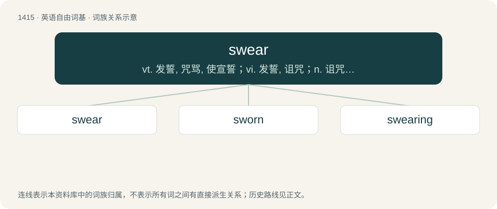

# 1497 · swear — vt. 发誓, 咒骂, 使宣誓；vi. 发誓, 诅咒；n. 诅咒, 誓言

[总目录](../00_总目录_按常用程度.md)

**类型**：英语自由词基　｜　**来源语言**：见词源记录

## 核心含义与来源

- 核心含义：vt. 发誓, 咒骂, 使宣誓；vi. 发誓, 诅咒；n. 诅咒, 誓言
- 英文含义：To take an oath, to promise intensely, solemnly, and/or with legally binding effect.
- 词形：swear

**多个词源／构词路径**：同一拼写可能有不同来源；以下按词性和含义分别列出。

**来源记录 1**（动词；To take an oath, to promise intensely, solemnly, and/or with legally binding effect.）

From Middle English sweren, swerien, from Old English swerian (“to swear, take an oath of office”), from Proto-West Germanic \*swarjan, from Proto-Germanic \*swarjaną (“to speak, swear”), from Proto-Indo-European \*swer- (“to swear”). Cognate with West Frisian swarre (“to swear”), Saterland Frisian swera (“to swear”), Dutch zweren (“to swear, vow”), Low German swören (“to swear”), sweren, German schwören (“to swear”), Danish sværge, Swedish svära (“to swear”), Icelandic sverja (“to swear”), Russian свара (svara, “quarrel”). Also cognate to Albanian var (“to hang, consider, to depend from”) through Proto-Indo-European. The original sense in all Germanic languages is “to take an oath”. The sense “to use bad language” developed in Middle English and is based on the Christian prohibition against swearing in general (cf. Matthew 5:33-37) and invoking God’s name in particular (i.e. frequent swearing was considered similar to the use of obscene words).

**来源记录 2**（名词；A swear word.）

From the above verb, or from Middle English sware, from Old English swaru, from Proto-Germanic \*swarō.

**来源记录 3**（形容词；Heavy.）

From Middle English swere, swer, swar, from Old English swǣr, swār (“heavy, heavy as a burden, of great weight, oppressive, grievous, painful, unpleasant, sad, feeling or expressing grief, grave, slow, dull, sluggish, slothful, indolent, inactive from weakness, enfeebled, weak”), from Proto-West Germanic \*swār, from Proto-Germanic \*swēraz (“heavy”), from Proto-Indo-European \*swer- (“heavy”). Cognate with West Frisian swier (“heavy”), Dutch zwaar (“heavy, hard, difficult”), German schwer (“heavy, hard, difficult”), Danish svær (“heavy, hard, severe”), Swedish svår (“heavy, hard, severe”), Latin sērius (“earnest, grave, solemn, serious”) and Albanian varrë (“wound, plague”).

## 词族图

## 单词速览（常用到不常用）

| 单词 | 音标 | 释义 |
|---|---|---|
| [swear](#w-1) | 英 /ˈswɛə(ɹ)/；美 /ˈswɛɚ/ | vt. 发誓, 咒骂, 使宣誓；vi. 发誓, 诅咒；n. 诅咒, 誓言 |
| [sworn](#w-2) | 英 /swɔːn/；美 /swɔɹn/ | swear的过去分词 |
| [swearing](#w-3) |  | \[法\] 发誓, 宣誓 |

## 逐词详解

### 1. swear

**词性**：动词　｜　**音标**：英 /ˈswɛə(ɹ)/；美 /ˈswɛɚ/

**中文释义**：vt. 发誓, 咒骂, 使宣誓；vi. 发誓, 诅咒；n. 诅咒, 誓言

**英文义项**：To take an oath, to promise intensely, solemnly, and/or with legally binding effect. / To take an oath that an assertion is true.

**词源与演化**：

From Middle English sweren, swerien, from Old English swerian (“to swear, take an oath of office”), from Proto-West Germanic \*swarjan, from Proto-Germanic \*swarjaną (“to speak, swear”), from Proto-Indo-European \*swer- (“to swear”). Cognate with West Frisian swarre (“to swear”), Saterland Frisian swera (“to swear”), Dutch zweren (“to swear, vow”), Low German swören (“to swear”), sweren, German schwören (“to swear”), Danish sværge, Swedish svära (“to swear”), Icelandic sverja (“to swear”), Russian свара (svara, “quarrel”). Also cognate to Albanian var (“to hang, consider, to depend from”) through Proto-Indo-European. The original sense in all Germanic languages is “to take an oath”. The sense “to use bad language” developed in Middle English and is based on the Christian prohibition against swearing in general (cf. Matthew 5:33-37) and invoking God’s name in particular (i.e. frequent swearing was considered similar to the use of obscene words).

**例句**：

> I swear I don't know what you're talking about.

该用例对应义项：To promise intensely that something is true; to strongly assert.

### 2. sworn

**词性**：形容词　｜　**音标**：英 /swɔːn/；美 /swɔɹn/

**中文释义**：swear的过去分词

**英文义项**：Given or declared under oath. / Bound as though by an oath.

**构词拆分**：swear + -en

**词源与演化**：

From Middle English sworen, isworen, from Old English sworen, ġesworen, from Proto-West Germanic \*swaran, \*giswaran, from Proto-Germanic \*swaranaz, past participle of Proto-Germanic \*swarjaną (“to swear”), equivalent to swear + -en.

**例句**：

> His sworn statement convinced the judge.

该用例对应义项：Given or declared under oath.

### 3. swearing

**词性**：名词

**中文释义**：\[法\] 发誓, 宣誓

**英文义项**：The act of swearing, or making an oath.

**构词拆分**：swear + -ing

**词源与演化**：

From Middle English swerynge; equivalent to swear + -ing.

**例句**：

> They were swearing at each other at the top of their voices.
