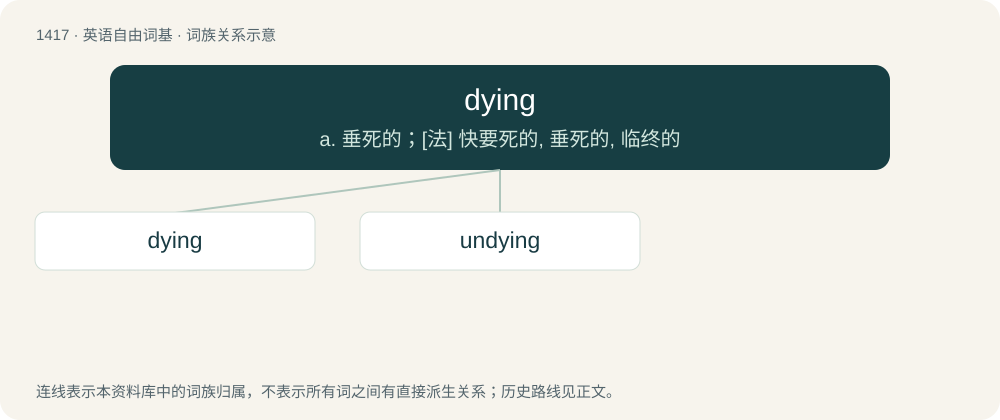

# 1499 · dying — a. 垂死的；\[法\] 快要死的, 垂死的, 临终的

[总目录](../00_总目录_按常用程度.md)

**类型**：英语自由词基　｜　**来源语言**：见词源记录

## 核心含义与来源

- 核心含义：a. 垂死的；\[法\] 快要死的, 垂死的, 临终的
- 英文含义：Approaching death; about to die; moribund.
- 词形：dying

**来源记录 1**（形容词；Approaching death; about to die; moribund.）

From die + -ing.

## 词族图

## 单词速览（常用到不常用）

| 单词 | 音标 | 释义 |
|---|---|---|
| [dying](#w-1) | /ˈdaɪ.ɪŋ/ | a. 垂死的；\[法\] 快要死的, 垂死的, 临终的 |
| [undying](#w-2) | /ʌnˈdaɪ.ɪŋ/ | a. 不死的, 不灭的, 不朽的 |

## 逐词详解

### 1. dying

**词性**：形容词　｜　**音标**：/ˈdaɪ.ɪŋ/

**中文释义**：a. 垂死的；\[法\] 快要死的, 垂死的, 临终的

**英文义项**：Approaching death; about to die; moribund. / Declining, terminal, or drawing to an end.

**构词拆分**：From die + -ing.

**词源与演化**：

From die + -ing.

**例句**：

> In the dying moments of daylight I glimpsed a sail on the horizon.

该用例对应义项：Declining, terminal, or drawing to an end.

### 2. undying

**词性**：形容词　｜　**音标**：/ʌnˈdaɪ.ɪŋ/

**中文释义**：a. 不死的, 不灭的, 不朽的

**英文义项**：permanent; never-ending; infinite

**构词拆分**：un- + dying

**词源与演化**：

From un- + dying.

**例句**：

> From that moment on, he felt undying hatred for his oppressors.
