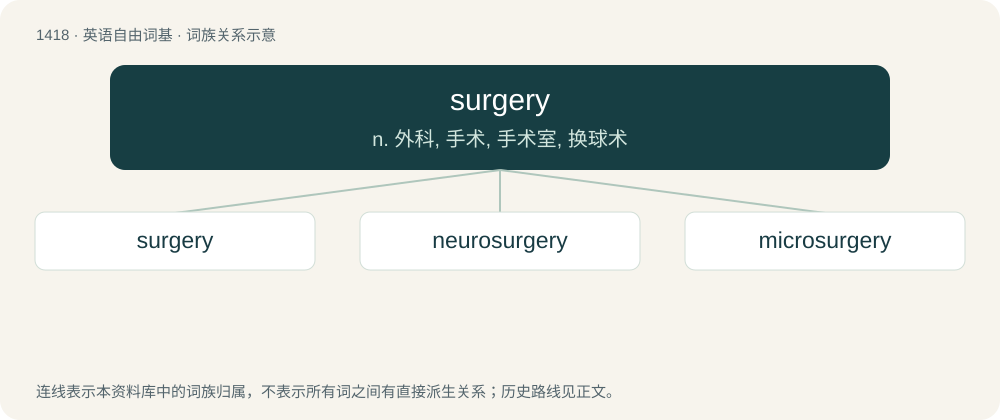

# 1501 · surgery — n. 外科, 手术, 手术室, 换球术

[总目录](../00_总目录_按常用程度.md)

**类型**：英语自由词基　｜　**来源语言**：见词源记录

## 核心含义与来源

- 核心含义：n. 外科, 手术, 手术室, 换球术
- 英文含义：The act or process of medical intervention involving incisions to remove, repair, or replace a part of a body; an instance of this process (a procedure).
- 词形：surgery

**来源记录 1**（名词；The act or process of medical intervention involving incisions to remove, repair, or replace a part of a body; an instance of this process (a procedure).）

From Middle English surgerie, from Old French surgerie, from Latin chirurgia, from Ancient Greek χειρουργία (kheirourgía), from χείρ (kheír, “hand”) + ἔργον (érgon, “work”). Doublet of chirurgy.

## 词族图

## 单词速览（常用到不常用）

| 单词 | 音标 | 释义 |
|---|---|---|
| [surgery](#w-1) | 英 /ˈsɜː.d͡ʒə.ɹi/；美 /ˈsɝ.d͡ʒə.ɹi/ | n. 外科, 手术, 手术室, 换球术 |
| [neurosurgery](#w-2) | /, njuərəuˈsəːdʒəri, nuə-/ | \[医\] 神经外科学 |
| [microsurgery](#w-3) | /ˈmaikrəuˈsəːdʒəri/ | \[医\] 显微外科, 显微手术 |

## 逐词详解

### 1. surgery

**词性**：名词　｜　**音标**：英 /ˈsɜː.d͡ʒə.ɹi/；美 /ˈsɝ.d͡ʒə.ɹi/

**中文释义**：n. 外科, 手术, 手术室, 换球术

**英文义项**：The act or process of medical intervention involving incisions to remove, repair, or replace a part of a body; an instance of this process (a procedure). / The medical specialty related to the performance of surgical procedures.

**词源与演化**：

From Middle English surgerie, from Old French surgerie, from Latin chirurgia, from Ancient Greek χειρουργία (kheirourgía), from χείρ (kheír, “hand”) + ἔργον (érgon, “work”). Doublet of chirurgy.

**例句**：

> I dropped in on the surgery as I was passing to show the doctor my hemorrhoids.

该用例对应义项：A doctor's office; a clinic.

### 2. neurosurgery

**词性**：名词　｜　**音标**：/, njuərəuˈsəːdʒəri, nuə-/

**中文释义**：\[医\] 神经外科学

**英文义项**：The surgical discipline focused on treating those central and peripheral nervous system diseases. / Any surgical procedure performed on the nervous system, especially the brain.

**构词拆分**：neuro- + surgery

**词源与演化**：

From neuro- + surgery.

### 3. microsurgery

**词性**：名词　｜　**音标**：/ˈmaikrəuˈsəːdʒəri/

**中文释义**：\[医\] 显微外科, 显微手术

**英文义项**：Surgical procedures that are very small.

**构词拆分**：micro- + surgery

**词源与演化**：

From micro- + surgery.

**例句**：

> Reattaching his severed finger required microsurgery to suture together the tiny blood vessels.

该用例对应义项：Surgical procedures that are very small.
