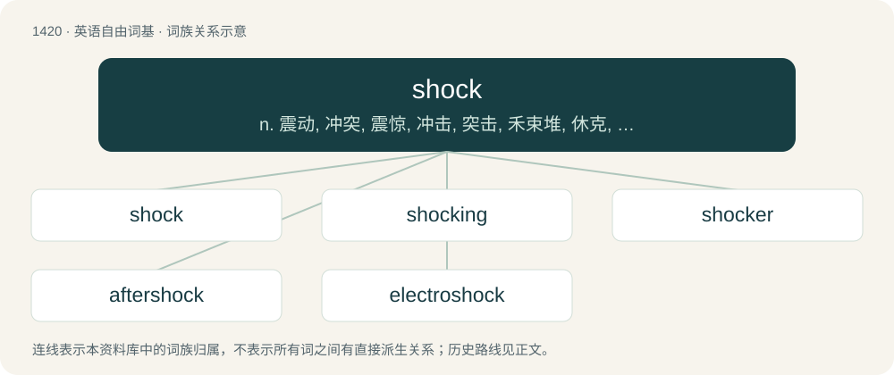

# 1503 · shock — n. 震动, 冲突, 震惊, 冲击, 突击, 禾束堆, 休克, 长毛狗；vt. 使震动, 使休克, 使受电击, 震惊得；vi. 震动, 吓人

[总目录](../00_总目录_按常用程度.md)

**类型**：英语自由词基　｜　**来源语言**：见词源记录

## 核心含义与来源

- 核心含义：n. 震动, 冲突, 震惊, 冲击, 突击, 禾束堆, 休克, 长毛狗；vt. 使震动, 使休克, 使受电击, 震惊得；vi. 震动, 吓人
- 英文含义：A sudden, heavy impact.
- 词形：shock

**多个词源／构词路径**：同一拼写可能有不同来源；以下按词性和含义分别列出。

**来源记录 1**（名词；A sudden, heavy impact.）

From Middle Dutch schokken (“to push, jolt, shake, jerk”) or Middle French choquer (“to collide with, clash”), from Old Dutch \*skokkan (“to shake up and down, shog”), from Proto-Germanic \*skukkaną (“to move, shake, tremble”). Of uncertain origin. Perhaps related to Proto-Germanic \*skakaną (“to shake, stir”), from Proto-Indo-European \*(s)kek-, \*(s)keg- (“to shake, stir”); see shake. Cognate with Middle Low German schocken (“collide with, deliver a blow to, move back and forth”), Old High German scoc (“a jolt, swing”), Middle High German schocken (“to swing”) (German schaukeln), Old Norse skykkr (“vibration, surging motion”), Icelandic skykkjun (“tremulously”), Middle English schiggen (“to shake”). Doublet of shog.

**来源记录 2**（名词；An arrangement of sheaves for drying; a stook.）

Inherited from Middle English schok, from Old English \*sċoc or Middle Low German schok; in any case, from Proto-West Germanic \*skok and possibly related to Latvian kàudze and Lithuanian kiūgis.

## 词族图

## 单词速览（常用到不常用）

| 单词 | 音标 | 释义 |
|---|---|---|
| [shock](#w-1) | 英 /ʃɒk/；美 /ʃɔk/ | n. 震动, 冲突, 震惊, 冲击, 突击, 禾束堆, 休克, 长毛狗；vt. 使震动, 使休克, 使受电击, 震惊得；vi. 震动, 吓人 |
| [shocking](#w-2) | 英 /ˈʃɒkɪŋ/；美 /ˈʃɑkɪŋ/ | a. 令人震惊的, 极坏的, 不正当的 |
| [shocker](#w-3) | 英 /ˈʃɒkə/；美 /ˈʃɑkɚ/ | n. 令人震惊的东西, 令人震惊的人, 令人愤慨的人, 令人厌恶的人 |
| [aftershock](#w-4) | 美 /ˈæftɜɹʃɔk/ | n. 余震 |
| [electroshock](#w-5) | /iˈlektrəuʃɒk/ | n. 电震, 电休克, 电击疗法；\[医\] 电休克 |

## 逐词详解

### 1. shock

**词性**：名词　｜　**音标**：英 /ʃɒk/；美 /ʃɔk/

**中文释义**：n. 震动, 冲突, 震惊, 冲击, 突击, 禾束堆, 休克, 长毛狗；vt. 使震动, 使休克, 使受电击, 震惊得；vi. 震动, 吓人

**英文义项**：A sudden, heavy impact. / Something so surprising that it is stunning.

**词源与演化**：

From Middle Dutch schokken (“to push, jolt, shake, jerk”) or Middle French choquer (“to collide with, clash”), from Old Dutch \*skokkan (“to shake up and down, shog”), from Proto-Germanic \*skukkaną (“to move, shake, tremble”). Of uncertain origin. Perhaps related to Proto-Germanic \*skakaną (“to shake, stir”), from Proto-Indo-European \*(s)kek-, \*(s)keg- (“to shake, stir”); see shake. Cognate with Middle Low German schocken (“collide with, deliver a blow to, move back and forth”), Old High German scoc (“a jolt, swing”), Middle High German schocken (“to swing”) (German schaukeln), Old Norse skykkr (“vibration, surging motion”), Icelandic skykkjun (“tremulously”), Middle English schiggen (“to shake”). Doublet of shog.

**例句**：

> The surprising blast of cold water on my face was a tremendous shock.

该用例对应义项：An experience that leaves someone shaken; a very surprising, exhilarating or amazing experience.

### 2. shocking

**词性**：形容词　｜　**音标**：英 /ˈʃɒkɪŋ/；美 /ˈʃɑkɪŋ/

**中文释义**：a. 令人震惊的, 极坏的, 不正当的

**英文义项**：Inspiring shock; startling. / Unusually obscene or lewd.

**构词拆分**：From shock + -ing.

**词源与演化**：

From shock + -ing.

**例句**：

> What a shocking calamity!

该用例对应义项：Extremely bad.

### 3. shocker

**词性**：名词　｜　**音标**：英 /ˈʃɒkə/；美 /ˈʃɑkɚ/

**中文释义**：n. 令人震惊的东西, 令人震惊的人, 令人愤慨的人, 令人厌恶的人

**英文义项**：One who or that which shocks or startles. / A device for giving electric shocks.

**构词拆分**：shock + -er

**词源与演化**：

From shock + -er.

**例句**：

> My performance today was an absolute shocker, I just wasn't feeling it.

该用例对应义项：Something done very badly.

### 4. aftershock

**词性**：名词　｜　**音标**：美 /ˈæftɜɹʃɔk/

**中文释义**：n. 余震

**英文义项**：An earthquake that follows in the same vicinity as another, usually larger, earthquake (the "mainshock"). / By extension, any result or consequence following a major event.

**构词拆分**：after- + shock

**词源与演化**：

From after- + shock.

**例句**：

> The aftershock from the earthquake knocked my bookshelf over.

### 5. electroshock

**词性**：名词　｜　**音标**：/iˈlektrəuʃɒk/

**中文释义**：n. 电震, 电休克, 电击疗法；\[医\] 电休克

**英文义项**：electric shock. / Electroconvulsive therapy.

**构词拆分**：electro- + shock

**词源与演化**：

From electro- + shock.

**例句**：

> I'm not homophobic, but I have no problem with electroshock therapy for gay people.
