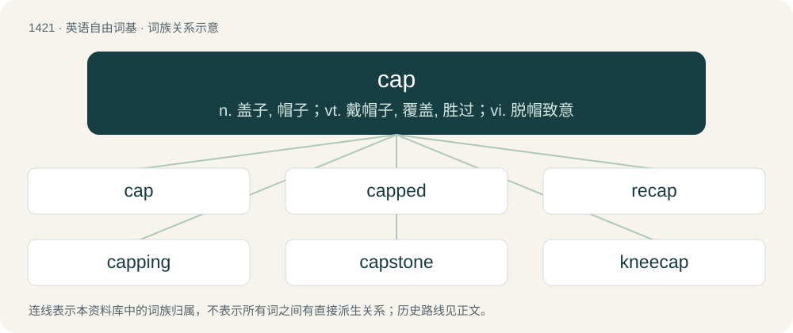

# 1504 · cap — n. 盖子, 帽子；vt. 戴帽子, 覆盖, 胜过；vi. 脱帽致意

[总目录](../00_总目录_按常用程度.md)

**类型**：英语自由词基　｜　**来源语言**：见词源记录

## 核心含义与来源

- 核心含义：n. 盖子, 帽子；vt. 戴帽子, 覆盖, 胜过；vi. 脱帽致意
- 英文含义：A close-fitting hat, either brimless or peaked.
- 词形：cap

**多个词源／构词路径**：同一拼写可能有不同来源；以下按词性和含义分别列出。

**来源记录 1**（名词；A close-fitting hat, either brimless or peaked.）

Inherited from Middle English cappe, from Old English cæppe, from Proto-West Germanic \*kappā (“covering, hood, mantle”), from Late Latin cappa, itself from Latin caput. Doublet of cape, chape, and cope.

**来源记录 2**（名词；Capitalization.）

Various clippings from longer words beginning with the three letters.

## 词族图

## 单词速览（常用到不常用）

| 单词 | 音标 | 释义 |
|---|---|---|
| [cap](#w-1) | 英 /kæp/ | n. 盖子, 帽子；vt. 戴帽子, 覆盖, 胜过；vi. 脱帽致意 |
| [capped](#w-2) | 英 /kapt/；美 /kæpt/ | vi. 脱帽致意（cap的过去式与过去分词形式） |
| [recap](#w-3) | /ɹiːˈkæp/ | vt. 翻新胎面；n. 翻新的轮胎 |
| [capping](#w-4) | 英 /ˈkapɪŋ/ | \[医\] 髓盖, 盖髓术, 盖髓物 |
| [capstone](#w-5) | 美 /ˈkæpˌstoʊn/ | n. 顶石 |
| [kneecap](#w-6) | /ˈniːˌkæp/ | n. 膝盖骨, 护膝 |
| [capper](#w-7) | /ˈkæpə/ | n. 诱骗者, 帽商, 封口机；\[建\] 封口机, 压盖机 |
| [madcap](#w-8) | 英 /ˈmædkæp/；美 /ˈmædˌkæp/ | a. 鲁莽的, 冲动的；n. 鲁莽的人 |
| [nightcap](#w-9) | 美 /ˈnaɪtˌkæp/ | n. 临睡前喝的酒, 睡帽 |
| [cappy](#w-10) | /ˈkæpi/ | a. 如帽般的 |
| [skullcap](#w-11) | /ˈskʌlkæp/ | n. 无边便帽, 黄芩属植物；\[医\] 美黄芩 |

## 逐词详解

### 1. cap

**词性**：名词　｜　**音标**：英 /kæp/

**中文释义**：n. 盖子, 帽子；vt. 戴帽子, 覆盖, 胜过；vi. 脱帽致意

**英文义项**：A close-fitting hat, either brimless or peaked. / A special hat to indicate rank, occupation, etc.

**词源与演化**：

Inherited from Middle English cappe, from Old English cæppe, from Proto-West Germanic \*kappā (“covering, hood, mantle”), from Late Latin cappa, itself from Latin caput. Doublet of cape, chape, and cope.

**例句**：

> Billy spent all morning firing caps with his friends, re-enacting storming the beach at Normandy.

该用例对应义项：A small amount of percussive explosive in a paper strip or plastic cup for use in a toy gun.

### 2. capped

**词性**：形容词　｜　**音标**：英 /kapt/；美 /kæpt/

**中文释义**：vi. 脱帽致意（cap的过去式与过去分词形式）

**英文义项**：Having a cap (various senses).

**构词拆分**：cap + -ed

**词源与演化**：

From cap + -ed. Piecewise doublet of caped, chaped, and coped.

**例句**：

> Capped teeth gave her a beautiful smile.

该用例对应义项：used especially of front teeth having (artificial) crowns

### 3. recap

**词性**：动词　｜　**音标**：/ɹiːˈkæp/

**中文释义**：vt. 翻新胎面；n. 翻新的轮胎

**英文义项**：To seal (something) again with a cap. / To replace the worn tread on a tire by gluing on a new outer portion.

**构词拆分**：re- + cap

**词源与演化**：

From re- + cap.

**例句**：

> They buy a lot of camelback because they recap a lot of truck tires for trailer fleets.

该用例对应义项：To replace the worn tread on a tire by gluing on a new outer portion.

### 4. capping

**词性**：名词　｜　**音标**：英 /ˈkapɪŋ/

**中文释义**：\[医\] 髓盖, 盖髓术, 盖髓物

**英文义项**：The act of removing one's hat as a token of respect. / the leached upper part of a body or rock that still contains disseminated sulphide mineral deposit.

**构词拆分**：cap + -ing

**词源与演化**：

From cap + -ing.

**例句**：

> Five years ago, the group said the industry was committed to capping carbon emissions.

### 5. capstone

**词性**：名词　｜　**音标**：美 /ˈkæpˌstoʊn/

**中文释义**：n. 顶石

**英文义项**：Any of the stones making up the top layer of a wall; a coping stone. / A crowning achievement, culmination or finishing touch.

**构词拆分**：cap + stone

**词源与演化**：

From Middle English capston; equivalent to cap + stone.

### 6. kneecap

**词性**：名词　｜　**音标**：/ˈniːˌkæp/

**中文释义**：n. 膝盖骨, 护膝

**英文义项**：The flat, roundish bone in the knee. / A metal cover trim that fits over a panel rib after it has been cut and bent.

**构词拆分**：knee + cap

**词源与演化**：

From knee + cap.

**例句**：

> If these muscles are weak, they cannot hold the kneecap in the correct position.

### 7. capper

**词性**：名词　｜　**音标**：/ˈkæpə/

**中文释义**：n. 诱骗者, 帽商, 封口机；\[建\] 封口机, 压盖机

**英文义项**：A device or person that applies caps, as to bullets or bottles. / A person that makes or sells caps.

**构词拆分**：cap + -er

**词源与演化**：

From Middle English capper; equivalent to cap + -er.

### 8. madcap

**词性**：形容词　｜　**音标**：英 /ˈmædkæp/；美 /ˈmædˌkæp/

**中文释义**：a. 鲁莽的, 冲动的；n. 鲁莽的人

**英文义项**：Capricious, impulsive, or reckless; also, bizarre, crazy, zany; or foolish, idiotic.

**构词拆分**：mad + cap (“(informal) head”)

**词源与演化**：

The noun is derived from mad + cap (“(informal) head”). The adjective is from an attributive use of the noun.

**例句**：

> The film featured a madcap car chase that went right through a crowded café.

该用例对应义项：Capricious, impulsive, or reckless; also, bizarre, crazy, zany; or foolish, idiotic.

### 9. nightcap

**词性**：名词　｜　**音标**：美 /ˈnaɪtˌkæp/

**中文释义**：n. 临睡前喝的酒, 睡帽

**英文义项**：A warm cloth cap worn while sleeping, often with pajamas, being common attire in northern Europe before effective home heating became widespread. / A beverage drunk before bed that is usually alcoholic.

**构词拆分**：night + cap

**词源与演化**：

From night + cap.

**例句**：

> I'll make myself a nightcap of whisky and lemon before heading to bed.

该用例对应义项：A beverage drunk before bed that is usually alcoholic.

### 10. cappy

**词性**：形容词　｜　**音标**：/ˈkæpi/

**中文释义**：a. 如帽般的

**英文义项**：Having, resembling, or relating to a cap (headwear).

**构词拆分**：cap + -y

**词源与演化**：

From cap + -y.

### 11. skullcap

**词性**：名词　｜　**音标**：/ˈskʌlkæp/

**中文释义**：n. 无边便帽, 黄芩属植物；\[医\] 美黄芩

**英文义项**：A small domed cap that covers the area from the forehead to just above the back of the neck. / A yarmulke-like hat.

**构词拆分**：skull + cap

**词源与演化**：

From skull + cap.

**例句**：

> You couldn't just don a skullcap and gatecrash a synagogue.
