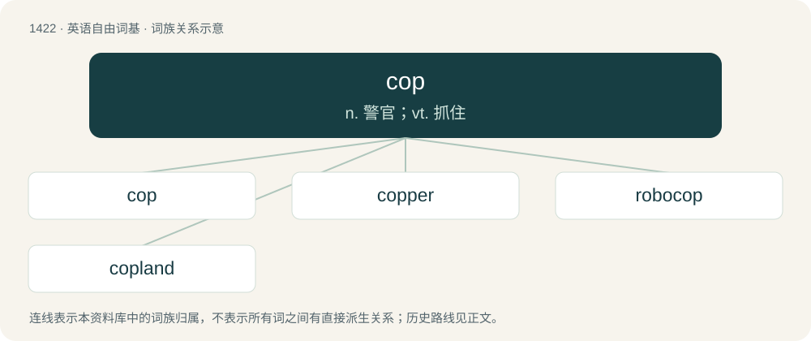

# 1505 · cop — n. 警官；vt. 抓住

[总目录](../00_总目录_按常用程度.md)

**类型**：英语自由词基　｜　**来源语言**：见词源记录

## 核心含义与来源

- 核心含义：n. 警官；vt. 抓住
- 英文含义：To capture or arrest someone.
- 词形：cop

**多个词源／构词路径**：同一拼写可能有不同来源；以下按词性和含义分别列出。

**来源记录 1**（动词；To capture or arrest someone.）

Uncertain. Perhaps from Middle English \*coppen, \*copen, from Old English copian (“to plunder; pillage; steal”); or possibly from Middle French caper (“to capture”), from Latin capiō (“to seize, grasp”); or possibly from Dutch kapen (“to seize, hijack”), from Old Frisian kāpia (“to buy”), whence West Frisian keapje, Saterland Frisian koopje, North Frisian koopi, kuupe. Compare also Middle English copen (“to buy”), from Middle Dutch copen.

**来源记录 2**（名词；A police officer or prison guard.）

Short for copper (“police officer”), itself from the verb cop (“to lay hold of”) above, in reference to arresting criminals. An erroneous folk etymology derives it from the acronym “Constable On Patrol” (C.O.P.).

**来源记录 3**（名词；A quill or tube upon which silk is wound.）

From Middle English cop, coppe, from Old English cop, copp, from Proto-West Germanic \*kopp, from Proto-Germanic \*kuppaz (“vault, basin, round object”), from Proto-Indo-European \*gew-. Cognate with Dutch kop, German Kopf.

## 词族图

## 单词速览（常用到不常用）

| 单词 | 音标 | 释义 |
|---|---|---|
| [cop](#w-1) | 英 /kɒp/；美 /kɑp/ | n. 警官；vt. 抓住 |
| [copper](#w-2) | 英 /ˈkɒpə/；美 /ˈkɑpəɹ/ | 【英文】A police officer, especially one in uniform. |
| [robocop](#w-3) | 美 /ˈɹoʊ.boʊˌkɑp/ | 【英文】A cyborg police officer. |
| [copland](#w-4) |  | 【英文】The world of police officers and police activity. |

## 逐词详解

### 1. cop

**词性**：动词　｜　**音标**：英 /kɒp/；美 /kɑp/

**中文释义**：n. 警官；vt. 抓住

**英文义项**：To capture or arrest someone. / To obtain, to purchase (items including but not limited to drugs), to get hold of, to take.

**词源与演化**：

Uncertain. Perhaps from Middle English \*coppen, \*copen, from Old English copian (“to plunder; pillage; steal”); or possibly from Middle French caper (“to capture”), from Latin capiō (“to seize, grasp”); or possibly from Dutch kapen (“to seize, hijack”), from Old Frisian kāpia (“to buy”), whence West Frisian keapje, Saterland Frisian koopje, North Frisian koopi, kuupe. Compare also Middle English copen (“to buy”), from Middle Dutch copen.

**例句**：

> When caught, he would often cop a vicious blow from his father.

该用例对应义项：To (be forced to) take; to receive; to shoulder; to bear, especially blame or punishment for a particular instance of wrongdoing.

### 2. copper

**词性**：名词　｜　**音标**：英 /ˈkɒpə/；美 /ˈkɑpəɹ/

**英文义项**：A police officer, especially one in uniform. / A person working as an informer for the police; a nark

**构词拆分**：cop (“(informal, dated) to arrest or capture (someone)”) + -er (suffix forming agent nouns)

**词源与演化**：

The noun is probably derived from cop (“(informal, dated) to arrest or capture (someone)”) + -er (suffix forming agent nouns), although cop is attested slightly later. The verb is derived from the noun.

### 3. robocop

**词性**：名词　｜　**音标**：美 /ˈɹoʊ.boʊˌkɑp/

**英文义项**：A cyborg police officer.

**构词拆分**：robo- + cop

**词源与演化**：

From robo- + cop, after the film RoboCop (1987).

### 4. copland

**词性**：名词

**英文义项**：The world of police officers and police activity.

**构词拆分**：cop (“police officer”) + land

**词源与演化**：

From cop (“police officer”) + land.
