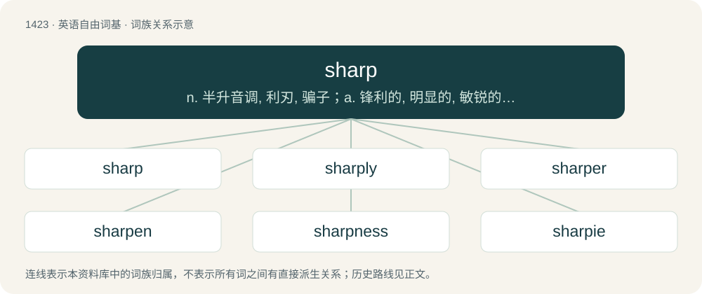

# 1506 · sharp — n. 半升音调, 利刃, 骗子；a. 锋利的, 明显的, 敏锐的, 急剧的, 尖刻的, 严厉的, 刺耳的, 精明的；adv. 锐利地, 急速地

[总目录](../00_总目录_按常用程度.md)

**类型**：英语自由词基　｜　**来源语言**：见词源记录

## 核心含义与来源

- 核心含义：n. 半升音调, 利刃, 骗子；a. 锋利的, 明显的, 敏锐的, 急剧的, 尖刻的, 严厉的, 刺耳的, 精明的；adv. 锐利地, 急速地
- 英文含义：Terminating in a point or edge, especially one that can cut or pierce easily; not dull, obtuse, or rounded.
- 词形：sharp

**来源记录 1**（形容词；Terminating in a point or edge, especially one that can cut or pierce easily; not dull, obtuse, or rounded.）

From Middle English scharp, from Old English sċearp, from Proto-West Germanic \*skarp, from Proto-Germanic \*skarpaz, from Proto-Indo-European \*(s)kerb-, from \*(s)ker- (“to cut”). Cognate with West Frisian skerp, Low German scherp, scharp, schaarp, Dutch scherp, German scharf, Danish skarp. Compare Irish cearb (“keen; cutting”), Latin acerbus (“tart, bitter”), Tocharian B kärpye (“rough”), Latvian skârbs (“sharp, rough”), Russian щерба (ščerba, “notch”), Polish szczerba (“gap, dent, jag, chip, nick, notch”), Albanian harb (“rudeness”). More at shear.

## 词族图

## 单词速览（常用到不常用）

| 单词 | 音标 | 释义 |
|---|---|---|
| [sharp](#w-1) | 英 /ʃɑːp/；美 /ʃɑɹp/ | n. 半升音调, 利刃, 骗子；a. 锋利的, 明显的, 敏锐的, 急剧的, 尖刻的, 严厉的, 刺耳的, 精明的；adv. 锐利地, 急速地 |
| [sharply](#w-2) | 英 /ˈʃɑːpli/；美 /ˈʃɑɹpli/ | adv. 锐利地, 严厉地, 厉害地；\[经\] 剧烈地 |
| [sharper](#w-3) | 美 /ˈʃɑɹpɚ/ | n. 骗子, 欺诈者, 赌棍；\[法\] 欺骗者, 欺诈犯 |
| [sharpen](#w-4) | 英 /ˈʃɑːpən/；美 /ˈʃɑɹpən/ | vt. 使尖锐, 使敏捷, 加重, 削尖；vi. 尖锐化, 变锋利 |
| [sharpness](#w-5) | /ˈʃɑːpnis/ | n. 锐利, 严厉, 疾速；\[计\] 清晰度 |
| [sharpie](#w-6) | 英 /ˈʃɑːpi/；美 /ˈʃɑɹpi/ | n. 骗子, 非常机灵的人, 狡诈精明的人, 时髦人物；\[法\] 骗子, 狡猾的人 |
| [shebang](#w-7) | /ʃɪˈbæŋ(ɡ)/ | 【英文】The character string "#!" used at the beginning of a computer file to indicate which interpreter can process the commands in the file, chiefly used in Unix and related operating systems. |

## 逐词详解

### 1. sharp

**词性**：形容词　｜　**音标**：英 /ʃɑːp/；美 /ʃɑɹp/

**中文释义**：n. 半升音调, 利刃, 骗子；a. 锋利的, 明显的, 敏锐的, 急剧的, 尖刻的, 严厉的, 刺耳的, 精明的；adv. 锐利地, 急速地

**英文义项**：Terminating in a point or edge, especially one that can cut or pierce easily; not dull, obtuse, or rounded. / Intelligent.

**词源与演化**：

From Middle English scharp, from Old English sċearp, from Proto-West Germanic \*skarp, from Proto-Germanic \*skarpaz, from Proto-Indo-European \*(s)kerb-, from \*(s)ker- (“to cut”). Cognate with West Frisian skerp, Low German scherp, scharp, schaarp, Dutch scherp, German scharf, Danish skarp. Compare Irish cearb (“keen; cutting”), Latin acerbus (“tart, bitter”), Tocharian B kärpye (“rough”), Latvian skârbs (“sharp, rough”), Russian щерба (ščerba, “notch”), Polish szczerba (“gap, dent, jag, chip, nick, notch”), Albanian harb (“rudeness”). More at shear.

**例句**：

> Milly couldn't stand sharp cheeses when she was pregnant, because they made her nauseated.

该用例对应义项：Having a strong acrid or acidic taste.

### 2. sharply

**词性**：副词　｜　**音标**：英 /ˈʃɑːpli/；美 /ˈʃɑɹpli/

**中文释义**：adv. 锐利地, 严厉地, 厉害地；\[经\] 剧烈地

**英文义项**：So as to terminate in a sharp point or edge. / Rapidly, abruptly.

**构词拆分**：sharp + -ly

**词源与演化**：

From Middle English sharply, scharply, from Old English sċearplīċe (“sharply, smartly”), equivalent to sharp + -ly.

**例句**：

> When I asked her about her husband, she replied sharply that she had not seen him for several months.

该用例对应义项：Of speech, sternly, harshly or critically.

### 3. sharper

**词性**：名词　｜　**音标**：美 /ˈʃɑɹpɚ/

**中文释义**：n. 骗子, 欺诈者, 赌棍；\[法\] 欺骗者, 欺诈犯

**英文义项**：A swindler; a cheat; a professional gambler who makes his living by cheating.

**构词拆分**：From sharp + -er.

**词源与演化**：

From sharp + -er.

**例句**：

> A sharp tongue is the only thing that grows sharper with constant use.

### 4. sharpen

**词性**：动词　｜　**音标**：英 /ˈʃɑːpən/；美 /ˈʃɑɹpən/

**中文释义**：vt. 使尖锐, 使敏捷, 加重, 削尖；vi. 尖锐化, 变锋利

**英文义项**：To make sharp. / To become sharp.

**构词拆分**：sharp + -en

**词源与演化**：

From Middle English scharpenen, scharpnen, equivalent to sharp + -en.

**用法示例／搭配（非完整句）**：

> to sharpen a pencil or a knife or a musical note

该用例对应义项：To make sharp.

### 5. sharpness

**词性**：名词　｜　**音标**：/ˈʃɑːpnis/

**中文释义**：n. 锐利, 严厉, 疾速；\[计\] 清晰度

**英文义项**：the cutting ability of an edge; keenness. / the fineness of the point a pointed object.

**构词拆分**：sharp + -ness

**词源与演化**：

From Middle English sharpnesse, scharpnesse, from Old English sċearpnes (“sharpness”), equivalent to sharp + -ness.

**例句**：

> The sharpness of her loss.

该用例对应义项：the quality of being keenly and painfully felt

### 6. sharpie

**词性**：名词　｜　**音标**：英 /ˈʃɑːpi/；美 /ˈʃɑɹpi/

**中文释义**：n. 骗子, 非常机灵的人, 狡诈精明的人, 时髦人物；\[法\] 骗子, 狡猾的人

**英文义项**：An alert person. / A knowledgeable fisherman.

**构词拆分**：From sharp + -ie (“diminutive suffix”).

**词源与演化**：

From sharp + -ie (“diminutive suffix”).

### 7. shebang

**词性**：名词　｜　**音标**：/ʃɪˈbæŋ(ɡ)/

**英文义项**：The character string "#!" used at the beginning of a computer file to indicate which interpreter can process the commands in the file, chiefly used in Unix and related operating systems.

**构词拆分**：hash + bang；sharp + bang

**词源与演化**：

From hash + bang or sharp + bang, after Etymology 1.
