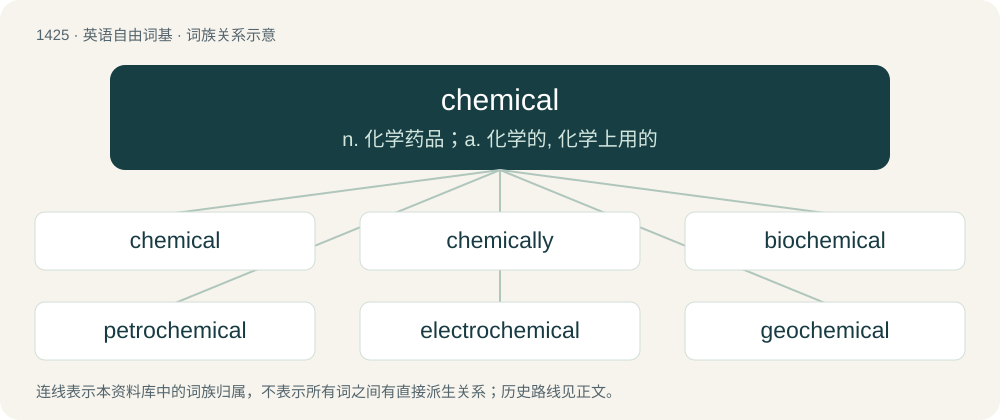

# 1507 · chemical — n. 化学药品；a. 化学的, 化学上用的

[总目录](../00_总目录_按常用程度.md)

**类型**：英语自由词基　｜　**来源语言**：见词源记录

## 核心含义与来源

- 核心含义：n. 化学药品；a. 化学的, 化学上用的
- 英文含义：Of or relating to chemistry.
- 词形：chemical

**来源记录 1**（形容词；Of or relating to chemistry.）

From New Latin chēmicus + -al.

## 词族图

## 单词速览（常用到不常用）

| 单词 | 音标 | 释义 |
|---|---|---|
| [chemical](#w-1) | /ˈkɛm.ɪ.kəl/ | n. 化学药品；a. 化学的, 化学上用的 |
| [chemically](#w-2) | /ˈkɛm.ɪ.kli/ | adv. 用化学, 以化学方法 |
| [biochemical](#w-3) | /ˌbaɪəʊˈkɛmɪkəl/ | a. 生物化学的；\[机\] 生物化学的 |
| [petrochemical](#w-4) | /.petrəuˈkemikəl/ | a. 石化的, 石化制品的, 岩石化学的；n. 石化产品 |
| [electrochemical](#w-5) | /i.lektəuˈkemikəl/ | a. 电气化学的；\[医\] 电化学的 |
| [geochemical](#w-6) | /dʒiːɒˈkemɪkl/ | 地球化学的 |
| [photochemical](#w-7) | /.fəutəuˈkemikl/ | a. 光化学的, 光化作用的；\[医\] 光化学的 |
| [physicochemical](#w-8) | /,fizikəuˈkemikəl/ | a. 物理化学的；\[医\] 物理化学的 |

## 逐词详解

### 1. chemical

**词性**：形容词　｜　**音标**：/ˈkɛm.ɪ.kəl/

**中文释义**：n. 化学药品；a. 化学的, 化学上用的

**英文义项**：Of or relating to chemistry. / Of or relating to a material or processes not commonly found in nature or in a particular product.

**词源与演化**：

From New Latin chēmicus + -al.

**用法示例／搭配（非完整句）**：

> Pentalene has chemical formula C₈H₆

该用例对应义项：Of or relating to chemistry.

### 2. chemically

**词性**：副词　｜　**音标**：/ˈkɛm.ɪ.kli/

**中文释义**：adv. 用化学, 以化学方法

**英文义项**：Using a chemical reaction, process, or operation. / According to the principles of chemistry.

**构词拆分**：chemical + -ly

**词源与演化**：

From chemical + -ly.

**例句**：

> I'm peeling this fruit because it's chemically treated.

### 3. biochemical

**词性**：形容词　｜　**音标**：/ˌbaɪəʊˈkɛmɪkəl/

**中文释义**：a. 生物化学的；\[机\] 生物化学的

**英文义项**：of, or relating to biochemistry / characterized by, produced by, or involving chemical processes in living organisms

**构词拆分**：bio- + chemical

**词源与演化**：

From bio- + chemical.

**例句**：

> Is the coronavirus really a biochemical weapon?

### 4. petrochemical

**词性**：名词　｜　**音标**：/.petrəuˈkemikəl/

**中文释义**：a. 石化的, 石化制品的, 岩石化学的；n. 石化产品

**英文义项**：Any chemical derived from petroleum. / Any chemical derived from any of the fossil fuels: petroleum, natural gas, or coal.

**构词拆分**：petro- + chemical

**词源与演化**：

From petro- + chemical.

**例句**：

> As the prices of petroleum, natural gas, and coal fluctuate over the years, the petrochemical industry can to some extent switch feedstocks.

该用例对应义项：Any chemical derived from any of the fossil fuels: petroleum, natural gas, or coal.

### 5. electrochemical

**词性**：形容词　｜　**音标**：/i.lektəuˈkemikəl/

**中文释义**：a. 电气化学的；\[医\] 电化学的

**英文义项**：Of, or relating to a chemical reaction brought about by electricity. / Of, or relating to electricity produced by a chemical reaction, e.g. in a battery.

**构词拆分**：electro- + chemical

**词源与演化**：

From electro- + chemical.

**例句**：

> The plant will use the technology of electrochemical purification of raw materials.

### 6. geochemical

**词性**：形容词　｜　**音标**：/dʒiːɒˈkemɪkl/

**中文释义**：地球化学的

**英文义项**：Of or pertaining to geochemistry.

**构词拆分**：geo- + chemical

**词源与演化**：

From geo- + chemical.

### 7. photochemical

**词性**：形容词　｜　**音标**：/.fəutəuˈkemikl/

**中文释义**：a. 光化学的, 光化作用的；\[医\] 光化学的

**英文义项**：Of, relating to, or produced by photochemistry or by photochemical reactions.

**构词拆分**：photo- + chemical

**词源与演化**：

From photo- + chemical.

**例句**：

> The air was infected with photochemical smog.

### 8. physicochemical

**词性**：形容词　｜　**音标**：/,fizikəuˈkemikəl/

**中文释义**：a. 物理化学的；\[医\] 物理化学的

**英文义项**：Dependent on the joint action of both physical and chemical processes. / Of or pertaining to physical chemistry.

**构词拆分**：physico- + chemical

**词源与演化**：

From physico- + chemical.
